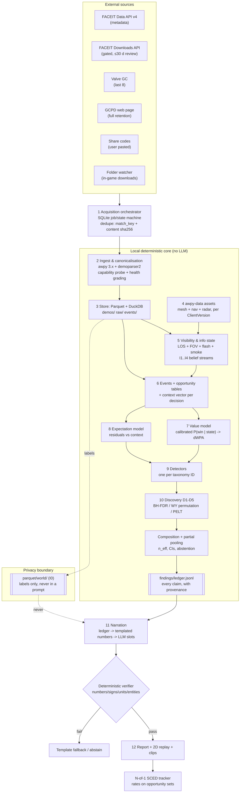

# CS2 Personal Coaching System — Consolidated Research Report

**Subject:** A local-first, API-inference CS2 demo-analysis and coaching system for a single player (~2000 FACEIT Elo, ex‑2400), built by an experienced developer (TS/PHP/Linux), running on CachyOS + MacBook Air M4.
**Compiled:** 2026-10-15, by synthesis of seven research slices (`A-ecosystem`, `B-acquisition`, `C-data-fogofwar`, `D-mistakes`, `E-longitudinal`, `F-ai-arch`, `G-coaching-eval`) plus their `parts/` deep dives and two scratch files.
**Scope discipline:** every significant claim carries a source link and a verification tier. Facts and recommendations are separated. Inferences are marked `[INFERENCE]`. Prices are USD unless stated. No implementation code beyond small illustrative sketches.

**Verification tiers used throughout** (defined again in the Glossary, §N.2):

| Tier | Meaning |
|---|---|
| **Demonstrated** | Shipped, documented, or read in source; reproducible today. |
| **Experimental** | Working code or study prototype with measured results, but unvalidated / partial / single-author. |
| **Research-supported** | Peer-reviewed literature or first-party engine/engine-adjacent source establishes the mechanism; not productised for CS2. |
| **Plausible-untested** | Coherent, credible, but no direct evidence in this domain. **Verify locally.** |
| **Infeasible** | Ruled out by recorded fact, cost, physics, or by the absence of the required information in a demo. |

**Naming collision resolved up front.** The research used "T0/T1/T2…" for two *different* things. This report keeps both but disambiguates:

* **D‑tiers — decision value:** `T0` outcome-conditioned · `T1` realised-state (ΔWPA) · `T2` action-value/counterfactual. *(source: `D-mistakes`)*
* **I‑tiers — information state:** `I0` omniscient · `I1` confirmed · `I2` inferable · `I3` relayed · `I4` unknown. *(source: `C-data-fogofwar`, which called these T0–T4)*

---

## The One-Page Answer

**How close can this get to an excellent human coach?** Not to the whole coach — to *one specific, high-value half of one*.

An excellent CS coach does four distinguishable things: (1) **notices patterns across many matches** a player cannot see about themselves; (2) **explains the mechanism** — why it costs rounds; (3) **prescribes the drill** that transfers; and (4) **builds the team system** (roles, defaults, mid-round protocols, comms). This project can credibly reach (1) and (2) at professional-analyst quality, can reach (3) in a *narrow, measurable* form (if–then plans bound to in-game cues, tracked as rates), and **cannot reach (4) at all** — team strategy needs voice comms, five players' demos, and a human who knows the team.

**The ceiling is set by one fact and one number.**

* The fact: **a GOTV demo is the server's omniscient state machine, not what any player saw.** Nothing in the file records what player *i* rendered. Visibility, sound audibility, teammate comms and *attention* must all be recomputed or modelled. Valve itself concedes the gap — **TrueView** (patch **2025-11-04**) exists precisely because "demo playback showed the server's view of the world, without accounting for network latency", and Valve still warns there may be differences and auto-disables it across game versions ([Steam news](https://store.steampowered.com/news/posts/?appids=730&enddate=1762988292)). **Consequence: pixel-level claims are off the table; geometry-level claims with a stated tolerance are legitimate.** *(Demonstrated)*
* The number: **`150,000 ticks × 10 players × 25 fields ≈ 37.5 M values ≈ 244 MB ≈ ~66 M tokens`** for one match. Raw ticks are infeasible for any model at any price. The representation must be *events + windows + images*, with the arithmetic done locally. *(Demonstrated — arithmetic)*

**What is already solved (do not rebuild):** demo parsing (awpy 3.x + demoparser2, both MIT, Linux-native), geometric line-of-sight (awpy `VisibilityChecker` over a per-`ClientVersion` collision mesh), nav-mesh pathing and area control, smoke/fire/flash timing, trade and economy arithmetic, and 2D radar rendering. Fog-of-war *reconstruction* is an **engineering** task, not a research risk: three independent implementations ship it (awpy `map_control`, CS2DemoKit `enemy_spotted`, 5Stack VISION), and two products market it (ReplayLab's "player-eye view", 5Stack's fog layer). *(Demonstrated)*

**What is genuinely unsolved (the real risk surface):**

1. **No ground-truth visibility dataset exists anywhere.** awpy's LOS tests are synthetic (a single wall quad); nobody has validated geometric LOS against what a player actually saw. Building that labelled fixture is the single highest-value greenfield artefact in this space. *(Demonstrated absence)*
2. **No counterfactual decision-quality engine for CS2.** Every published model sees *global* state; "was this wrong **given what the player could see**" is unmodelled in the entire literature. Leetify's Rating is *outcome impact of observed events*, not evaluation of alternatives — and Leetify's own product framing concedes the difference. The `I‑tier` belief stream is the cleanest novel contribution available, and also the highest-risk part to get *right*. *(Research-supported gap)*
3. **Counterfactual judgement by LLMs is the worst-performing thing they do.** CausalGame (arXiv:2607.04293, ICML 2026 Oral): across 14 games and 29 frontier agents, **no model reaches any scenario's win threshold**, and 68% of sessions never attempt causal reasoning. Every "you should have done X" must therefore be emitted as a *hypothesis with a support count*, never an assertion. *(Demonstrated)*
4. **Acquisition, not analysis, is the schedule risk.** FACEIT demo bytes sit behind an application-gated Downloads API (expected review **≤30 days**, and commercially priced — Leetify was quoted **≈€270,000/year**); Valve's Game Coordinator returns only the **last 8** matchmaking matches with **~1-month** replay-link expiry; HLTV prohibits scraping (ToS eff. 2025-01-27). There is **no "fetch any CS2 demo via API" path**. *(Demonstrated)*
5. **Team chat in demo files became encrypted on 2026-09-09** and voice was never in demos at all — so any claim of the form "a teammate called it" is **unfalsifiable from the demo alone**. *(Demonstrated)*

**The most credible path, in order**

| Step | What | Why this order | Cost |
|---|---|---|---|
| 1 | **Submit the FACEIT Downloads-API application today** | It is the only long-lead item (≤30-day review, may be refused). Everything else can proceed on manually supplied files. | €0 + calendar |
| 2 | **Build the deterministic local core** — parse → nav-node map → BVH visibility → info-state stream → incident windows → **claim ledger** | This is where correctness lives. It is the artefact that makes the LLM safe, and it needs no LLM at all. | Dev time only |
| 3 | **Validate visibility against your own POV recordings** (5–10 self-played demos) | There is no benchmark to borrow; the acceptance fixture is yours to make. | Hours |
| 4 | **Ship Tier‑A detectors + deterministic narratives, no LLM** | UEC12/UEC8 (buy arithmetic), MECH4 (counter-strafe), UEC1/UEC3 (utility), TM2/TM4/TM5 (trade/Friendly-fire), POS10/DEC6 (state + clutch feasibility). These are engine-truth, low-FP, instantly checkable. | Dev time |
| 5 | **Add the tiered LLM narration** — cheap bulk pass + mid-tier judgement on flagged incidents (~20/demo) + bounded agentic on the top 2–5 | Recommended tier lands at **≈$0.40–$1.50 per demo**; 20 demos/month ⇒ **$10–$30/month**. | API $ |
| 6 | **Run a pre-registered N-of-1 SCED** on one behaviour | The only mechanism that can honestly claim "the coaching worked". | Weeks |

**The honest verdict.** A system built this way will approximate an excellent human coach on *pattern detection and mechanistic explanation*, will be *better than a human coach* at consistency, longitudinal memory and cost-per-review, and will be *clearly worse* at team strategy, at reading intent, at anything requiring comms, and at judging what a player "should have seen". The correct product claim is **"an analyst with perfect recall and no imagination"** — not "an AI coach". The failure mode to design against is not being unhelpful; it is being **confidently, plausibly wrong about a round the player remembers** (see §G.5, §I, and the anti-hallucination architecture in §H.9).

---

## A. Executive Feasibility Assessment

### A.1 What "approximating a human coach" decomposes into

| Coach function | Machine equivalent | Verdict | Best evidence |
|---|---|---|---|
| **A1. Recall & retrieval** — "we ran this on Mirage, you always lose the A-ramp duel" | Deterministic similarity search over your own demos (nav-node tokens + quantised position blobs + geodesic Chamfer) | **Feasible, Demonstrated** | DemoQueryCS2 ships exactly this ([repo](https://github.com/TheBrokas/DemoQueryCS2)); ggViz is the paper ancestor (arXiv:2107.06495) |
| **A2. Pattern detection** — spotting a recurrent habit across dozens of demos | Per-habit aggregation with partial pooling + multiplicity control | **Feasible, Research-supported** (engineering-ordinary) | `E-longitudinal`; Franks et al. meta-analytics (arXiv:1609.09830) |
| **A3. Mechanism** — "this costs you because you lose the info trade, not the aim duel" | Decision-vs-execution split + availablity/calibration gates | **Partly feasible**, and the *hard* part | `D-mistakes` §3; EPS framework (arXiv:2608.09156) |
| **A4. Decision quality** — "given what you knew, that was the wrong call" | Counterfactual action value (D‑tier `T2`) | **Plausible-untested / Infeasible at scale** | No CS2 implementation exists; CausalGame null; OSE is CS:GO/economy-only |
| **A5. Prescription** — the drill that transfers | If–then plans + representative scenarios + rate tracking | **Feasible in narrow form** | Implementation intentions d = 0.65 (Gollwitzer & Sheeran 2006); process goals d = 1.36 vs outcome d = 0.09 |
| **A6. Team system** — roles, defaults, executes, comms | — | **Infeasible** (no voice; single-player scope) | Valve 2026-09-09 chat encryption; CS2VoiceData README |
| **A7. Motivation / accountability** | Habit tracking + visible progress monitoring | **Feasible**, and under-rated | Monitoring goal progress **d⁺ = 0.40** (Harkin et al. 2016, 138 studies) |
| **A8. Reading intent** — "he was baiting" | — | **Infeasible without annotation** | HLTV: trade/entry statistics measure *style, not effectiveness* |

### A.2 Practical / difficult / ceiling

**Practical now (Demonstrated):**
parsing and canonical event extraction; per-tick world state; geometric LOS + horizontal FOV + flash + sphere-smoke visibility; nav-ETA reachability; economy and buy arithmetic; utility attribution (including self- and team-flash); trade clusters with a declared window; clutch defuse/plant feasibility arithmetic; counter-strafe/moving-inaccuracy measures from engine fields; 2D radar rendering; similarity search over your own history; radar-image reasoning by a mid-tier model; cost-bounded tiered narration.

**Difficult but reachable (Experimental → Demonstrated with work):**
voxel-exact smoke occlusion (decode route exists — port `cs2parser`'s `m_VoxelFrameData` decoder; the convenient raw-dump route in awpy/demoparser2 is **ruled out**, see §C.5); sound audibility from `player_sound.radius` **if the event survives in your demos**; attention/"noticed" grading; a calibrated CS2 win-probability model for *your* population; doors/breakables; weapon-range audibility calibration; per-zoom effective FOV.

**The ceiling (and why):**

| Ceiling | Cause | Consequence for product claims |
|---|---|---|
| **No pixel-level "what he saw"** | Demos are server state; TrueView exists because playback ≠ POV | Never claim rendered frames, never claim "you were seen". Say **"2 defenders had potential line-of-sight"** |
| **No intent** | Intent is unobservable in a demo; only effects are recorded | Never claim baiting, tilting, choking, "unconscious" habits. `E-longitudinal`: **"demos can show *unreported*, not *unconscious*"** |
| **No comms** | Voice absent always; team chat encrypted 2026-09-09 | Never claim "you should have known because X called it" |
| **No true reaction time** | Tick quantisation (64 Hz = 15.6 ms), no click timestamps, TrueView click-frame caveat | Report *time-to-damage*, and state that it **is not** reaction time (Leetify says so itself) |
| **No hitbox/pose data** | Not in demos; only approximate player volumes | Leetify's own error bound: replacing an 8-point box with human-shaped hitboxes moved **Aim Rating by ≈+4** and forced renormalisation (2026-08-11) |
| **No absolute "correct decision"** | No labelled corpus exists anywhere | Report `(type, severity, evidence, confidence, caveats)` — never a bare verdict |

### A.3 Feasibility verdict table (whole system)

| Capability | Verdict | Basis |
|---|---|---|
| Extract per-tick state, events, economy, utility, input | **Demonstrated** | awpy 3.x + demoparser2 0.42.0 |
| Reconstruct who *could* see whom (walls, FOV, flash, sphere-smoke) | **Demonstrated** | awpy `map_control`; CS2DemoKit `enemy_spotted` |
| Voxel-exact smoke | **Experimental** (decode-only route) | §C.5 |
| Sound audibility (movement) | **Demonstrated if `player_sound` present**, else Plausible-untested | §K.1 is the probe |
| Model player-facing *attention* ("noticed") | **Research-supported / Plausible-untested** | Mann et al. 2007; no CS ground truth |
| Acquire demos unattended (Valve) | **Demonstrated** via GC and/or GCPD page | §C |
| Acquire demos unattended (FACEIT, non-partner) | **Infeasible within policy** | §C.2 |
| Detect Tier‑A mistakes (arithmetic/engine truth) | **Demonstrated** | §D.5 |
| Detect Tier‑C mistakes (cohort/value-relative) | **Experimental / Plausible-untested** | §D.4 |
| Counterfactual decision grading | **Plausible-untested → Infeasible at scale** | CausalGame; no CS2 action-value model |
| Narrate without fabricating numbers | **Achievable** via claim ledger + deterministic verifier; LLM-only is **not trustworthy** | `E` §5.1, `G` §15.3 |
| Prove coaching changed behaviour for one player | **Research-supported** via N-of-1 SCED | WWC ≥6 baseline points; Tau-U |
| Prove coaching raised Elo | **Infeasible** (no valid trial exists; component training reliably fails to transfer) | Wachholz 2025; Kim & Chang 2022 |

### A.4 The three claims this system may make, and the three it may not

**May claim (each mechanically checkable):**
1. *"In situation S (defined by context predicate), behaviour B occurred at rate r across n opportunities in m matches (90% CI …, composition-standardised)."*
2. *"The realised win-probability change across the action was Δ = … pp (model vX, ECE …; caveats: …)."*
3. *"The action was / was not physically available at that tick: travel time … s from nav-graph; round clock … s."*

**May not claim:**
1. *"You should have won that fight"* — outcome-conditioned counterfactual (`G` §15.10.4).
2. *"You have poor awareness / you always choke / you subconsciously…"* — self-level, not task-level feedback, and the documented route to the **negative third of all feedback effects** (Kluger & DeNisi 1996: 38% of 607 effects were negative).
3. *"This costs you X rounds per game"* as *avoidable* cost — without a counterfactual the correct word is **realised cost**.

---

## B. State‑of‑the‑Art Landscape

### B.1 Parsing & programmatic tooling

| Project | Kind | Latest artifact (date) | Licence | Linux | Visibility | usercmd | Verdict |
|---|---|---|---|---|---|---|---|
| **awpy 3.x** ([`pnxenopoulos/awpy`](https://github.com/pnxenopoulos/awpy)) | Python+Rust analysis lib | PyPI **3.0.0**, **2026-10-14** (3.1.0 on `main`, commits 2026-10-15) | **MIT** | ✅ x86_64/aarch64 wheels, py3.11–3.15 | ✅ geometric `VisibilityChecker` + `NavMesh` + `map_control` | ✗ | **REUSE (primary)** |
| **pbdems2** | Rust Source‑2 core | crates.io **0.4.0**, 2026-10-12 | MIT | ✅ | n/a | n/a | **INTEGRATE via awpy** |
| **demoparser2** ([`LaihoE/demoparser`](https://github.com/LaihoE/demoparser)) | Rust → Py/Node/WASM | PyPI/npm **0.42.0**, **2026-08-08**; WASM pkg frozen 0.15.0 (2023-12) | **MIT** | ✅ | ✅ `spotted`, `approximate_spotted_by` (bits 0..15 only) | ✅ `usercmd_*` (`subtick_moves` bug #345 open) | **INTEGRATE (sidecar)** |
| **demoinfocs-golang** ([`markus-wa`](https://github.com/markus-wa/demoinfocs-golang)) | Go stream parser | v6.0.0-alpha.1 (2026-10-11); stable v5.2.0 (2026-04-21) | MIT | ✅ | ✅ but source says *"This is NOT 'Line of Sight' / FOV"* | v6 adds full `UserCmd` | **INTEGRATE only for MM chat decryption / CSTV+** |
| **cs-demo-analyzer** ([`akiver`](https://github.com/akiver/cs-demo-analyzer)) | Go CLI/lib | v1.11.0, 2026-09-09 | MIT | ✅ | ✗ | ✗ | **REUSE (ingest, `csdm` JSON)** |
| **CS Demo Manager** ([`akiver`](https://github.com/akiver/cs-demo-manager)) | Electron desktop | v3.20.1, 2026-07-30 | **MIT** | ✅ AppImage | ✗ | ✗ | **REUSE (UX ref)** — its FACEIT download is **disabled** |
| **cs2-demo-format v3 + `cs2df`** ([`Starfie1d1272`](https://github.com/Starfie1d1272/cs2-demo-format)) | Interchange contract (Zod + JSON Schema) | `cs2df` 3.1.0 (2026-06-20) | **MIT** | ✅ | ✗ | ✗ | **REUSE (parser→warehouse seam)** ⭐ |
| **`@cs2dak/*` (DAK Studio libs)** | Product-neutral pipeline packages | commits 2026-10-15 | **MIT libs / app AGPL-3.0** | ✅ | ✗ | ✗ | **REUSE the MIT half only** |
| **ValveResourceFormat / Source2Viewer** | Source‑2 asset tool | release 20.0, 2026-08-17 | MIT | ✅ | ✗ | ✗ | **INTEGRATE (asset extraction only)** |
| **GameTracking-CS2** | proto + schema dumps | commits 2026-10-15 (build 2000932) | dump | n/a | defines `EntitySpottedState_t` | defines `CMsgServerUserCmd.delta_data` | **REUSE (schema reference)** |
| **CS2DemoKit** ([`CS2OpenDev`](https://github.com/CS2OpenDev/CS2DemoKit)) | .NET parser + rules DSL + visibility BVH | 116 commits, 2026-09-25 | **MIT** | ✅ | ✅ `enemy_spotted` rising edge from baked geometry | `UserCmdReconstructor` | **INTEGRATE the design, not the code** |
| `cs2parser` / `@deademx/cs2` | TS/Node | 4.0.2, 2026-10-09 | unverified | ✅ | — | — | **WATCH** — only public **smoke-voxel** decoder |

**Two version facts worth pinning:** awpy 3.x's **v3 track record is ~1 day old** (a collapsed big-bang rewrite; commits jump Mar-2025 → Oct-2026), and demoparser2's issue tracker is dominated by CS2-patch breakage (`EntityNotFound`, `IllegalPathOp`, FACEIT `UnknownDemoCmd(34)`, POV gaps). **Pin versions; run a canary; probe capabilities per demo.** *(Demonstrated)*

### B.2 Products, competitors, prior art — per-tool verdicts

| Product | Class / status | Machine interface | AI reality | Our read |
|---|---|---|---|---|
| **PureSkill.gg** | Automated coach, since 2018; **30+ graded detectors** (economy 12, grenades 8, shooting 6, teamwork 4, movement 3) | none | No LLM; 0–10 scores calibrated to human coaches | **Competitive baseline + coverage denominator.** Lists **"Decision making — rotate or hold? peek or reload?"** and **"Crosshair placement"** as *coming soon* ⇒ **our wedge** |
| **CSReplays** (csreplays.com) | LLM coach, new/active 2026 | none | **Real and partially checkable**: grounded LLM over a hand-shaped digest + calibrated logistic-regression role classifier with published LOGO‑CV metrics (**f1-macro 0.667, n=63**; AWPer 0.97 / entry 0.65 / support 0.55 / lurker 0.50) | **Best grounding pattern in the ecosystem** — copy the discipline, not the code |
| **Leetify** | Stats SaaS + API | REST + key | No AI branding; **real raycaster** for "enemy (actually) spotted" + round win-probability impact model | **Integrate metrics only; NEVER persist** (see B.5) |
| **SCOPE.GG** | Largest incumbent (self-reported 2 M users) | none | Undisclosed heuristics | Ignore for code; UX reference |
| **ReplayLab** (replaylab.pro) | "AI review" coach, RU UI | none | Metered **"AI reviews", no method disclosed** | **Feasibility proof**: ships **3D player-eye view** + "who saw whom first"; separately meters AI reviews ⇒ evidence that **per-match inference is the limiting cost**; its site concedes judgements are *"not proof that a specific play was objectively incorrect"* |
| **5Stack** | Match replay, fog-of-war VISION layer | — | — | Ships fog of war "for CT, T or BOTH"; smokes **rebuilt from CS2's own simulation**; real blind durations ⇒ product-quality fog of war is achievable |
| **Skybox.gg → Skybox EDGE** | Pro/B2B, **alive** (death rumours false) | none | "AI" only in Broadcast | Pricing-ceiling reference (a €350/mo tier is cited) |
| **Refrag.gg** | Training + analysis | none | "Virtual coach", no published models | Compete, don't integrate |
| **Game Demon** (Altros) | Live in-match AI coach, from $14.99 | none | **Real guardrail stack**: GSI+screen-reading → validator chain → **post-match truth-check with a visible "calls I got wrong" report card** | **Copy the truth-check/receipt pattern** — the most credible answer found to "how do you stop an LLM lying about a round" |
| **DEMO-SLAP** (demo-slap.net) | MCP + REST clip renderer, OpenAPI 2.5.0 | **remote MCP (OAuth/Steam) + REST** | n/a | Integrate (optional) for clip rendering; exposes `ttd`/`ttk`, `thrusmoke`, `isWallBang`, **not** positions |
| **pr1maly** ([`pr1malator/pr1maly`](https://github.com/pr1malator/pr1maly)) | Local-first tracker + LLM coach; last commit 2026-08-14 | own FastAPI | LLM narrative over pre-computed facts | **Closest prior art; code NOT reusable** (see B.5) |
| **counterstrafe** ([`naeyn`](https://github.com/naeyn/counterstrafe)) | 2D replay + coach review queue; dormant (2026-01-22) | Fastify REST | none | Design reference (flags + threaded review); MIT badge but **no LICENSE file** |
| **DemoQueryCS2** ([`TheBrokas`](https://github.com/TheBrokas/DemoQueryCS2)) | Scenario search over your own demos | none (Windows app) | n/a | **COPY THE ALGORITHM** — nav-node Chamfer search |
| **cs2-meta-engine** ([`Twoos123`](https://github.com/Twoos123/cs2-meta-engine)) | Pro-demo mining + anti-strat | — | heuristic lineup impact | **Ideas only, no licence.** Its `"12u left, 3° too high"` lineup delta is the ecosystem's clearest example of measurable micro-feedback |
| **VDAPI/cs2-analyst** | SaaS skeleton, FACEIT demo worker | — | "mistake reports" **planned, not built** | Evidence the FACEIT worker is the standard pattern |
| **Renown** | — | — | — | **DEAD 2026-01-30**; CSDM + Leetify still carry dead code paths |

### B.3 Map / geometry / radar / viewer layer

| Item | Class | Licence | Verdict |
|---|---|---|---|
| **awpy-data** — per-`ClientVersion` releases (`navs.zip`, `images.zip`, `geometry.zip`, `map_data.json`); **daily CI gated on the Steam buildid** | Demonstrated | MIT (scripts; **assets are Valve's**) | **REUSE** — ship the extractor, never the assets |
| **awpy `.mesh` (`AWMH`) + BVH `VisibilityChecker`** | Demonstrated (Rust source read) | MIT | **REUSE** — Inferno mesh: 2.5 M → 0.55 M triangles at 8-unit grid with **<0.1% LOS answer change over 200,000 rays** |
| **awpy `map_control`** (`raycast`/`vision`/`reachability`) | Demonstrated | MIT | **REUSE as the fog engine**; defaults `eye 64/crouch 46/target 46/fov 90/smoke r144 h60/fire r150/contest_margin 200` |
| **Radar KV1** `pos_x/pos_y/scale/rotate/zoom` + `verticalsections` | Demonstrated (raw files read) | Valve data | **REUSE**, one parser only (radar metadata is parsed ≥4× across the ecosystem) |
| **Smoke voxels** `C_SmokeGrenadeProjectile.m_VoxelFrameData` (32³·20 u, Morton) | Demonstrated (schema) / Experimental (constants) | Valve data | **INTEGRATE with sphere fallback** |
| **Molotov** `C_Inferno.m_firePositions[64]`, `m_bFireIsBurning[64]` | Demonstrated | Valve data | REUSE (read, don't model) |
| `skkwowee/cs2-demo-viewer` | MIT | High embeddability (one canvas component; ~120 lines of cone raycasting against the radar PNG's alpha/luminance wall mask) | **INTEGRATE** (ceiling: no height, passes through smoke) |
| `sparkoo/csgo-2d-demo-viewer` | MIT | **FACEIT `match_id` share links**, clean parser↔player seam | **INTEGRATE (FACEIT plumbing)** |
| `Gary2005/cs-net` | MIT | The only credible OSS CS2 **3D** replay | REFERENCE (3D) |
| `boltobserv` (GPL‑3.0), `zenojunior/cs2d` (no licence), `pableeee` (no licence), `commitandpray67`, `Sylixa` | blocked | — | **IGNORE code** |

### B.4 Datasets & academic methods

| Item | Type | Access | Verdict |
|---|---|---|---|
| **ESTA** (arXiv:2209.09861) | 1,558 demos / 41,782 rounds / 3.9 GB CS:GO, 8.6 M actions, 7.9 M frames | CC‑BY‑SA‑4.0, **pinned awpy 1.3.1** | INTEGRATE as training corpus — ⚠️ the awpy‑1.x pin conflicts with awpy 3.x tooling |
| **CS2CD** (doi 10.57967/hf/5654) | 795 CS2 matches / 52.6 GB tick CSVs + VAC cheater labels | **CC BY 4.0** | INTEGRATE as benchmark (labels noisy; **processed, not `.dem`**) |
| **X-Ego-CS** (arXiv:2510.19150) | CS2: 101 matches / 2,168 rounds / **21,680 ego-clips / 279.4 h** first-person video + 64 Hz tick actions incl. mouse dx/dy | HF `wangyz1999/X-EGO-CS` | **INTEGRATE** — the strongest available info-asymmetry precedent (video + state-action) |
| **CS2 Playstyle & Roles 2024** (Packer) | CS2 player features (TAPD/OAP/PODT/POKT/ADNT/ADAT) + role labels | CC‑BY‑4.0 | REUSE features |
| **Xenopoulos 2020 WPA** (arXiv:2011.01324) | CS:GO action valuation by ΔP(win) | arXiv | **REUSE (canonical core)**; AUC 0.7913, log loss 0.5353 on 18 M test states |
| **OSE** (arXiv:2109.12990) | CS:GO economy/MDP; optimal buy class per round | arXiv | Method only; paper is explicitly **non-causal** |
| **ggViz** (arXiv:2107.06495, CHI Play 2022) | Sketch retrieval over >10 M states, guided by win-probability; motivated by coach interviews | arXiv + code | INTEGRATE (closest prior art to "find rounds like mine") |
| **Durst 2024 / MLMove + CSKnow** (arXiv:2408.13934) | Transformer movement model; 123 h pro CS:GO; EMD occupancy comparison | arXiv | INTEGRATE (similarity, occupancy) |
| **Luo 2020 IRL‑DK** (IJCAI) | Counterfactual decision value in hockey | IJCAI | Method; **vanilla IRL is unstable** |
| **Go DQI** (`1 − ΔW`) | Decision-quality index | PMC | REUSE (metric idea) |
| **btp_cs2** (Kumar 2025/26) | SOM role discovery; reports a **tight null: role consistency does not predict next-round outcome** (β = 0.32, 95% CI [−0.88, 1.52]) | repo | **Do not market role consistency as a win lever** |
| **"Crafting Champions"** (CHI 2025, DOI 10.1145/3706598.3713141) | How human coaches actually coach | ACM | REUSE (design) |

### B.5 The three traps (each has bitten a shipped product)

**Trap 1 — `m_bSpotted` misuse. `[Demonstrated]`**
`EntitySpottedState_t { bool m_bSpotted; uint32 m_bSpottedByMask[2]; }` is real and demo-native, but:
* Both parsers that expose it **disclaim it**: demoinfocs' source repeats *"This is NOT 'Line of Sight' / FOV"*, and notes it "may not behave as expected with multiple spotters".
* demoparser2's mapping resolves only **bits 0..15 → controller ids 1..16**, and — decisively — **cannot produce a trustworthy negative**: it accepts only a single `Variant::U32`, drops unresolvable set bits silently (numerically identical to "nobody spotted"), and can emit literal `0`s.
* Leetify's audit (2020-10-04) measured **0–500 ms lag**, part-of-model/angle dependence, a post-LOS "shadow", and AWPers firing *before* the event — and replaced the whole signal with a geometric raycaster.
* In GOTV/FACEIT demos the mask most plausibly reflects the **GOTV client's** spotting, not each player's `[INFERENCE]`.

**Rule: read the bit-level truth via `m_entitySpottedState.m_bSpottedByMask.0000/.0001` (the bare prop name does not resolve in awpy), or `approximate_spotted_by` in demoparser2 — and use it as a *corroborator only*, never as a label.** *(Demonstrated)*

**Trap 2 — pr1maly's licence. `[Demonstrated]`**
The closest local-first prior art is **Source-Available, Non-Commercial** (copyright pr1malator 2026): use/copy/modify allowed, but **no selling, sublicensing, or commercial exploitation**, explicitly including bundling with commercial products. **Read-only reference.** Same class: CS2 Insight Agent (**PolyForm Noncommercial**), DAK Studio's **app** (**AGPL‑3.0-only** — network copyleft, fatal for a hosted derivative) while its libraries are MIT, and numerous **no-licence** repos (`cs2d`, `pableeee/cs-demo-viewer`, `cs2-meta-engine`, `VDAPI/cs2-analyst`, `denmonz/CS2-RAG`, `OGL86/cs2AI`) which are all-rights-reserved by default.

**Trap 3 — Leetify's no-store clause. `[Demonstrated]`**
Leetify's Developer Guidelines require attribution, **forbid renaming/rescaling metrics**, and **§6 forbids storing API data at all**; since **2026-01-23** the API returns data **only for registered Leetify users**, so most opponents are blank. The API is **aggregate-only** — no per-round, no positions. Its only awareness-adjacent fields are `preaim` and `reaction_time_ms`, both aggregate.
**Consequence:** Leetify is an *enrichment* source and a *benchmark reference*, **never a longitudinal local store**, and it cannot supply a per-tick belief stream. Everything in §C must be computed from your own parse cache.

### B.6 Two lesser traps worth a line each

* **`bullet_impact` is not exposed by demoparser2** (only `fire_bullets` + `player_bullet_hit` exist). Where a missed bullet went is therefore **Plausible-untested** (requires reimplementing weapon spread RNG from `seed`/`inaccuracy`/`spread`) or **Infeasible**. `[Demonstrated]`
* **Valve mutates share-code/crosshair-code formats on a weeks cadence** — three format changes in three weeks of Sept 2026 (`legacy-v3` 23/09, `legacy-v4` 24/09, `cs2-v1` 30/09). Pin `csgo-sharecode` (v7.0.1, 2026-10-05, MIT) and monitor. `[Demonstrated]`

---

## C. Demo Extraction & Automation

### C.1 Verdict summary

| Platform / case | Realistic automation | Key constraint |
|---|---|---|
| **FACEIT, approved Downloads API** | **Demonstrated** fully automatic (webhook/poll → `demo_url` → signed URL → file) | Application-gated, expected **≤30 days**, commercially priced. CS:DM — the most mature OSS consumer — **still cannot ship it** ("no ETA") |
| **FACEIT, normal user** | **Semi-automatic**: user clicks "Watch demo"; everything after is automatic (extension/native host/folder watcher) | `demo_url` is a private resource; signed URLs are short-lived; internal-API use prohibited |
| **FACEIT, >30 days old** | **Infeasible** | Match-room demos offered for ~30 days |
| **Valve GC (last 8)** | **Demonstrated** fully automatic | Steam logged in; CS2 briefly launched; **hard cap of 8 matches** |
| **Valve GCPD page** | **Demonstrated** fully automatic, **walks the full retained history (not capped at 8)**, no CS2 launch | Steam **web session**; it is scraping `steamcommunity.com/my/gcpd/730` |
| **Valve, no credentials** | Semi-automatic (UI download watcher) | Last 8, ~30-day availability |
| **Valve, >~30 days** | **Infeasible** unless captured earlier | `replay*.valve.net` 404 / "Match demo has expired" |

### C.2 FACEIT — the real limit story `[Demonstrated]`

**Endpoints:** `GET /data/v4/players/{id}/history` (limit ≤100, offset ≤1000; **no demo field**) → `GET /matches/{id}` (`demo_url[]`) → `POST /download/v2/demos/download {resource_url} → {payload.download_url}` (requires an **exclusive Downloads-API-scoped token**).

**Timeline:**

| Date | Event |
|---|---|
| 2023-09-28 | Support: demos only for matches within **30 days** |
| 2023-11-24 | CS:DM code comment: links "now private and require access to the Downloads API… I sent an access request… FACEIT downloads will not work" |
| 2024-02/03 | FACEIT moved downloads to a **paid model**; Leetify quoted **≈€270,000/year** ([Leetify](https://leetify.com/blog/faceit-changes/)) |
| 2024-07 → 2025-08 | Leetify pivots to **browser extension + user-submitted presigned URL** (`POST api.cs-prod.leetify.com/api/faceit-demos/submit-demo-download-url`, 429 → wait 300 s) |
| **2026-04-09/22** | FACEIT Season 8 **Match Insights** (Premium): round-by-round 2D radar, kill/death coords, utility timeline — in the browser, "removing the requirement to download a demo file". **No public API** |
| current | CS:DM: *"FACEIT restricted demo downloads to a private API… no ETA; download from your browser (one extra click)"* |

**Formats/TTL:** containers migrated **`.dem.gz` → `.dem.zst`** (Backblaze B2). The browser link is an **S3/Backblaze SigV4 presigned URL** (`X-Amz-Expires` in seconds; Backblaze examples use 3600 s; the FACEIT value is **not observable** `[Plausible-untested]`), **host-bound** (never rewrite the hostname) and **short-lived** (resolve → download must be near-atomic).

**Rate limits:** every endpoint documents `429` but **no numeric quota**. The only official figure — **40 rps** — belongs to the **CDP partner integration**, not the public Data API. CS:DM documents that FACEIT gave it "a server-side API key with the maximum rate limit", i.e. limits are **tiered per credential**. `[Demonstrated]`

**Policy:** FACEIT **Organizer Code of Conduct** (pub. 2025-09-04, upd. 2026-03-17): *"Organizers must not use any internal APIs, unless an explicit exception is granted. You may only use Open API…"*. The general ToS is not externally machine-readable (Cloudflare 403); ToS;DR's index records prohibitions on unauthorised system access and on "automatic, macro, bots, automated programs, screen analysis utilities". **Practical reading: documented Open API = fine; scraping internal endpoints or automating the website = not authorised, and the sanction is account-level (yours). Treat session-cookie automation as opt-in, local, personal-use-risk.** `[Research-supported]`

**No-demo fallback:** `/matches/{id}/stats` returns per-round `round_stats` + per-player `player_stats` (schema-less `string→string` maps) — enough to key a match record without the demo. `[Demonstrated]`

### C.3 Valve / Steam — the practical unattended path `[Demonstrated]`

**There is no CS2 match-history Web API.** `ICSGOPlayers_730` has exactly three methods: **`GetNextMatchSharingCode`**, `GetPlayerProfile`, `GetPlayerProfileCoin`. `GetMatchHistory`/`BySequenceNum` for app 730 do not exist (those are Dota's).

**(a) Game Coordinator.** The demo URL is in `CMsgGCCStrike15_v2_MatchmakingServerRoundStats.map` (CS2); CS:DM reads `roundstatsLegacy ?? last(roundstatsall)`. Download is a **plain HTTP GET** from `replayNNN.valve.net`, then bzip2-decompress. **Hard limit: the last 8 matches** — a property of the GC message, not of Valve's storage.
*Reference implementation:* `akiver/boiler-writter` (C++, uses the running Steam client's session; no credentials on disk; prebuilt Win/Linux/macOS).

**(b) Share-code cursor.** `GET ICSGOPlayers_730/GetNextMatchSharingCode?key=…&steamid=…&steamidkey=…&knowncode=CSGO-…`
* `200` → `nextcode`; `202` → `"n/a"` (known code is newest); `412` → code invalid/not owned (stop, ask the user); `403` → bad `steamidkey`; `429/503` → strict rate limiting (**repeated bad `steamidkey` triggers 503 for valid pairs too**).
* Valve's 2023-08-31 notes: history access "will now cover Competitive, Wingman, and Premier", and codes must be **≤1 month old**.
* **This yields share codes, not demos.** Layout: **8 B `matchId` ‖ 8 B `reservationId` ‖ 2 B `tvPort`** (`csgo-sharecode` v7.0.1). **The third field has a hard 16-bit budget and cannot carry a replay URL's tv port**: the library's own README *encodes* `tvPort: 599906796` and *decodes* `55788`, and `599906796 & 0xFFFF = 55788` exactly, while the observed URL component is 31-bit (e.g. `2104686856`). ⇒ **share code and replay URL cannot be joined on `tvPort`; the only viable id join is `reservationId`.**
* `matchId→matchid`, `reservationId→outcomeid`, `tvPort→token` is a **functionally supported inference** (CS:DM's working mapping), not documentation.

**(c) GCPD web page — the depth path (`?tab=matchhistorypremier|competitive|wingman|scrimmage`).**
* Login-gated (unauthenticated 302s to Steam login — verified 2026-10-15).
* Each row links `http(s)://replay<NNN>.valve.net/730/<reservationId>_<tvPort>.dem.bz2` + a GMT date.
* Paginated via `g_sGcContinueToken` + `?continue_token=…&sessionid=…&ajax=1` ⇒ depth bounded by **Valve's demo retention, not the GC's 8 slots** `[Plausible-untested — depth not measured]`.
* Reference implementation: `claabs/cs-demo-downloader` (Docker, hourly cron, jsdom DOM parse, `unbzip2-stream`, atomic rename, mtime = match date, `lastContinueToken` watermark). **[Demonstrated]**
* **Layout confirmed field-level, not just by string agreement:** parsing CS:DM's `.dem.info` fixtures as `CDataGCCStrike15_v2_MatchInfo` gives `watchablematchinfo.server_ip` = the host number and `watchablematchinfo.tv_port` = the second component; `roundstatsall[].reservationid` = the first component; `roundstatsall[].map` = the URL. Filename/URL agreement held in **5 of 6** fixtures (1 outlier). **Padding is load-bearing:** `tv_port = 93428724` appears as `0093428724` in both filename and URL. **Download the URL string verbatim.**

**The two Valve paths are complementary, and the tradeoff is recorded, not resolved:** GC is **more defensible** (it is what the game client does; no HTML scraping); GCPD is **more capable** (any depth, headless). A design that keeps GCPD as an optional adapter and GC + folder-watching as the baseline gets both. `[Demonstrated]`

### C.4 Pipeline design `[Demonstrated design]`

**Reference data model**

```
source        : FACEIT | VALVE
match_key     : "faceit:1-<uuid>" | "valve:<matchid>"     -- primary dedupe key
sub_key       : "" | "<reservationId>"
demo_url, url_acquired_at, url_expires_at
state         : see state machine
attempts, last_error_class, next_attempt_at
file_sha256   : hash of the DECOMPRESSED .dem        -- global unique index
bytes, duration_s, map_name, played_at, players[]
artifacts     : { dem_path, info_path?, parsed? }
```

**Dedupe order:** (1) `source + match_id`; (2) **content hash of the decompressed demo** as the *single authoritative reconciliation key* — it collapses GC-, GCPD-, in-game-download- and hand-dropped copies of the same match, and catches the "same demo via two paths" case. Cross-surface caveat: a **GCPD row encodes `reservationId` + `tvPort` but not `matchid`**; key GCPD records on the URL digest and treat the content hash as the join.

**State machine**

```
DISCOVERED ─▶ PENDING_DEMO ─(url available)─▶ QUEUED ─▶ DOWNLOADING ─▶ VERIFYING ─▶ DECOMPRESSED ─▶ PARSE_QUEUED ─▶ DONE
                  │                              ▲            │
                  ├─(window elapsed, no url)─▶ UNAVAILABLE    ├─ 404/403 URL-level ─▶ EXPIRED_URL ─(re-resolve)─┘
                  └─(auth/quota)────────────▶ AUTH_BLOCKED   ├─ 4xx auth ─▶ AUTH_BLOCKED (halt + surface)
                                                              ├─ 429/5xx/timeout ─▶ RETRY_WAIT (backoff+jitter)
                                                              └─ hash/decompress fail ─▶ CORRUPT (quarantine)
```

* `PENDING_DEMO` is a **first-class state**, not an error (FACEIT's `demo_url` can be absent for a while; the GC can return a match before its demo is processed).
* `EXPIRED_URL` must **never** be retried with the same URL — re-resolve first.
* **Idempotency:** one worker per `match_key`; download to `*.part`; `rename()` only after decompression + hash succeed; a queue entry clears only when the parsed-demo row exists.

**Triggers**

| Trigger | Platform | Mechanism |
|---|---|---|
| **Game exit** | Valve | Poll the CS2 process every ~30 s; on running→stopped after a ≥20 min session, run the GC fetch (CS:DM does exactly this — avoids GC contention) |
| **Interval poll** | FACEIT | 5–10 min: history poll → diff `match_id`s → match-detail calls only for unseen ids |
| **GCPD cron** | Valve | Hourly: load the web session, page back until the `lastContinueToken` watermark |
| **Re-resolve sweep** | both | Every N minutes for `PENDING_DEMO`/`EXPIRED_URL` rows inside the window |
| **Folder watcher** | both | Watch `…/game/csgo/replays/` + the Downloads dir; settle by size stability |
| **Native-messaging handoff** | FACEIT | Extension posts the presigned URL (or file path) to a local daemon — the only real "automation" for a non-partner |
| (optional) **Webhook** | FACEIT | `match_demo_ready` → fetch match → `demo_url`; **needs a public HTTPS endpoint**, payload schema **undocumented** (`payload.id` per community code) |

**Download mechanics:** resolve URL → `GET` streamed with `Accept-Encoding: identity` (payload already compressed) → decompress **on the stream** (`zstd` | `gzip` | `bzip2` | single-entry `zip`) → sha256 during decompression → validate demo magic → atomic rename to `demos/<source>/<match_key>.dem` → write `meta/<match_key>.json`, keep the Valve `.dem.info` sidecar → insert dedupe row.

**Bandwidth/storage:** a CS2 demo is roughly **200–500 MB decompressed** (compressed ~1/3). At 1 match/day that is **~100–200 GB/year** ⇒ decide retention up front (e.g. keep demos N days, keep derived features forever). Note pr1maly's measured ratio: **~280 MB per demo → ~1.3 MB analysed**. `[Demonstrated]`

### C.5 What cannot be automated, and the two unverifiable traps

**Cannot be automated:**
* FACEIT demo bytes for a non-partner (policy + gate).
* Anything older than each platform's ~30-day window (terminal 404).
* Valve matches dropped from the 8-slot list without a monthly share-code refresh from the user.
* Voice comms (**never** in Valve MM demos per CS2VoiceData; FACEIT's "two demo files, one with both teams' voice" is **vendor-secondary and must be verified on your own demo**).

**Two traps to encode as tests:**
1. **Never construct a replay URL.** Always take it from GC/GCPD; padding is load-bearing.
2. **Never join on `tvPort`.** A silent round-trip of the observed `2104686856` yields `63752` (= value & 0xFFFF), so code that reconstructs a URL from a share code would confidently request a *different* (almost certainly 404) file rather than failing loudly.

**Locked decisions (from the slice's own open list):**
* **RESOLVED — negative:** no accessible parser surfaces `m_VoxelFrameData` payload. In `pbdems2 0.4.0` (pinned by awpy 3.0.0), `CNetworkUtlVectorBase<T>` decodes as `DynamicArray` and the update loop stores the **element count** at the parent key with elements under **child field-path keys** — a 32³ grid would need ~32k indexed child paths, and `FieldValue` has no array variant that reaches a typed column. demoparser2 has no prop-map entry. **Decision: port `cs2parser`'s decoder, or keep awpy's r = 144 sphere.**

---

## D. Mistake-Detection Feasibility

### D.0 The framing, stated once

**Every item has three claim strengths, and they must never be merged:**

| Claim | Definition | Typical tier |
|---|---|---|
| **Fact** | Engine/event-level, objectively recorded ("blinded a teammate for 2.3 s") | **Demonstrated** |
| **Indicator** | A computed quantity with declared constants ("crosshair placement: 7.4° angular error at first visible tick") | **Demonstrated/Experimental** |
| **Verdict** | "this was a mistake" — requires counterfactual + information-set caveat | **Plausible-untested** or **Infeasible** |

**Design rule:** emit **facts + explicitly-stated model counterfactuals**, never bare verdicts. Leetify itself reports "what repeatedly happened", not "why"; mLkoach **explicitly omits values it cannot measure rather than estimating them**. `[Demonstrated]`

### D.1 The D‑tier decision-quality frame

| Tier | Definition | CS2 examples | Independent of final result? | Independent of luck *within* the action? |
|---|---|---|---|---|
| **T0** Outcome-conditioned | Label depends on final result | win rate, K/D, "clutch %", MVP votes | ❌ | ❌ |
| **T1** Realised-state | `Ŷ(s_{t+1}) − Ŷ(s_t)` — estimated win-probability change across the state transition that actually happened | WPA, Leetify Rating, HLTV Round Swing, FACEIT Round Swing | ✅ | ❌ — a 15% spray that connects is credited as a good *state* change |
| **T2** Action-value / counterfactual | `Q(s,a) = E[Ŷ | s,a]`; error = regret | **no CS2 implementation exists** | ✅ | partially |

**Three consequences the system must encode:**
1. **T1 is the floor, not the goal.** HLTV ships 3.0's Round Swing as an approximation with admitted drawbacks (multi-kill diminishing, early rounds under-weighted) and states it *"should not be treated as a perfect measure of impact"* ([news/42485](https://www.hltv.org/news/42485/introducing-rating-30)). `[Demonstrated]`
2. **T1 carries three documented attribution side-effects to log with every finding:** (i) **saves/survivorship** — zero-sum credit punishes saving (HLTV 3.0; Leetify: "considers rounds in isolation… no consideration [of] the current scoreline"); (ii) **passive-play preference** — HLTV: Round Swing "slightly favors more passive players"; (iii) **zero-sum team distortion** — WPA's own limitation ("if the T side plants the bomb and there are three CT remaining, it is not immediately obvious how the loss in win probability should be divided").
3. **T2-lite is the practical target:** a **reference-policy comparison** — how often do comparable players in the same state bucket choose action *a*, and what is the typical T1 value? A finding is defensible only when **cohort-rare ∧ repeatedly T1-negative**, never from one round.

**A misreading to avoid:** WPA's "independence" claim is about **non-correlation with other metrics** (KDR correlation 0.73 vs Rating 2.0's 0.93), and its *stability* claim is month-to-month correlation (WPA 0.40 vs KDR 0.38, ADR 0.24, KAST 0.30, Rating 2.0 0.29). The paper **never claims outcome-independence**, and its model is *trained on the round outcome as the target*. `[Demonstrated]`

### D.2 Smoke + information-set: the two blockers `[Demonstrated]`

**Blocker 1 — smoke.** awpy's LOS is **smoke-blind by documentation** ("Does not model smokes, moving doors, or bullet penetration"); `map_control` substitutes a **sphere** (r = 144, h = 60); no open tool reconstructs post-hoc smoke occlusion; the networked `m_VoxelFrameData` is extractable only via a port (§C.5). ⇒ **Utility-smoke and smoke-dependent positioning verdicts are unreliable by construction today.** Rule: report **"no modelled sightline change"**, never "bad smoke".
**Blocker 2 — information set.** No voice, no gaze, no POV frames. Every finding must state its assumed information set, and `I1`/`I2`/`I3` statements are licensed while "what he saw" is not.

### D.3 The 52-class taxonomy, tiered by epistemic strength

*(POS 10 · DEC 10 · TM 10 · MECH 10 · UEC 12; split grades counted in their strongest bucket)*

**Tier A — engine truth: deterministic, no geometry model, no counterfactual needed**

| IDs | Grade | Why Tier A | FP | Value |
|---|---|---|---|---|
| **UEC12** kit/armour/defuser omissions · **UEC8** buy-consistency | D | Affordability arithmetic on recorded purchases; rules checkable line by line | Low | High |
| **UEC1** utility unspent at death · **UEC3** flash attribution (incl. self/team) · **UEC7** utility spend on eco · **UEC2-facts** zero-effect throw · **UEC11** money hygiene · **UEC10** buy incoordination | D | Events + inventory/money fields; only constants are price tables and a blind-duration convention (>1.1 s, Leetify's) | Low–Med | Med–High |
| **TM4** friendly flash · **TM5** team damage · **TM2** trade cluster (declared window) · **MECH10** ammo/reload · **MECH9-self** self-flash | D | Engine events with attacker/victim attribution | Low | Med–High |
| **POS10** caught in bad weapon/utility state · **DEC4** utility-in-hand at contact · **DEC6-feasibility** defuse/plant arithmetic · **MECH4** counter-strafe / velocity at fire · **MECH7** weapon-handling rules | D | Tick-level state predicates + thresholds; MECH4 uses the engine's own movement-accuracy fields | Low | **High** |

**Tier B — geometry + declared constants (nav mesh, LOS, timers)**

| IDs | Grade | Why Tier B | FP | Value |
|---|---|---|---|---|
| **POS1** isolation/untradeable death · **POS5** rotation ETA/abandonment · **POS7** post-plant coverage/spacing · **POS8** path exposure · **MECH8** movement efficiency vs nav ETA | D/E | Nav mesh + raycasts; every constant is a declared convention | Med | Med–High |
| **TM1** missed trade · **TM3** angle duplication · **TM7** coverage gap · **TM6** entry sequencing | D/E | Same geometry stack, team-relative; TM1's window is the known non-comparable parameter (**1 s HLTV / 5 s cs-demo-analyzer / 5.25 s awpy**) | Med | Med–High |
| **TM8** utility sequencing · **UEC5** fire placement · **UEC6** utility timing | D/E | Event geometry + lifetimes vs contact ticks | Med | Med–High |
| **DEC2** missed duel opportunity · **DEC7-feasibility** plant timing/cover · **MECH9-positioning** | D/E | Opportunity detection needs LOS + readiness heuristics | Med | Med–High |
| **MECH2** crosshair placement · **MECH5** time-to-damage · **MECH1** missed easy shot · **MECH3-measure** spray deviation | E/D | Computable **only** through an assumed player volume + visibility model. Leetify's **+4 Aim Rating shift** after the hitbox change is the error bound | Med–High | **High** |

**Tier C — cohort/model-relative (requires a reference policy or a calibrated win-probability model)**

| IDs | Grade | Why Tier C | FP | Value |
|---|---|---|---|---|
| **DEC5** save/play-for-kills · **DEC10** tempo/inaction decay | E/R | Needs a calibrated win-prob model; DEC5 needs a **next-round-aware** model (Leetify explicitly does not model scoreline) | Med | Med–High |
| **UEC9** OSE buy optimality | R (2021 CS:GO) / P (CS2) | Reimplementation of a published metric; paper explicitly non-causal; "optimal" = the modeller's own argmax | Med–High | High |
| **DEC1** negative-EV duel · **POS2** overextension · **POS6** lurk value | E | Cohort-conditioned rates + T1 value; role/plan confounding severe | High | Med |
| **MECH6** peek choice · **POS3** predictable re-peek | E | Definitional patterns; outcome-conditioned statistics; needs matched controls | Med–High | Med–High |

**Tier D — speculative / infeasible as detection from demo data**

| IDs | Grade | Why it fails | FP | Value |
|---|---|---|---|---|
| **TM10** comms/coordination | **I** | Voice never in demos; chat encrypted 2026-09-09 | N/A | High but unreachable |
| **DEC8** commitment under unknown enemy positions | P/I | Needs a belief model **and** a counterfactual over enemy distributions; no ground truth | Very High | Low–Med |
| **POS4** angle/position *choice* quality | P | Strategy-conditional; published work says outcome-driven models cannot separate failed-good-tactic from bad-tactic | High | Med |
| **POS9** baiting/exit-fragging | P | "Style, not effectiveness" (HLTV's own framing); same behaviour correct in other roles | High | Med |
| **TM9 / UEC4** smoke-quality verdicts | P | No post-hoc smoke occlusion model; awpy LOS smoke-blind ⇒ wrong by construction | High | Med |
| **DEC9** information hygiene | P | Perception unobservable; sound occlusion/mix unmodelled; `spotted` mask unreliable | High | Med |
| **DEC3** aggression-timing quality | P | Needs a reference policy **and** an information-state model simultaneously | High | Med |
| **MECH** missed-bullet location · true reaction time · mechanical-vs-decision attribution | **I** | No impact event; no gaze/input timing; no label source | N/A | — |

**Grade counts:** D = 18 · D/E = 15 · E = 9 · R = 2 · P = 7 · **I = 1 class (TM10)** plus three capability-level infeasibilities (true reaction time, bullet-impact location, mechanical-vs-decision attribution).

### D.3b The full 52-class matrix

*Legend — `Grade` = evidence grade for **detecting this class**; `Lib` = library support; `CD` = context dependence; `LLM` = need for LLM narration (none / terse / essential); `FP` = false-positive risk; `OBJ` = objective validatability; `Value` = coaching value at ~2000 FACEIT. **All constants are conventions and must be printed with the finding.** Every row inherits the information-set caveat: findings must state which channel they assumed.*

| ID | Class | Grade | Data · Lib | Algorithm + declared constants | CD | LLM | FP | OBJ | Value |
|---|---|---|---|---|---|---|---|---|---|
| **POS1** | Isolation death (untradeable) | D/E | ticks, kills, nav, LOS · awpy nav/vis/events | per-teammate nav-ETA (A*) + LOS to killer; if min(ETA) > window (5.25 s) → isolated | High | terse | Med–High | Y-with-model | High |
| **POS2** | Overextension / no-support advance | E | ticks, kills, LOS · awpy nav/events | support-distance percentile vs cohort + multi-attacker death + weapon disadvantage | High | terse | High | model-rel. | Med–High |
| **POS3** | Predictable re-peek | D | ticks (yaw/pos), wounds, LOS · awpy vis/events | same nav area re-engaged ≥2× within **30 s** + visible-before-peek flag; compare survival vs matched first-peeks | Med | terse | Med | Y-with-model | **High** |
| **POS4** | Angle/position *choice* quality | **P** | strategy labels, enemy route priors · none | only a weak peer-baseline prior (hold-frequency by state bucket) | Very High | essential | High | No | Med |
| **POS5** | Rotation/commitment error | D/E | ticks, footstep/shot/bomb events, nav · awpy nav/mc/events | nav-ETA feasibility vs round/plant timer; "arrival after decision" = arrival tick > last relevant kill tick; info set at departure | High | terse→essential | Med–High | Y-with-model | **High** |
| **POS6** | Lurk without coordination/impact | E | ticks, events, nav · awpy nav/events | isolation-time + information-gain + realized T1 impact; cohort comparison | High | essential | High | model-rel. | Med |
| **POS7** | Post-plant setup error | D/E | ticks, bomb events, nav, LOS · awpy mc/vis/events | coverage = fraction of retake-approach nav areas under T vision; pairwise spacing/angle; contact-time rule | Med–High | terse | Med | Y-with-model | **High** |
| **POS8** | Exposed pathing under known threat | D/E | ticks, damage, info model · awpy vis/mc | raycast opponents onto each path sample; combine with info flags; report exposure fraction | Med | terse | Med | Y-with-model | Med–High |
| **POS9** | Baiting / exit-fragging | **P** | kills, LOS, positions · awpy events/vis | trade-opportunity vs attempt-rate + response latency; needs ≥N instances across matches | Very High | essential | High | model-rel. | Med (sensitive) |
| **POS10** | Caught in bad weapon/utility state | **D** | ticks: active weapon, `is_in_reload`, ammo, `is_scoped` · dp2 ticks | deterministic predicate within **500 ms** before taking damage/dying while an enemy is/was visible | Low–Med | none | **Low** | Y | **High** |
| **DEC1** | Negative-EV duel selection | E | ticks (HP/weapon/armour), LOS, WP model | pre-duel condition scorecard + T1 ΔP across the duel + cohort rate; role-conditioned | High | terse | High | model-rel. | Med–High |
| **DEC2** | Missed required duel / hesitation | D/E | kills, LOS, shots, positions · awpy events/vis | opportunity detection (visibility + distance + readiness) → attempt-latency distribution; **report latency, not verdict** | High | terse | Med–High | Y-with-model | Med–High |
| **DEC3** | Aggression timing vs information | **P** | info model, economy, timer · awpy mc + WP model | cohort-conditioned action rate given info state + T1 value of the bucket; needs a reference policy | Very High | essential | High | model-rel. | Med |
| **DEC4** | Utility-in-hand at contact | **D** | ticks: active weapon; kills · dp2/awpy | deterministic proximity/timing: nade-active window vs contact tick; distance at contact | Med | terse | Med | Y-with-model | Med |
| **DEC5** | Round-state misjudgement (play-for-kills when lost; late/early save) | E/R | ticks, items, WP model, economy · WP model + awpy | value-of-save = **next-round state value** ⇒ requires a game-level/next-round-aware model (OSE-style) | High | terse | Med | model-rel. (OSE) | **High** |
| **DEC6** | Clutch pathing/time/kit errors | **D** | ticks, nav, bomb timer, kit flag, defuse events · awpy nav/events | feasibility: distance→nav ETA + kit + defuse duration (**5 s / 10 s**) vs remaining timer; report feasible/impossible at decision ticks | Med | terse | **Low–Med** | Y for feasibility | **High** |
| **DEC7** | Bomb decisions (fake vs commit, plant choice/timing, defuse-vs-kill) | D/E | bomb events, ticks, timer, alive counts · awpy events/nav/vis | time-to-plant vs enemy ETA; post-plant exposure via LOS coverage of the plant position; site-conditional plant timing | High | essential | Med | Y-with-model | **High** |
| **DEC8** | Commitment under unknown enemy positions | **P/I** | enemy belief model (**does not exist**) · none | research-level only (belief modelling / DECOY testbed) | Very High | essential | Very High | No | Low–Med |
| **DEC9** | Information hygiene (ignoring sound/timer/teammate contact; no re-clear) | **P** | footstep/shot events, `direction_last_injury`, `spotted`, positions · dp2 events/ticks | build an "available info" set with caveats → flag decisions inconsistent with it; needs a cohort decision-normality model | Very High | essential | High | No (perception unobservable) | Med |
| **DEC10** | Tempo errors (slow after picks/plant; fast on save) | E | ticks, timer, events, WP model | compute dP(win)/dt across the round; flag sustained high-decay segments; compare action-onset latency to cohort | High | terse | Med | model-rel. | Med–High |
| **TM1** | Missed trade (in position, no attempt) | D/E | kills, LOS, positions, shots, ammo/reload · awpy events/vis | opportunity → attempt → success decomposition; opportunity = visibility + distance + not reloading; **window is a free parameter** (1 s / 5 s / 5.25 s) | Med–High | none | Med | Y-with-model | **High** |
| **TM2** | Failed trade / untradeable cluster | **D** | kills, positions, timing · awpy events | cluster deaths within **5 s** to the same killer/area with no return kill | Low–Med | none | **Low** | Y-with-model | **High** |
| **TM3** | Angle duplication / stacking | D/E | ticks (pos/yaw), enemy positions, nav · awpy vis/events | from each enemy viewpoint: angular separation < **~5°** **and** within blast radius (**~150 HU** fire radius) | Med | none | Med | Y-with-model | Med–High |
| **TM4** | Friendly flash | **D** | `player_blind` / awpy `blinds` (attacker, victim, duration) · awpy stats/events | deterministic; exclude partial blinds (< **1.1 s**); strong claim only when the blinded teammate dies within the window | Low | none | **Low** | Y (engine truth) | Med–High |
| **TM5** | Team damage | **D** | `player_hurt`, convars · dp2/awpy events | deterministic; classify by weapon; note competitive FF multipliers (bullets ×0.33, grenades ×0.85) | Low | none | Low (FF-off ⇒ infer from `fire_bullets` angles) | Y | Med |
| **TM6** | Sequential-entry error (one-by-one) | E | kills, ticks, positions · awpy events | inter-entry interval distribution vs cohort; attribute deaths between entries | Med–High | terse | Med | model-rel. | Med–High |
| **TM7** | Route/flank coverage gap | E | ticks, nav, LOS, enemy path · awpy mc/vis/nav | per enemy traversal, compute whether any route sample was uncovered by friendly vision; aggregate per round | High | terse | Med–High | model-rel. | Med |
| **TM8** | Utility sequencing/coordination error | D/E | grenades, smoke/fire intervals, events, timer · awpy grenades/events | ≥2 throwers smoking the same callout within **6 s**; smoke/fire lifetime vs contact tick; resource accounting at commit | High | terse | Med | Y-with-model | Med–High |
| **TM9** | Support omission / smoke that blocks nothing | **P** | grenades, LOS, positions, smoke geometry · awpy vis (**smoke-blind**), mc sphere | pre/post-smoke LOS delta over enemy sightlines using the **sphere**; report "no modelled sightline change", never "bad smoke" | High | terse | High | model-rel. | Med |
| **TM10** | Communication/coordination error | **I** | only text `chat` · none | **not derivable.** Optional: user-recorded comms (a different problem) | N/A | N/A | N/A | No | High if solvable (not solvable) |
| **MECH1** | Missed easy shot | D/E | `fire_bullets` (origin/angles/inaccuracy/seed/spread), victim pos, hits · dp2/awpy shots | angular error between shot direction and true target direction at fire tick; "easy miss" if distance small and target slow; **no hitbox data ⇒ assume a volume** | Low–Med | none | Med (spread RNG, penetration, volume) | Y-with-model | **High** |
| **MECH2** | Crosshair placement / pre-aim error | E | ticks (yaw/pitch + **aim_punch**), LOS, assumed volume · dp2/awpy vis | degrees of eye-angle movement from first appearance in FOV to first damaging shot (median, outliers excluded) | Med | terse | Med–High | model-rel. | **High** |
| **MECH3** | Spray/recoil-control failure | **D** (measure) / **P** (validated score) | `aim_punch_angle`, `i_recoil_idx`, `shots_fired`, `fire_bullets.angles`, hits · dp2 | reconstruct true crosshair = view angle − view punch; compare against reference spray patterns; classify long ineffective sprays | Low | none | Med (moving targets, intentional taps) | Y-with-model (**no validated metric exists**) | **High** |
| **MECH4** | Counter-strafe / moving-inaccuracy shot | **D** | `velocity`, `max_speed`, `velo_modifier`, `accuracy_penalty`, `is_airborne`, per-shot `inaccuracy`/`player_inair` · dp2 | deterministic per-shot velocity fraction (**34% of weapon max speed**, rifles, no crouch) + inaccuracy; correlate with hit/miss; engine `m_flVelocityModifier` as cross-check | Low | none | **Low** | Y (engine fields; threshold is convention) | **High** |
| **MECH5** | Slow time-to-damage | E | LOS model, damage events · awpy vis/events | median TTD per map/tickrate, excluding engagements ≥ **1 s**; percentile vs cohort; **explicitly not reaction time** | Med | none | Med | model-rel. | Med–High |
| **MECH6** | Peek quality/choice (wide swing vs jiggle; re-peek) | E–P | ticks (pos/vel/yaw), LOS, damage · dp2/awpy vis | classify peeks by exposed angle and speed; outcome-conditioned survival per type; calibrate with peeker's-advantage research (peeker TT-damage 290.5 ms vs defender 301.0 ms) | High | terse | High | model-rel. | Med |
| **MECH7** | Weapon handling (reload/swap timing, AWP follow-up, secondary unused) | **D** | ticks: weapon, `is_in_reload`, `is_scoped`, ammo · dp2/awpy | deterministic rules on weapon/reload/scope state around contact | Med | none | Low–Med | Y-with-model | Med |
| **MECH8** | Movement mechanics (failed jump/boost, fall damage, stuck, inefficient routing) | D/E | ticks, nav (A* ETA), damage events · awpy nav/events | movement-efficiency ratio per traversal (actual time vs nav shortest-path time); jump/boost heuristics | Med | none | Med | Y-with-model | Med |
| **MECH9** | Nade mechanics (self-flash, blocked bounce, wrong throw) | **D** | grenade trajectory + detonation, `blinds` · awpy grenades/stats + lineups DB | self-blind counting; detonation-position clustering vs lineups DB; blocked-throw detection is approximate (**no impact event**) | Med | none | Med | Y-with-model | Med–High |
| **MECH10** | Ammo/engagement economy (empty on entry, reload mid-duel) | **D** | ammo fields, reload, kills · dp2/awpy | deterministic rules | Low | none | **Low** | Y | Med |
| **UEC1** | Utility unspent at death / round end | **D** | ticks inventory, money, deaths · awpy snapshots/stats | deterministic + value weighting; **holding for retake/post-plant is legitimate** | Low–Med | none | Low–Med | Y | **High** |
| **UEC2** | Utility thrown with zero effect | **D** (facts) / **P** (verdict) | grenades, blinds, damage, LOS · awpy grenades/stats | attribute effects with windows; report zero-effect throws as **facts**, never "wasted" | High (fakes, anti-flash, denial) | terse | High | facts Y; verdict model-rel. | Med–High |
| **UEC3** | Flash ineffective / self- or team-flash only | **D** | `player_blind`/`blinds` (attacker, victim, duration) · awpy stats | deterministic attribution + duration threshold; separate "flashed enemy but no follow-up" from "flashed nobody" | Med | none | Med | Y (with convention) | **High** |
| **UEC4** | Smoke that blocks no enemy sightline | **P** | smokes (position, start/end tick), enemy positions, geometry · awpy mc sphere; **voxels undecoded** | pre/post raycast delta with the sphere; **must** be labelled an approximation | High | terse | High | model-rel. | Med |
| **UEC5** | Molotov/HE placement ineffective | D/E | inferno intervals, damage, nav paths · awpy fires/damages/nav | fire region ∩ enemy traversal path within its lifetime; damage accounting incl. team damage | High | none | Med–High | Y-with-model | Med |
| **UEC6** | Utility timing vs execute | D/E | events + timings, timer, contact tick · awpy events | timing rules vs contact windows; resource accounting at commit | High | terse | Med | Y-with-model | Med–High |
| **UEC7** | Utility spend on eco/save rounds | **D** (facts) | buy classification, purchases, throws · awpy round_economy/item_events | rule: throws during eco-class rounds; quantify spend | Med | none | Med | facts Y; verdict model-rel. | Med |
| **UEC8** | Buy-type errors (unfunded rifle w/o armour; CT no kit with money; wrong weapon for state) | **D** | money, purchases + costs, equipment value, armour/helmet/kit flags · awpy round_economy/item_events | deterministic affordability/consistency rules + declared buy taxonomy | Low–Med | none | **Low** | Y (rules) / model-rel. (optimality) | **High** |
| **UEC9** | Save/force/eco decision errors (OSE) | **R** (paper) / **P** (CS2) | game-level WP model + round state · **none open-source** | reimplement OSE for CS2/MR12: game-level classifier → argmax buy class; report squared win-prob loss per round | High | terse | Med–High | model-rel. (**paper explicit: not causal**) | **High** |
| **UEC10** | Team buy incoordination | D/E | per-player money/equipment, purchases · awpy events/stats | equipment-value dispersion at freeze-end + buy-class classification per team-round | Med | none | Med | Y-with-model | Med–High |
| **UEC11** | Money hygiene (no drop; buy after commit; wasted refund) | D/E | money, `item_events` (action/item/cost), inventory · awpy item_events | surplus-vs-unarmed rule; purchase-timing checks | Med (dropping is a team decision) | none | Med | Y-with-model | Med |
| **UEC12** | Kit/armour/defuser omissions | **D** | money, purchases, kit/armour flags · awpy events/ticks | deterministic rules with round-phase conditions (CT with money ≥ **400** and no kit in a retake-plausible round) | Low | none | Low–Med | Y | Med–High |

**Reading the matrix:** the rank order of *epistemic strength* is what matters — Tier A rows are arithmetic and events; Tier B add geometry with declared constants; Tier C require a cohort or a value model; Tier D are speculative or impossible. **Coaching value and detection strength are anti-correlated in exactly two places (POS4/TM9 and POS9/UEC4) — which is why they carry the loudest caveats.**

### D.4 Top‑5 feasible vs bottom‑5 infeasible

**Top 5 most reliably detectable — build these first**

| # | Class(es) | Why |
|---|---|---|
| 1 | **UEC12 kit/armour/defuser + UEC8 buy-consistency** | Pure arithmetic over recorded purchases/money: zero geometry, zero counterfactual, instantly checkable by the user, directly Elo-relevant at 2000 |
| 2 | **MECH4 counter-strafe / moving-inaccuracy shots** | The engine itself exposes `velocity`, `max_speed`, `m_flVelocityModifier`, `accuracy_penalty` and per-shot `inaccuracy`/`player_inair` — measurable with **no** visibility model, and the single most fixable mechanic |
| 3 | **UEC1 utility unspent at death + UEC3 flash attribution** | Inventory-at-death and `player_blind` (attacker + `blind_duration`) are direct events; only the >1.1 s convention must be declared |
| 4 | **TM2 trade clusters + TM4 friendly flash + TM5 team damage** | Death clustering, blind attribution and FF damage are recorded events; only the trade window is a free parameter |
| 5 | **POS10 caught in bad weapon/utility state + DEC6 clutch defuse/plant arithmetic** | Deterministic predicates + feasibility arithmetic (nav-ETA + kit + 5 s/10 s defuse vs timer) |

**Bottom 5 — do not promise these**

| # | Class | Why |
|---|---|---|
| 1 | **TM10 communication/coordination** | Voice is absent from every demo format; detection is infeasible, not merely hard |
| 2 | **DEC8 commitment quality under unknown enemy positions** | Needs a belief model over hidden enemies **and** a counterfactual action model; no CS2 implementation or ground truth exists |
| 3 | **POS4 "wrong angle"** | Correctness depends on the team's plan, opponent tendencies and round context; published work says outcome-driven models cannot distinguish a failed good tactic from a bad choice |
| 4 | **TM9/UEC4 smoke-quality verdicts** | No open post-hoc smoke occlusion; the one offline solver is an unmet-target draft (`NC1107/cs2-smoke-solver`, targets IoU ≥0.85, not reported as met) |
| 5 | **POS9 baiting / exit-fragging** | Identical behaviour is correct for a lurk, an anchor or an AWPer; separating intent needs cross-match aggregation the per-round data cannot supply |

*Honourable mentions to wire with confidence gating:* DEC1 negative-EV duel, DEC9 information hygiene, MECH6 peek choice, DEC3 aggression timing.

### D.5 Reference architecture and hard gates

```
Layer 0  Demo ingest + parsing        awpy 3.x (Polars) + demoparser2 extras; pin versions;
                                      per-demo capability probe (list_game_events / list_updated_fields / usercmd sanity)
Layer 1  Fact extraction              deterministic events: kills, trades (declared window), blinds, damage,
                                      grenades/smokes/fires, purchases, bomb, defuse start/abort, footsteps, tick predicates
Layer 2  State valuation              calibrated P(win | causal state) per map/side; XGBoost/LightGBM baseline (WPA feature set)
                                      + game-level model for economy; report Brier/ECE per phase; match-grouped splits only
Layer 3  Information model            modelled known-info per player per tick: static LOS, FOV 90°, flash state,
                                      sphere-smoke; sound proxy; label every output "modelled information set"
Layer 4  Candidate detectors          one detector per taxonomy ID, emitting
                                      {type, severity ΔP + bootstrap CI, evidence pointers, constants used, info-set assumption, confidence}
Layer 5  Cohort comparison            peer distribution for the same state bucket (own history / cohort / pro ref);
                                      flag only cohort-rare ∧ repeatedly negative
Layer 6  LLM narration                claim objects → prose; the LLM may rank, group, explain, ask.
                                      It may NOT introduce a finding, a number, or a causal claim not in the object.
```

**Six hard gates before a finding is surfaced** (each suppresses a specific documented failure mode):
1. **Availability gate** — the "better" alternative was reachable in time (nav-graph ETA).
2. **Information gate** — the finding states its modelled information set; decisions reasonable under the player's modelled info are demoted to "question".
3. **Calibration gate** — the win-prob model's ECE in that map/phase must be below a declared threshold, else severity = `unknown` (pistol and early-round states are weakest).
4. **Sample gate** — per-habit aggregation with a minimum instance count and a CI excluding zero; single instances are "anecdote", never prioritised.
5. **Definition gate** — every constant (trade window, blind threshold, velocity fraction, coverage radius) is printed, and the UI states cross-tool comparison is invalid where definitions differ.
6. **Recall budget** — cap findings per round/half, ranked by severity × reliability. *A 60-item mistake list is a product failure, not a completeness win.*

### D.6 Two model-quality requirements inherited by the detector layer

* **Report Brier/ECE per round phase and per map, and suppress findings where calibration is poor.** Published CS/CS2 win-probability numbers are **not comparable** (different maps, splits, snapshot densities): WPA log loss 0.5353; `cs2-evalbar` 0.534 ± 0.012 (Inferno only, 0★ prototype); THGNN log loss 0.4587 (Inferno, 114 matches; **feeds prior-year HLTV Rating 2.1/KAST/Impact as features** ⇒ disqualified as an independent critic of those ratings). `[Demonstrated]`
* **Two negative results that shape design:** `cs2-evalbar`'s own ablation found **utility- and event-family features contributed ≈0** to round-win prediction ⇒ **utility value is not recoverable from round-outcome labels** and needs its own local causal tests. And Szmida & Toka's counter-smoke example shows a defensible smoke yielding **zero net WP change** ⇒ "no value" ≠ "misplay". `[Demonstrated]`

---

## E. AI Architecture & Model Comparison

### E.1 Executive stack (2026-10 prices, USD per 1M tokens, vendor primary docs read 2026-10-15)

| Role | Primary | Fallback / bulk |
|---|---|---|
| Deterministic local layer (parse, geometry, visibility, preselection) | awpy 3.x + demoparser2 (local, **$0**) | CS2DemoKit design patterns (ported concept) |
| Cheap bulk pass (classification, tagging, window summarisation) | **Grok 4.3** ($1.25/$2.50) or **Gemini 3.8 Flash** ($0.75/$3.75) | Gemini 2.5 Flash‑Lite ($0.10/$0.40; batch $0.05/$0.20) |
| Mid reasoning pass (per-incident decision quality, text+radar) | **Claude Sonnet 5.5** ($2/$10, 1M ctx, 5% cache read) | GPT‑6.1 Sol ($2/$10), Gemini 4 Argon ($2/$10 promo) |
| Deep/agentic top pass (cross-incident synthesis, counterfactuals) | **Claude Opus 5.5** ($4/$20) | GPT‑6 Astra ($10/$50, 2× above 272K ctx) |
| Vision/video | Gemini 3.8 Flash / Gemini 4 Argon (cheapest per image & video token) | Claude/GPT image input |
| Batch/async bulk (overnight queue) | Batch API on any of the above (**−50%**) | — |

**Priced frontier table (standard tier, short context):**

| Model | Vendor | Input | Cached in | Output | Context | Ctx premium |
|---|---|---|---|---|---|---|
| GPT‑6 Astra | OpenAI | $10.00 | $1.00 | $50.00 | 1,050,000 (max in 922K) | >272K: 2× in / 1.5× out |
| GPT‑6.1 Sol | OpenAI | $2.00 | $0.10 | $10.00 | — | >272K: 2×/1.5× |
| GPT‑6 Luna | OpenAI | $0.10 | $0.01 | $0.50 | — | >272K: 2×/1.5× |
| GPT‑5.6 Terra | OpenAI | $2.00 | $0.20 | $12.00 | — | — |
| Claude Fable 5.1 | Anthropic | $10.00 | $0.25 (2.5%) | $50.00 | 1M | none |
| Claude Opus 5.5 | Anthropic | $4.00 | $0.20 (5%) | $20.00 | 1M | none |
| Claude Sonnet 5.5 | Anthropic | $2.00 | $0.10 (5%) | $10.00 | 1M | none |
| Claude Haiku 5.5 | Anthropic | $0.10 | $0.01 | $0.50 | 1M | >100K prompt: 5× |
| Gemini 4 Argon | Google | $2.00* | $0.10* | $10.00* | 1,048,576 | none listed |
| Gemini 3.8 Flash | Google | $0.75* | $0.075* | $3.75* | 1M | none listed |
| Gemini 2.5 Flash‑Lite | Google | $0.10 | $0.01 | $0.40 | 1M | — |
| Grok 4.7 | xAI | $2.00 | $0.50 | $6.00 | 500K | ≥200K: 2× |
| Grok 4.3 | xAI | $1.25 | $0.20 | $2.50 | 1M | ≥200K: 2× |

`*` Promotional, and it reverts: **Argon → $4/$20 on 2026-12-01**; **3.8 Flash → $1.50/$7.50 on 2027-01-01**. **Budget on the post-promo number.**

**Cheap/open-weight tier (selected):** DeepSeek `deepseek-flash` $0.15/$0.60 off-peak (1M ctx, vision, thinking, JSON, tools); Alibaba `qwen3.8-flash` $0.15/$0.47 with **50% batch**; Fireworks `nemotron-3.5-lightning-30b` $0.05/$0.20; DeepInfra `Llama-3.1-8B-Turbo` **$0.02/$0.04** (cheapest text); Groq `gpt-oss-20b` $0.075/$0.30 at ~500–1000 tok/s; Z.ai `GLM-4.7-Flash` **free** (terms need checking).

**Serving modes are the biggest lever after model choice:**

| Vendor | Batch | Cheaper tier | Faster-tier premium |
|---|---|---|---|
| OpenAI | **−50%**, 24 h SLA | **Flex −50%** | Fast 2×, Ultrafast 6× |
| Anthropic | **−50%, stacks with caching** | — | Fast 2× (not with Batch) |
| Google | **−50%**, 24 h; **Flex −50%** | Flex | Priority 1.8× |
| xAI | **−20%** only | — | Priority 2× |

Two non-obvious rules: **OpenAI/Anthropic/Google batch discounts stack multiplicatively with prompt caching** (a cached, batched prefix can cost ~5% of uncached input); **Google's Batch does *not* apply the batch rate to a cache hit**, and **xAI's ZDR and Batch are mutually exclusive**. `[Demonstrated]`

### E.2 Why not raw ticks — the required token arithmetic

```
A CS2 match (MR12, ~40 min) at 64 demo-ticks/s ≈ 150,000 ticks
150,000 ticks × 10 players × 25 fields ≈ 37.5 M values ≈ 244 MB ≈ ~66 M TOKENS
```

**Infeasible for every model at every price** — and it also overshoots the ~64K-token *effective* reasoning limit by three orders of magnitude. Even a 1 Hz downsample of 10 players × 8 fields for a whole match is ~330k tokens: technically inside a 1M window, but expensive, positionally fragile, and temporally lossy exactly where it matters (sub-second duels). **Rule: never send raw ticks. Send events + windows + images.** `[Demonstrated — arithmetic]`

**Long context is capacity, not capability** `[Research-supported]`: NoLiMa — 10/12 long-context models fell below 50% of their short-context baseline by 32K tokens (arXiv:2502.05167); "Context Length Alone Hurts" — 13.9–85% accuracy loss *despite perfect retrieval* (Findings of EMNLP 2025); "Too Long, Didn't Model" — no tested frontier model kept stable whole-novel understanding past ~64K (arXiv:2505.14925); LongBench v2 — best direct-answer model 50.1% vs human experts 53.7% (ACL 2025). **Multi-piece reasoning is worse than single-needle retrieval** (LongPiBench, ACL 2025 Findings; "Lost in Decomposition", ACL 2026 Findings) ⇒ *never require the model to fuse 20 dispersed incidents in one call*. **Self-consistency voting can fail on long context** because positional bias is reproduced across samples (TACL 2026) ⇒ *majority-vote over full demo dumps is not a reliability fix*.

### E.3 Representation spec (L0–L5)

| Layer | Content | Size | Modality |
|---|---|---|---|
| **L0 Match index** | map, tickrate, teams, score, per-player identity/role, side switches, economy summary, rounds with (start_tick, end_tick, winner, reason, buy type, man-advantage timeline) | ≈1–3k tok | text |
| **L1 Round card** | per round: buy class (≤$5,000 eco / ≤$16,250 semi / else full, from equipment value incl. saved weapons), 5v5 opening contacts, first-blood tick, plant/defuse, utility thrown (type, tick, thrower, target area), round-swing points | ≈150–400 tok × ~22 rounds ≈ 3–9k | **text only** |
| **L2 Incident window** | the unit of coaching: an engagement, a death, a site-execute, a failed retake, a utility cluster. Header (round, tick range, clock, side, alive counts, bomb state, economy); per-player rows at **1–4 Hz** for the subject + nearest 2–3 enemies + one teammate; **relative geometry**; derived local facts (distance, angle off facing, cover, exposure-to-N, trade availability) | ≈300–1,000 tok each | text |
| **L3 Geometry / visibility / info-state** | **not tokens — local structure queried by tools**: collision mesh + BVH for LOS; nav mesh clustered to **~100–180 nodes** with a precomputed geodesic distance matrix; callout labels learned from the demos' own `last_place_name`; and **the fog-of-war info state** (per tick, per player: potentially-visible set `LOS ∧ FOV ∧ ¬smoked ∧ alive`, and the known set) | tool-only | structure |
| **L3.5 Player input / intent** | `svc_UserCmds` (~90% of all net messages; 1.15 M on a 290 MB demo): view angles, mouse deltas, button press/release, sub-tick move steps. Since **build 10896 (~July 2026)** ~99.8–99.9% of commands are `delta_data` patches, so a naive read sees <1% of input | tool-only | structure |
| **L4 Radar image** | top-down render of L2's window on the map's radar PNG; player markers + facing cones, trails, utility footprints, kill markers, and — for fog renders — **two overlays: "what the player saw" and "what was actually true"**. Crop to the area of interest; ~1 px ≈ 1–2 world units locally | ≈560 tok/image (Gemini) | image |
| **L5 Clip** | only where motion/timing *is* the question (crosshair placement, counter-strafe, spray control, peek timing); 5–15 s, one at a time | ≈100 tok/s low-res, ≈300 tok/s high-res | video |

**Relative-geometry encoding (cheaper and more robust than world coords):** subject at origin, subject facing = +Y; enemy as `(fwd, right, up)` in units rounded to 10 u; **angle off crosshair** in signed degrees; **distance bands** (`<64u` knife, `64–256` close, `256–512` mid, `512–1024` far, `>1024` long — 1 unit ≈ 1.9 cm, so 512 u ≈ 9.7 m `[INFERENCE on exact scale; Hammer units are native]`); occlusal verdict per enemy (`visible`/`occluded`/`smoked`/`not_in_fov`); cover state (`in_cover`/`exposed_to(N)`/`peeking_corner`); direction as compass octant **plus** callout. Each player row stays ~30–60 characters, and the model never does coordinate arithmetic.

**Two clocks exist** — a **frame index** (from 0) and an **absolute server tick** (via `ServerStartTick`); mixing them "produces results that look plausible and are wrong" (CS2DemoKit). **Pick one clock, convert explicitly, and cite it in every claim.** `[Demonstrated]`

### E.4 Modality selection

| Question type | Best modality | Why |
|---|---|---|
| "Where was everyone?" | **Structured** (relative geometry) | Exact, cheap, no OCR risk, auditable |
| "Was this a good angle / crosshair placement?" | **Radar image** | Spatial relations are native; text quantisation loses the gestalt |
| "Did he clear that corner / was his path sensible?" | **Radar image** (trail) | Path shape is spatial |
| "Is he exposed to the AWP?" | **Tool call** (`los`) → structured text | Geometry must not be guessed |
| "Was his crosshair on the angle before the peek?" | **Clip** or `aim_trace` numbers | Sub-second motion is not in a 1–4 Hz text window |
| "Was the smoke correct?" | **Radar image** or tool | Smoke footprints are spatial |
| 20 similar incidents batched | **Text + one composite image** | Token efficiency |

**Cost of the visual layers, computed:** radar image ≈560 tok → **$0.0011 (Argon) / $0.0004 (Flash)** per image; 20 images ≈ **$0.022 / $0.008** per demo. Low-res video ≈100 tok/s, so **a whole 40-min match = 240k tokens ≈ $0.48 / $0.18 — and it blows past the ~64K effective ctx limit. Never send whole-match video.** 20 × 8 s low-res clips = 16k tok ≈ **$0.032 / $0.012**. Google's agentic video mode loads only segments needed (claims up to ~88% fewer tokens) but is asynchronous and requires replaying steps in stateless mode `[Demonstrated feature; efficiency % = vendor claim, Plausible-untested for our workload]`.

**Evidence on modality** `[Demonstrated]`: **TRACE** (arXiv:2603.23404, ACL 2026) — forcing a model to emit a *text allocentric intermediate representation* beats direct video reasoning on VSI-Bench/OST-Bench. **Image Prompt Packaging** (arXiv:2604.02492) — rendering text into an image cuts tokens 35.8–91.0% but **spatial reasoning and character-sensitive tasks are the most fragile (10–30 pp swings from rendering choices alone)**; fewer billed tokens ≠ better reasoning. **Tables as Texts or Images** (arXiv:2402.12424) — with content held constant, structured text generally beats a rendered table image. **Chart/coordinate extraction** (CHI'26, arXiv:2606.29808) — MLLMs "reconstruct table structure reliably but struggle with precise value recovery". ⇒ **feed numeric game state as structured text; use pixels only for genuinely visual things; never route coordinates or counts through an image.**

### E.5 Tool API sketch (illustrative, not final)

All tools are **local, deterministic, read-only**, and return compact, evidence-tagged payloads (every payload carries `round`, `tick`, `tick_clock`, `source`).

```
round_timeline(round, player?) -> {round, buy{t,ct}, events:[{tick,type,actor,target,weapon,headshot,place_name}],
                                   utility:[{tick,type,thrower,target_node,detonate_tick,damage}],
                                   swing_points:[{tick,kind,wp_delta}], plant{site,tick}, result}
trajectory(player, tick0, tick1, hz=2, relative_to?) -> {points:[{tick,t,x,y,z,yaw,hp,armor,alive,flashed,in_smoke,node}], geometry}
snapshot(tick, relative_to?) -> {players:[{id,side,alive,node,place_name,hp,armor,weapon,money,
                                   rel:{fwd,right,up}, bearing_deg, dist_band, cover_state, occluded_by}], bomb{}, economy{}}
los(a, b, tick?) -> {visible:bool, occluder_plane?, distance_units:int}
los_candidates(player, tick) -> {visible_enemies:[int], blocked_enemies:[int], not_in_fov:[int], smoked:[int]}
known_enemies(player, tick) -> {engine_spotted:[int], geometry_los:[int], inferred_from_sound:[{enemy,evidence_tick}],
                                last_known:[{enemy,tick,node,confidence}]}
info_state(player, tick0, tick1, hz=1) -> {frames:[{tick, visible_enemies, seen_ever, uncertain_nodes:[node_id]}],
                                           fog_render_uri:"local://fog/<id>.png"}
trade_calc(victim, tick, window_ticks=192) -> {teammates:[{id,dist_units,eta_ticks,los_to_killer,hp,weapon}],
                                               tradeable:bool, expected_trade_prob:float}
utility_timeline(round, player?) -> {throws:[{tick,type,click,stance,from,target,lineup_delta_vs_pro?:{units,degrees},
                                             effect:{damage,area_denied_ticks,enemies_blinded_ticks}}]}
similar_situations(window_id, k=10, corpus="self"|"pro"|"both") -> {matches:[{match_id,round,tick,similarity,geodesic_cost,outcome}]}
render_radar(round, tick0, tick1, overlay="truth"|"fog"|"both", crop="incident") -> {image_uri, scale_units_per_px}
render_clip(round, tick0, tick1, pov, resolution) -> {video_uri, duration_s}
incident_compare(a, b) -> {deltas:[{field,a,b}], outcome_delta, note:"deterministic diff only"}
win_prob(snapshot_tick, ...) -> {p_win_t, p_win_ct, delta_1s}
aim_trace(player, tick0, tick1) -> {samples:[{tick,yaw,pitch,d_yaw,d_pitch,buttons,move_speed,on_ground}],
                                    derived:{crosshair_placement_deg, reaction_ticks, counterstrafe_quality_0_1,
                                             spray_deviation_deg, first_bullet_on_target:bool}}
```

**Design rules** (Anthropic tool-writing guidance, primary source): minimal, non-overlapping set (~8–12 tools — *if a human engineer can't say which tool to use, the model can't either*); token-efficient returns (*verdicts and small tables*, not raw arrays); **crisp boundaries** (`los` = geometry only; `known_enemies` = information only — never let the model infer LOS itself if `los` exists); **include `win_prob`** so "was this a mistake?" is anchored to a local, consistent number rather than the model's vibes.

### E.6 Agentic vs one-pass — verdict: **bounded hybrid**

| Dimension | One-pass | Agentic (tool loop) |
|---|---|---|
| Hallucination risk | **High** for numbers/geometry | **Low** for numbers; risk shifts to **tool routing** and over-calling |
| Cost | Predictable, batchable → **−50%** | Variable, **not batchable**, 3–10× tokens for the same incident |
| Reproducibility | Moderate | Lower (trace variance) |
| Coverage | Can look at everything *if* affordable (it isn't) | Only where you point it ⇒ bias moves to **preselection** |
| Debuggability | Opaque | Every claim traceable to a tool result |

**Recommended:**
1. **Pass 1 (cheap, batch, one-pass):** per-round/incident classification and tagging over L1 text. Map-reduce over ~20 rounds.
2. **Pass 2 (mid, one-pass per incident, text+radar):** decision-quality judgement for the K flagged incidents, with **all facts pre-injected** (no tool loop) — the model only judges.
3. **Pass 3 (deep, bounded agentic):** the top 2–5 incidents only. Cap **max tool calls (e.g. 8), max turns (e.g. 6), and tokens per incident**.
4. **Never** let an unbounded agent loose on a whole demo.

**Reproducibility facts to design around** `[Research-supported]`: agent traces are only partially reproducible — mean **tool-sequence similarity 0.87 but argument consistency 0.69**, and only tool-sequence similarity predicted correctness (arXiv:2605.28840); **2.3–4.2 distinct action sequences per 10 identical runs**, with ≤2-path tasks scoring 82–87% vs 41–65% for ≥4-path tasks (arXiv:2602.11619). Tool-execution failures create apparent nondeterminism — blind retries duplicate side effects 20%→72% as fault level rises; verify-before-retry + idempotency keys cut it to 0–20% (arXiv:2608.02645) — **give every tool an idempotency key and cache by `(tool, args_hash)`**.

**Measure pass^k, not pass@1.** τ-bench: GPT-4o **61% pass^1 → <25% pass^8** (arXiv:2406.12045); τ³-bench leaders ~49–55% pass^1 on hard domains. **A single successful demo run proves nothing about reliability.**

**Judging the coaching text:** no universal judge agreement rate exists — four conflated constructs (human alignment, position consistency, repeat-run consistency, inter-judge agreement). Position bias is real and worst in near-ties (Shi et al., IJCNLP‑AACL 2025, >150k instances); **rubric scoring is secretly multiple-choice, so permute rubric-option order too** (arXiv:2602.02219); **self-preference bias does not shrink with capability** (structured multi-dimensional judging cuts it ~31.5%, arXiv:2604.22891). Protocol: pairwise over absolute scoring, both orders, report the order-flip rate, ≥2–3 heterogeneous judges, length-matched controls, and a small human-labelled gold set (50–200 items) to calibrate. **High agreement ≠ validity.**

**Routing failure is the main agentic risk, not hallucination.** Route deterministically where possible: if the question is "was he visible", call `los` **in code** and pass the answer in.

**Preselection bias and hybrid exploration:**
1. **Multi-axis preselection, union not intersection** (win-prob swing, damage delta vs expectation, isolation, untraded death, utility waste, positioning-vs-pro-prior, repetition within your own history).
2. **Always include a random sample** (e.g. 2 rounds) as an unbiased control; report per-axis coverage.
3. **Recurrence weighting:** `value ∝ impact × recurrence_frequency`.
4. **Let the agent pull in** one or two rounds the preselector missed (just-in-time retrieval).
5. **Audit loop:** periodically run the expensive pipeline on preselector-rejected incidents and measure how often they'd have been flagged.
6. **Never announce a "top mistake" from a single incident.**

### E.7 Cost model

**Volume assumptions:** MR12 ~21–24 rounds, ~40 min; **64 demo-ticks/s** on FACEIT demos (often 64 even on 128-tick servers); ~150k ticks; **~20 flagged incidents**; **2–5 escalated**; ~20 radar images; 0–5 clips; cacheable prefix (system prompt + rubric + tool schemas + map primer) ~6–8k tokens.

**Per-demo token budget by tier**

| Tier | Uncached in | Cached in | Output | Notes |
|---|---|---|---|---|
| **A** lean text (cheap model, batch) | 30k | 6k | 9k | L0+L1 all rounds + L2 text for 20 incidents, one-pass |
| **B** + radar images (mid model) | 42k | 6k | 12k | A + 20 radar images |
| **C** agentic-mid (strong model) | 60k | 25k | 30k | 20 incidents, bounded tool loop ≤4 calls each |
| **D** agentic-deep (frontier) | 90k | 40k | 45k | C + counterfactuals, clips, cross-match retrieval |

**Per-demo cost (USD), computed from vendor rates.** Batch applies to A/B; C/D are interactive agent loops priced standard.

| Model | A lean | B +radar | C agentic-mid | D agentic-deep |
|---|---:|---:|---:|---:|
| GPT‑6 Luna | **0.004** | 0.005 | 0.021 | 0.032 |
| Claude Haiku 5.5 | **0.004** | 0.005 | 0.021 | 0.032 |
| Gemini 3.8 Flash | 0.028 | 0.038 | 0.159 | 0.239 |
| Grok 4.3 | 0.031 | 0.042 | 0.155 | 0.233 |
| GPT‑6.1 Sol | 0.075 | 0.102 | 0.422 | 0.634 |
| Claude Sonnet 5.5 | 0.075 | 0.102 | **0.422** | 0.634 |
| Gemini 4 Argon | 0.075 | 0.102 | 0.422 | 0.634 |
| Claude Opus 5.5 | 0.151 | 0.205 | 0.845 | 1.268 |
| GPT‑6 Astra | 0.378 | 0.513 | 2.125 | **3.190** |

**Volume (USD, pure tier)**

| Demos | A (Luna) | B (Haiku) | C (Sonnet 5.5) | D (Astra) |
|---:|---:|---:|---:|---:|
| 1 | 0.00 | 0.01 | 0.42 | 3.19 |
| 10 | 0.04 | 0.05 | 4.22 | 31.90 |
| 50 | 0.19 | 0.26 | 21.12 | 159.50 |
| 100 | 0.38 | 0.51 | 42.25 | 319.00 |

**Monthly:** the recommended tiered pipeline (A over all rounds + C on ~20 incidents + B images + 2 D passes on top incidents) lands at **≈$0.40–$1.50 per demo**. A player at 20 demos/month pays **$10–$30/month per active player**, before any cross-match work. Cross-match retrieval over the *deterministic* similarity index is free; only narration costs tokens. **Per-demo cost range overall: $0.004 (lean, batch, cheap model) to $3.20 (frontier agentic-deep).**

**Cost-control checklist:** (1) Batch/Flex everything non-interactive — and **check stacking** (OpenAI/Anthropic/Google stack with caching; **Groq and Alibaba explicitly do not**; xAI batch is only −20% and mutually exclusive with ZDR; **no batch API** at DeepSeek, Kimi, Z.ai, MiniMax, Cerebras, DeepInfra, Perplexity). (2) Cache the stable prefix; aim for 30–50% cached share; note Google bills cache *storage* hourly and does not discount cache reads inside Batch. (3) Incremental analysis keyed by `(demo_hash, round, model_version, prompt_version)`. (4) Tiered models. (5) Hard spend caps (per-demo tokens, per-day USD, max tool calls/turns, max clips). (6) Deduplicate similar incidents before spending — cluster the 20 flagged incidents, analyse one representative per cluster at the expensive tier. (7) Don't send video unless unanswerable from structured data. (8) **Watch the promo cliffs** (Argon doubles 2026-12-01; Flash 2027-01-01).

### E.8 Fine-tuning and embeddings (note only — no training prerequisite)

* **Fine-tuning is not a prerequisite, and is arguably the wrong lever:** the reliability problem (hallucinated numbers, wrong tool routing) is solved by *tools + validation*.
* **OpenAI is winding down self-serve FT** (no new users; existing users can create jobs "for the coming months"); **Google's Gemini API no longer supports FT** (1.5 Flash‑001 deprecated May 2025; supervised tuning lives in the enterprise platform). `[Demonstrated]`
* **Open-weight FT if ever needed:** Fireworks LoRA $0.50/M ≤16B … and **serves fine-tuned models at base-model price**; Together LoRA SFT from **$0.34/M** ≤9B. Anthropic, xAI, Z.ai, MiniMax, Groq, Cerebras and hosted DeepSeek publish no FT offering.
* **Embeddings (cheapest first):** Fireworks ≤150M $0.008/M · Voyage `voyage-4-lite` $0.02/M · OpenAI `text-embedding-3-small` $0.02/M (ZDR-eligible) · Google `gemini-embedding-2` $0.20/M (25× Fireworks). **No first-party embeddings at Anthropic, xAI, DeepSeek, Z.ai, MiniMax, Moonshot, Groq, Cerebras.**
* **There is no pretrained CS2 tactical embedding.** The practical substitute is the **deterministic similarity index** — nav-node tokens + quantised position blobs + geodesic Chamfer, per DemoQueryCS2 — exact, free, explainable; use text embeddings only for *coaching-prose* similarity. Generic embeddings of raw positions are `[Plausible-untested]` and likely worse.

### E.9 Privacy / retention / ZDR — the architecture constraint

| Provider | Default retention | Trains on API data by default? | ZDR | Notes |
|---|---|---|---|---|
| OpenAI | 30 d abuse logs | **No** (since 2023-03-01) | **Approval-gated** (sales) | **Batch is ZDR-ineligible**; 10% uplift for non-US residency on models ≥2026-03-05 |
| Anthropic | 30 d; UP-violating 2 y; T&S scores 7 y | **No** | **Sales-approval-gated**, per org | **Batch = 29-day retention, ZDR-ineligible** |
| Google Gemini API | Paid ~55 d max; **Free: used to improve + human review** | **Free tier: YES**; paid: no | Pay to avoid training; no toggle | **Paid tier required for user-facing apps in EEA/CH/UK** |
| Google Vertex | logging off by default; durable cache ≤24 h; `store` defaults true | **No** | Yes on request (abuse-monitoring exception) | **Grounding-with-Search = no ZDR possible** |
| xAI | 30 d encrypted | **No** | **Self-serve, team-wide** (`x-zero-data-retention`) | **ZDR disables Batch entirely** |
| DeepSeek | Not published; PRC-processed | **Yes, "may be"** (email opt-out only) | No ZDR product | Do not send player-identifying data |
| Alibaba Model Studio | ≤30 d (stateful until deleted) | **No** | Enterprise + account manager; **Batch excluded from ZDR** | — |
| Moonshot/Kimi | Not fixed; Singapore | **Ambiguous** | Enterprise on request; **Batch + File media excluded** | — |
| Z.ai (GLM) | processed in real time, not stored `[R]` | No for API/enterprise (ToS §IV.7) | Not published | — |
| MiniMax | Not fixed; US DC | **No blanket promise** | Not published | Bars HIPAA/ITAR |
| Mistral | Not stated | Not concluded `[P]` | Not documented | Classifier FT only |
| **Groq** | delete ≤30–180 d post-termination | **No** — contractual | **Self-serve zero-retention setting** | Batch 50%, doesn't stack with caching |
| **Together** | settings-controlled | **No** — explicit opt-in required | **Self-serve ZDR toggle** | — |
| **Fireworks** | **zero retention by default** (volatile memory) | **No** | **Default ZDR**; admin can enforce reject-if-persist | Best privacy+cost posture in the cheap tier; `store=true` = 30 d |

**Implications.**
* Demos contain Steam IDs, names, chat and (if clips are uploaded) video — **treat as personal data**. Prefer providers with a no-training default; **never synthesise the pipeline around Google's free tier**; do not send identifying data to DeepSeek/MiniMax/Moonshot/Z.ai without a confirmed opt-out.
* **Strict "nothing retained" and Batch are mutually exclusive at OpenAI, Anthropic, xAI, Alibaba and Moonshot** — exactly where the 50% discount matters most. If ZDR is a hard requirement, the async bulk pass must use **Vertex, Fireworks, or (by config) Together**, or run synchronously on a ZDR-eligible path. `[INFERENCE]`
* **Valve/Steam terms, not AI-provider terms, are the binding constraint on the CS2 side.** The Steam Web API ToS (still dated July 2010) sets 100,000 calls/day, requires data be retrieved "as requested by the end user", and **prohibits technology giving "unfair competitive advantage when playing multiplayer versions"** — which constrains *live/in-match* coaching, not post-match analysis. `[Demonstrated]`

### E.10 CS-specific benchmark proposal (none exists)

Ground truth is cheap because **the parser is an oracle**. ~95% of items are text-only, verifiable, batchable.

| # | Task family | Ground truth | Metric | Modality |
|---|---|---|---|---|
| T1 | **State reconstruction** at tick t (positions, alive set, HP, economy, utility) | parser replay | exact/±tolerance, per-field F1 | structured text |
| T2 | **Event ordering / causality** (plant → rotate → retake → save) | bomb/buy/kill events | Kendall-τ; **frame-shuffle control** (VECTOR-style) | event log (+video ablation) |
| T3 | **Numerical tracking** over a frame sequence | replay counts | MAE; degradation vs horizon (REM-style) | text/frames |
| T4 | **Counterfactual "what if"** (paired perturbed scenarios) | scripted perturbation + local WP/solver; or observed near-identical situations | outcome-sign accuracy; PRISM-style causal-graph validity | structured |
| T5 | **Spatial/metric** (distance, LOS, smoke blocking, crosshair placement) | geometry ray-cast | ±1 m / ±2°; binary LOS accuracy; uncommon-viewpoint split | structured vs rendered POV |
| T6 | **Coaching quality** (3 improvement points per round) | human reference set (100–200 items) | order-permuted multi-judge rubric + pairwise win-rate | text output |
| T7 | **Tool-use reliability** (query economy / get round / run solver) | τ²-bench analogue + injected tool failures | **pass^1 and pass^4/^5**, tool-call validity, policy-violation rate, recovery rate | agentic |

Also required: a **modality ablation** on identical items (structured text vs single image vs N-frame video vs JSON-into-image) reporting accuracy, tokens, latency and `$ per 1,000 questions`; and an **oracle-structured vs predicted-structured** split to separate perception from reasoning. **T5 and T1's numeric fields are fully automatable; only T6 needs human effort.**

**What the benchmark literature says about each family** `[Demonstrated]`: temporal order, metric 3D and state tracking are **weakly solved** — VECTOR shows VLMs answer benchmarks fine **even with frames scrambled**; Video-MME-Logical finds a "substantial human–model gap" that 500K SFT samples do not close; MindCube shows GPT‑4o 38.8 / Claude‑4‑Sonnet 44.8 vs a specialised model 90.1, and **feeding a precomputed map *degrades* accuracy (−5.8%)**; 3DSRBench shows uncommon viewpoints cost GPT‑4o −13.5% relative; REM finds best models unreliable at *moderate* trajectory complexity. **Therefore the model must not be the source of positions, counts or ordering.**

---

## F. Evidence-Based Coaching Methodology

### F.0 Executive answer — five adoptions, three falsified heuristics

| # | Adopt | Anchor |
|---|---|---|
| 1 | **Deliberate practice = error-specific, feedback-closed practice.** Never sell volume. | Among elites, practice explains ≈**1%** of variance (Macnamara et al. 2016); CS:GO rank β = .02 (Martončik et al. 2024, registered report) |
| 2 | **Spacing is the cheapest, most robust lever.** | Motor d = 0.97 (simple psychomotor); classroom d = 0.54 (2025 meta); 162k-player LoL dataset agrees distributed > massed (d = 0.15–0.27) |
| 3 | **Structured after-action review is the best-supported intervention in the stack.** | Tannenbaum & Cerasoli 2013: overall d = 0.67; aligned/team d = 1.20; individual-outcome branch d ≈ 0.41 |
| 4 | **Implementation intentions (if–then plans) are the one strong habit technique.** | Gollwitzer & Sheeran 2006: 94 tests, N = 8,461, **d = 0.65** |
| 5 | **Temporal-occlusion / anticipation training is the highest-value buildable feature.** | 2024 *Sports Medicine* meta: overall **d = 1.21**; field transfer d = 0.85 — and the paradigm (cut the clip before the critical action) is directly implementable from demos |

| # | Drop (falsified) | Evidence |
|---|---|---|
| 6 | **"Reduce feedback frequency to improve learning."** | McKay et al. 2022: 61 papers, 75 experiments, 2,228 participants — **no reliable reduction benefit** at acquisition, immediate retention, or delayed retention; independently corroborated by Marschall/Bund/Wiemeyer's meta (fail-safe N of only 2–3 erases the reversal) |
| 7 | **"Random/interleaved practice is better."** *(as a blanket rule)* | Lab transfer SMD ≈ 0.55 (sensitivity-adjusted ≈ 0.38, I² ≈ 86%), but the canonical pattern appears in only **~20%** of outcomes in the critical multilevel review and shows **no overall applied-sport advantage** |
| 8 | **"Long detailed reports = good coaching."** | Expertise reversal d = **0.971** (high-assistance is *worse* for high-prior-knowledge learners); seductive details g ≈ **−0.41** for retention+transfer |

`"10,000 hours"` is **Infeasible as a threshold claim**: the figure is an average for the best violin students in **one conservatory sample**, and the preregistered replication found the best group had **not** practised significantly more than the good group (η² = .26 vs ~48% originally; Macnamara & Maitra 2019, Royal Society Open Science).

### F.1 What excellent CS coaches actually do (primary sources only)

**Supported by first-person coach/analyst evidence** `[Research-supported]`:

1. **Top-level review is a behaviour/decision test, not a statistics test.** kassad: *"There are dozens of more important factors when making a team… how he handles high-pressure situations, how he reacts… does he have the amount of initiative needed for his position… Stats aren't that important when choosing new players."* ash (GamerLegion): *"the statistics make the shortlist, and then from there I go through and break down if the numbers are that good, is it sustainable the way he's playing, can he fit in a system."* DeMarsDeRover (Liquid): *"The stats can help us look at a wider range of players… get us a shortlist… [Analysts] are not as experienced as the players when it came to the eye test."* All from [HLTV 2024-10-28](https://www.hltv.org/news/40128/why-were-still-waiting-for-counter-strikes-data-revolution).
2. **Review works by converting observations into repeatable drilled actions, not commentary.** zonic's "double-nade" drilling; Xyp9x: *"Thanks to zonic it's become a thing that we have to find spots we can double-nade."* ([HLTV 2018-04](https://www.hltv.org/news/23626/xyp9x-thanks-to-zonic-its-become-a-thing-that-we-have-to-find-spots-we-can-double-nade))
3. **Coaches explicitly separate error classes** before prescribing. zews (2024) gives a concrete per-round taxonomy: *"just a miscommunication, over-aggression, it can be a bad whiffed duel, it can even be some strat that we were caught off guard."* ImAPet treats clutch outcomes as variance rather than reviewable fault.
4. **The one documented example of demo study producing a mid-match decision is a conditional prediction, not a verdict.** zonic, ESL One NY 2016 vs G2: *"I saw a couple of demos… they were either explosive on B or doing the smoke line on A, and when they had done both of those, I took a timeout and said 'They're going to try and do an A split now, go short.'"* **This is the shape an AI coach should imitate — "given this evidence, expect X" — because it is testable against the following rounds.**
5. **Data-augmented review exists at the top, and its features are the interesting part.** valens (Major-winning coach): EG's internal rating factored *"communication, utility quantity, utility quality, mechanical skill, and how well you perform in moments that really dictate the outcome of a game"*, combining in-game data **with communication files** since 2019, emphasising *"how many 'fair duels' a player wins and how often a player can make a duel 'unfair' in their favor."* His caveat: *"The majority of CS, you need to have a feel for the game."*
6. **"Good at CS" is contested between stakeholders, not just methods.** Sharpe et al. 2023 (Delphi panel; *JEGE* 1(1), doi:10.1123/jege.2022-0017), separating **outcome** / **action** / **task** / **contextual** performance: professional players preferred match outcomes and game score; researchers and practitioners preferred action measures. ⇒ **Q9's answer depends on which panel you ask, and the eval must say which.**

**Folklore — `VENDOR-UNVERIFIED`, admissible only as "what coaches claim they check"** `[Plausible-untested]`:

* The popular "review order" frameworks (macro → micro → utility; root-cause-before-symptom; one-habit-per-review) are vendor content with no citation and no efficacy evidence. **There is no peer-reviewed study of CS demo-review methodology** (absence established by search across PubMed/PMC/JSES/Collabra).
* "Aim is the ceiling" and "aim isn't the problem at high Elo" are *both* asserted; the evidence points to **perception and decision factors** separating experts from amateurs, but that evidence is largely cross-sectional.
* **Outcome-blind review is a sound transfer from decision science but is untested in CS.**

### F.2 Outcome bias and hindsight bias — the operational rules

**Outcome bias is demonstrated; CS transfer is not.** Baron & Hershey (1988, *JPSP* 54(4):569–579): in five studies subjects rated the **same** decision process as better when it turned out well — despite being told the decision-maker possessed all relevant information — and *"subjects who were asked felt that they should not consider outcomes in these evaluations, [but] they did so."* Inside CS it is measurable: HLTV's worked example shows EliGE's 133 ADR / 23-frag game scoring **2.06** under Rating 2.1 and **1.40** under 3.0 once 12 of 23 kills are revealed as anti-eco/anti-force. `[Demonstrated lab / Plausible-untested CS]`

**Hindsight *instruction* fails; only *structural* fixes work** `[Demonstrated — negative]`:
* Christensen-Szalanski & Willham 1991, 122 studies: weighted **r = .17** (95% CI .14–.20).
* Guilbault et al. 2004, 95 studies: **interventions intended to reduce hindsight bias did not significantly lower it.** *Telling a reviewer "don't be outcome-biased" does not work.*
* What *does* work: a task-specific prompt at the point of judgment, and **preserving the pre-outcome judgment** (2024 forensic-risk study; Salmen et al. 2023 found the last communicated judgment still influenced judgments two weeks later).
* **⇒ The pre-round prediction must be captured by the system *before the round resolves*.** Any "we will review outcome-blind" policy implemented as a written instruction to a human reviewer is the intervention class that failed meta-analysis.

**The mechanism to encode: decision quality independent of outcome.** `observed outcome = decision + execution + variance`. The transferable construct is the soccer literature's separation of **intention vs execution value** (I‑VAEP/O‑VAEP, arXiv:2209.03882) and Paul et al.'s **completion-probability × reward** split (xSuccess + adjusted VAEP, MLSA 2025): original VAEP/xT "rely on outcome-driven learning, which conflates execution quality with tactical intent". **Only cross-sample aggregation separates noise from habit** — per-round mistake lists are noisy; per-habit distributions are not.

**Detection rules that follow (encodable as asserts):**
1. **No label may read the final round/match result.** Features causal (state at t only); targets may use outcomes, **labels may not**.
2. **No verdict without a counterfactual + information-set qualifier.**
3. **Execution ≠ decision.** A missed shot by a correct decision belongs in *mechanics*, not *decision* — and the system must keep them as separate findings, never merge them into one "mistake".
4. **Availability check.** An alternative action must have been **physically reachable** (nav-graph travel time).
5. **Report per-habit, not per-event.**
6. **Precision over recall; never silently third-party.** A coach-flavoured tool that flags 20 mistakes/round is unusable.

### F.3 The decision-vs-execution split, and the bottleneck

**Defensible root-cause chain** (`Plausible-untested` as a documented template, testable): `Outcome → first observable mistake → decision error or execution error → repeated pattern (habit) → underlying cause → training intervention`.
**The load-bearing question is the counterfactual one:** *"if I had executed perfectly, would this still have been a bad decision?"* **Yes → decision problem. No → execution problem. Do not solve a decision problem with aim training.**

**Where the bottleneck actually is** `[Research-supported]`:
* Expert FPS players differ from novices mainly in **perceptual encoding speed, selective visual attention, and anticipatory use of game-specific context** — not domain-general multitasking (White Rose eprint 246278: 230 CS players classed novice/skilled/emerging/expert; the expert advantage is **processing speed**, with **no** reliable difference in decision-boundary/risk-caution parameters).
* Meta-analysis (Miao et al. 2024, *PeerJ* 12:e17857; 15 studies, 142 effect sizes, N = 1,085): overall **g = 0.373**, **spatial cognition g = 0.822** — with the authors stressing the evidence is *"largely correlational"*.
* Experts use **contextual priors early and kinematic cues late** to confirm/override, and describe a "control mechanism" checking that the anticipated situation unfolded (Magnaguagno & Beck 2025).
* Mann et al. 2007 (*JSEP*): expert advantage rpb = **.43** anticipation, **.31** decision-making, with **fewer fixations** (rpb = .44) and **longer fixation durations** — i.e. expertise is *structured long-term-memory retrieval* (Chase & Simon 1973: the recall advantage **largely vanishes for random positions** — the null is what makes the claim credible).

**⇒ "Awareness" is not a state to be scored ("didn't check minimap"); it is a *prediction-based* construct.** The evaluable question is: *at decision time, did the player's observed behaviour match what their contextual priors should have led them to expect?* That requires explicit priors — exactly what a demo-derived model can supply, and exactly what makes the information-set test the hardest one in the whole eval framework.

**Why strong aim plateaus at high Elo** (`Plausible-untested` synthesis of four independently evidenced mechanisms):
1. **Saturating, non-monotonic learning** in the trained skill — motor acuity improved substantially over months with 40–60% day-to-day retention, and *"the greatest improvements… were evident with about an hour of practice and 90% of the learning benefit was achieved by practicing 30 min per day"* (Listman et al. 2021, N = 7,174). At high Elo the **baseline term dominates**.
2. **Specificity of practice** — skill is bound to the information structure of practice (Proteau et al. 1992); transfer-appropriate processing (Morris et al. 1977) is the mechanism.
3. **Ceiling/selection effects** — perceptual-motor tests separate pros from *non-players* but *"their ability to distinguish between professional and recreational esports players is limited"* (Pluss et al. 2020).
4. **Residual variance at the top is team/context and decision quality, not practice volume** — 43 pro CS:GO players, ~32 h/week, 8 weeks: final model **R² = 0.30**, a per-SD increase in **practice K/D** → +7.94% tournament score, while **practice quantity had "limited association"** (Pluss et al. 2021).

**The transfer nulls that make this a product principle** `[Experimental]`: an 8-week RCT improved physical measures with **no significant between-group improvement in Aimlabs performance, reaction time or anticipation** (Wachholz et al. 2025); a 9-session psychological-skills RCT in LoL improved psychological skills and communication but **not** objective in-game skill (Kim & Chang 2022); the only pre-registered action-game transfer test is **null** (Yeh et al. 2024, *Sci. Rep.* 14:27864); the frequently cited Aim-Lab→Valorant study is n = 6, one week, no control, and only average damage per round reached significance.

**⇒ The system must judge prescriptions on match-level behaviour with a representativeness score, never on the drill metric.**

### F.4 The feedback loop: mistake → explanation → evidence → alternative → objective → measurement

**The loop is a design artefact, not a validated method.** Each stage has an evidence anchor and a named failure mode.

| Stage | Rule | Evidence anchor | Failure mode |
|---|---|---|---|
| **0 Trigger** | Select **decision-dense** moments (player chose among plausible alternatives) and **include won rounds**. Never select by outcome impact. | AAR's alignment effect requires *specific events*; outcome blindness licensed by Baron & Hershey | Selecting "rounds that cost the match" — **reproduces outcome bias** (smartCoach's public framing does exactly this) |
| **1 Mistake statement** | Must be a **fact citation**: tick, position, angle, event id, and the demo field it came from | Seductive details/redundancy damage transfer | **Fabricated evidence** — the highest-severity defect, directly testable |
| **2 Explanation** | Must be **ex ante**: "given the information available at decision time", with the information set and its uncertainty *stated* | TAP/specificity: the explanation must reuse the processing the decision required | Hindsight narration ("you should have known"); unfalsifiable claims from missing data |
| **3 Evidence** | The claim must be **traceable** to demo facts, and the trace checkable by the player | **CSReplays' verification pass re-checks every round reference against the parsed demo rather than the model** — the right architecture, verifiable by construction | Plausible-sounding round references that are wrong by one round |
| **4 Alternative** | Must be a **reachable** alternative, with counterfactual uncertainty stated and a **support count** | Counterfactual xG's *deliberately restricted* sense (arXiv:2511.23072); causal inference requires **overlap/common support** (arXiv:2505.11841) | Offering alternatives no human in that state ever takes; asserting them as better |
| **5 Objective** | An **if–then plan bound to a concrete in-game cue**, one at a time, representative, spaced across days | Implementation intentions d = 0.65; spacing d = 0.46–0.97; representativeness | Goals instead of plans ("play smarter"); five objectives at once; unrepresentative drills |
| **6 Measurement** | A **behavioural rate** on a defined opportunity set, tracked across days, with a baseline — not a rating delta | Goal-setting: process goals d = **1.36**, performance 0.44, outcome 0.09; **monitoring progress d⁺ = 0.40** | Measuring the metric the system is good at; measuring drifting ratings; measuring practice stats |

**The strongest single number in this section** `[Demonstrated]`: **feedback's informational content, not its sign, predicts benefit.** Wisniewski, Zierer & Hattie (2020) rebuilt the dataset behind the famous "feedback d = 0.79" (435 studies, k = 994, N > 61,000; deduplicated; random-effects with robust variance estimation): **d = 0.55 raw → 0.48 after removing outliers**, I² = 83.4%, **17% of effects negative**. The load-bearing moderator: **reinforcement/punishment d = 0.24; corrective feedback d = 0.46; high-information feedback (what was wrong, why, and what to do next) d = 0.99**. Kluger & DeNisi had already found that feedback *sign* did **not** reliably separate positive from negative effects.

**And the strongest argument against a "mistake catalogue"** `[Demonstrated]`: **Kluger & DeNisi 1996** — 131 studies, 607 effect sizes, ~23,663 observations: mean weighted effect **d = 0.41**, but **38% of the 607 effects were negative**. Mechanism (Feedback Intervention Theory): feedback can shift attention away from the task toward self-evaluation. **⇒ Keep feedback at task/process level ("when you have no visual on the second angle, re-anchor behind cover"), never self-level ("you have poor awareness").** Praise sits at d = 0.14 vs video/audio feedback at 0.64 (Hattie); process-focused feedback beats purely task-focused feedback for transfer (Brummer et al. 2024, 116 studies, g = 0.41).

**Delivery rule** `[Research-supported]`: **the report should ask the player to judge each selected round *before* revealing the system's verdict, and keep score on those predictions.** Instantaneous KR can degrade retention relative to short-delayed KR (Swinnen et al. 1990); learner-generated error estimation is the mechanism that survived meta-analysis; AAR is defined as *active participation*, explicitly not passive receipt. **Learner *control* over feedback is the variable that survives: acquisition null, retention SMD = 0.63, transfer SMD = 0.68** (Wang et al. 2025, 29 RCTs) — so prefer an **on-demand report over a fixed push schedule**, and grade on later games, not on the review session. (Note: significant publication bias was detected in those retention/transfer analyses, so magnitudes are optimistic.)

### F.5 Verbosity, load and the shape of the output

* **Expertise reversal is large and unfavourable for long reports** `[Demonstrated]`: Tetzlaff et al. 2025 (60 studies, 176 effect sizes, N = 5,924) — for **high**-prior-knowledge learners, low-assistance beats high-assistance (**d = −0.428**), reversal contrast **d = 0.971**.
* **Seductive details actively harm transfer** `[Research-supported]`: Sundararajan & Adesope 2020 (58 papers, N = 7,521) — retention-only **g = −0.37**; retention+transfer **g = −0.41**.
* **Redundancy ≠ seductive detail but also costs processing** — duplicated relevant content in multiple mutually redundant formats imposes extraneous load; use complementary channels.
* **Boundary caveat** `[Experimental]`: ERE was established on well-structured tasks; a legal-reasoning study found worked examples helped both novices and advanced learners on **ill-structured** tasks (no reversal). **Safe rule: remove *redundant* guidance, keep *necessary* guidance — a design judgment, not a measured quantity.**

**Shape the output as:** process-level, specific, mechanism-naming, short, forward-looking (feed-forward), with counterexamples shown by default and the system's own abstentions rendered as first-class.

### F.6 What cannot be claimed, and why it matters for the product claim

* **No CS-specific study of outcome or hindsight bias in demo review exists** — the transfer is from decision science and is `Plausible-untested`, but the cost asymmetry justifies it (teaching a player to repeat a bad decision because it worked is worse than the reverse).
* **No peer-reviewed study of demo-review method efficacy exists** — review ordering, root-cause-vs-symptom and habit-detection are workflow preferences, not validated methods.
* **"Did my coaching work?" on Elo is not demonstrable** — rank change is a downstream, low-power, multi-cause outcome; report it as a **descriptive secondary measure with a CI**, never as primary evidence.
* **N-of-1 generalisation requires replication *across behaviours*** (multiple baseline), not statistical inference to a population.

---

## G. Longitudinal Behavioral Analysis

### G.0 The central design decision: **model-first, slice-second**

Do **not** enumerate the cross-product of context dimensions and compute per-cell rates. Reasons: (1) combinatorial explosion — 10 dimensions × ~5 levels ≈ **10⁷ cells** against ~10⁴ usable events; (2) selection/confounding — cells are not exchangeable; (3) multiplicity — 10⁷ cells means the largest deviation is noise by construction.

```
For each event e:   observed outcome y_e, action a_e, context vector x_e, player p
Fit:                P(y | x, φ)      <- event-level model, fitted across ALL your events
Residual:           r_e = y_e − ŷ_e
Severity:           w_e = ΔWPA_e      <- change in own-team win probability caused by the action
```

A **situation** is then a *predicate over x* used only for **aggregation and reporting**, and the statistic for slice `s` is a weighted average of per-event residuals/values with cluster-robust uncertainty — i.e. **g-computation / direct standardisation**: predict under the observed action and average over a **fixed target composition**. **Tag every slice with the target composition used.** `[Research-supported]`

**Why the local, single-player case is not "pro-team analytics, smaller"** `[Demonstrated reasoning]`:
1. **n is small in the units that matter.** ~300 demos × ~22 rounds ≈ 6,600 rounds, but a *specific* situation (Mirage, CT, full-buy, 3v3, post-plant, A-site retake, no utility) may have **n = 4**. The number of situations a domain expert can *name* is in the hundreds; the number the data can *support* is a handful. This is the central statistical constraint of the whole slice.
2. **No reference population by default.** "You are bad at X" requires a comparison. Only your own past and your own other slices are guaranteed offline.
3. **Selection is pervasive and self-referential** — economy, opponents, your own earlier decisions and your team determine which situations you face ⇒ collider/mediator errors.
4. **Nested and correlated units:** event ⊂ round ⊂ half ⊂ match ⊂ session ⊂ patch period. Ignoring this inflates nominal n and understates uncertainty (design effect).

### G.1 Situation taxonomy (two groups: context `x` and information state `i`)

| # | Dimension | Levels | Why it matters | Min support guidance |
|---|---|---|---|---|
| 1 | map | `de_*` (only maps with ≥ K matches) | dominant variance source | ≥10 matches |
| 2 | side | T / CT | different objectives and value model | ≥20 rounds |
| 3 | round liquidity | freeze / early (0–20 s) / mid (20–60 s) / late (60 s–bomb) / post-plant | decision types differ entirely | ≥20 rounds |
| 4 | buy class | pistol / eco / force / full / AWP-heavy | weapon asymmetry is a **confounder**, not a skill test | ≥20 rounds |
| 5 | man-advantage | +2, +1, 0, −1, −2 | value of a kill flips with numbers | ≥20 rounds |
| 6 | bomb state | carried / planted / defusing / defused | changes objective value | ≥20 rounds |
| 7 | zone | map-specific named areas + coarse site/route groups | locality of habits | ≥20 events |
| 8 | role | declared or inferred (entry / AWP / lurker / anchor / support / IGL) | role-relative comparison is **mandatory** | ≥10 matches |
| 9 | teammate geometry | nearest-teammate distance bucket; trade-available yes/no | solo vs supported duels are different games | ≥20 events |
| 10 | opponent strength | own-history-derived bucket | strongest observed confounder | ≥15 matches/bucket |
| 11 | weapon class | rifle / sniper / SMG / pistol / shotgun | mechanical fairness | ≥20 events |
| 12 | **information state (I‑tier)** | `I1 confirmed` / `I2 inferable` / `I3 relayed` / `I1∖noticed` (available-but-unnoticed) / `I4 unknown` | separates "misjudged" from "didn't know" | per-slice, ≥15 events |
| 13 | session context | match index in session, hours since first match / since last session | fatigue/rust **proxies** — not psychological claims | ≥10 sessions |
| 14 | patch / game version | version id (awpy can pin it) | drift + recalibration trigger | — |

**Do not include** "tilt", "confidence", "concentration", "motivation". No demo-derivable measurement supports them; inventing them is exactly the confabulation failure this design exists to prevent. If the user supplies self-report (Leetify-journal style), it becomes an **annotation stream** to be correlated — with its own multiplicity control, and the journal's own caveat that dozens–hundreds of entries are needed. `[Demonstrated]`

### G.2 Normalisation rules (each fixes a specific artefact)

1. **Map** — never pool maps in a reported number unless composition is standardised.
2. **Side** — T and CT are separate populations; pooling requires the value model, not counting.
3. **Role** — per-role normalisation is explicitly recommended in esports rating work (PandaSkill models each role independently). A lurker's trade-kill rate is not an anchor's.
4. **Economy** — always report buy class as a stratum and standardise over buy-class composition. *"Won more duels" after a month of full-buys is an economy artefact.*
5. **Opponent strength** — prefer including it in the expected-performance model over multiplying a strength-of-schedule factor afterwards. **Never compute it from the same statistic you are adjusting (circularity).**
6. **Patch / version** — a **hard stratification key** for any trend claim.
7. **Teammates** — random effect where repeated lineups exist; at minimum record a teammate-rating bucket, since a weak teammate changes your opportunity set.
8. **Time-of-round** — normalise distance/rotation metrics by remaining round time.
9. **Spatial** — normalise to **zone occupancy histograms** (compare with **Earth Mover's Distance**) rather than raw coordinates.

### G.3 Scoring: frequency × severity × confidence

* **Frequency (rate, not count):** `f_s = E_s / O_s`, where `E_s` = events matching the pattern and `O_s` = **opportunities** (the denominator that makes it comparable — e.g. site entries attempted, not rounds played). Also report `e_s = E_s / R_s` per-round incidence.
* **Severity (context-adjusted value):** `S_s = mean_{e ∈ s}( v_e / 100 )`, with `v_e` the per-event win-probability cost in **percentage points** from the calibrated value model. Sign convention: positive = harmful. For mechanical events without clean `ΔP(win)`, use the residual form `S_s = mean(y_e − ŷ_e)`.
* **Expected loss per 100 rounds (the ranking quantity):** `EL_s = 100 · e_s · S_s` — reads as "this habit costs you ≈X rounds per 100 rounds".
* **Confidence:** `C_s = P(EL_s > δ | data)` — the posterior probability the effect exceeds a **practical** threshold (proposal: **δ = 0.5 rounds / 100 rounds** ≈ noise floor). Report `C_s`, the posterior median and the 90% credible interval — **never a bare point estimate**.
* **Coverage caveat:** none of these measure "how often you could have done better" without a counterfactual. Severity here is **realised** cost, not **avoidable** cost. **Never word the output as "you lost X rounds because of this".**

### G.4 Small-sample guards (all mandatory)

| Guard | Rule (calibrate later) |
|---|---|
| Opportunity floor | report only if `O_s ≥ 30` **and** `E_s ≥ 15` **and** events span ≥8 matches |
| Mid tier | `O_s ∈ [10,30)` → "hypothesis / exploratory", labelled, excluded from rankings |
| Watchlist | `O_s < 10` → aggregate only, never individually narrated |
| Partial pooling | every slice shrunk toward a higher-level prior; report **both** raw and shrunk; `shrink ≈ O_s/(O_s + k)` with `k` estimated empirically |
| Cluster-aware uncertainty | model rounds as the cluster; report **`n_eff` = n / (1 + (m̄−1)ρ)** explicitly |
| Abstention | if the posterior interval overlaps the ROPE, output **"insufficient evidence"** — not a direction |
| Composition report | every comparison states its target composition and standardisation method |
| Overlap/positivity | if a slice has near-zero support in one arm, flag and refuse the adjustment |
| Patch boundary | cross-patch comparisons require an explicit "not comparable across patches" label |
| Selection guard | for streak-based detections, use a permutation null that **reproduces the selection rule** |

### G.5 The four discovery channels (different jobs, different nulls)

| Channel | Finds | Method | Null / guard |
|---|---|---|---|
| **D1 Predefined detectors** | known failure modes (untraded deaths, dry entries, wasted utility) | hand-written predicates over canonical events | BH‑FDR over the fixed detector family |
| **D2 Residual clustering** | *unknown* recurring signatures: contexts where you systematically underperform | context+action+residual vector → **UMAP (5–20d) → HDBSCAN**; tag clusters by dominant context features; keep only bootstrap-stable clusters | permutation: shuffle residuals **within round clusters** (preserves nesting) |
| **D3 Subgroup / exceptional-model mining** | interpretable context *predicates* where the model is exceptional | EMM/SD over the taxonomy grammar (bounded depth, min support) | **Westfall–Young max-statistic (FWER) over the whole enumerated space** — the only defensible control when you searched 10⁴ predicates; LAMP-style pruning for scale |
| **D4 Series anomalies & drift** | rare configurations; change over time | matrix-profile discords on per-session aggregates; **PELT / BOCPD / CUSUM** on per-metric series | exclusion zones for overlapping discords; autocorrelation-aware (block) nulls; online FDR / confidence sequences |
| **(D5) External reference** *(amplifier)* | turns "you are unusual" into "you are unusual *relative to a reference*" | compute the **same** residual definition for the reference population and compare distributions | must be **versioned** — Leetify's Aug-2025 re-benchmark shows peer benchmarks silently change |

**D1 + D2 on a narrow context vector with wildcard-free reporting surface ~80% of the value.** D3/D4 are the unknown-unknowns layer and are where multiplicity and confabulation risk live — build them second, behind the guards. `[Plausible-untested as an integrated system; components are Research-supported]`

### G.6 What counts as a habit (definition) — and the unusual-vs-bad 2×2

A candidate is promoted to "habit" only if **all four** hold:
1. **Recurrent** — ≥K distinct matches (**K ≈ 8**, calibrated) and more than one session.
2. **Consistent** — sign and rough magnitude stable across ≥2 disjoint data splits.
3. **Consequential** — `EL_s > δ` with posterior confidence `C_s ≥ 0.95` **after** multiplicity control.
4. **Context-bound** — the effect is *conditional*: not explained by a global (context-free) deficit.

**"Unconscious" is not measurable from demos.** Demos can show **unreported**, not **unconscious**. The operational substitute: collect a self-report channel and define the interesting set as **detected ∧ not-self-reported** (and symmetrically **self-reported ∧ not-detected**, which is its own coaching insight). **Any wording like "you subconsciously…" must be blocked in the renderer.** `[INFERENCE]`

**Two independent questions, two independent models:**

* **Unusual?** → *novelty*, measured against **your own** behaviour distribution (density/Mahalanobis in context-action space; matrix-profile discord; change point). **Model A = behaviour model, no outcomes.**
* **Bad?** → *cost*, measured against **outcomes** relative to context expectation (residual/`ΔWPA`). **Model B = value model, outcomes only.**

| | **Low cost** | **High cost** |
|---|---|---|
| **Unusual** | *Signature* — this is your identity/style. **Do not "fix" it.** Report as insight, not weakness. | *Priority habit* — recurrent, costly, not you normally. Top of the list. |
| **Common** | *Baseline* — no action. | *Systematic weakness* — the boring, true finding. Report plainly; it is *not* novel but *is* actionable. |

**Separating these prevents the single most common failure of automated coaching: labelling a stylistic quirk as a weakness because it is statistically unusual.**

### G.7 Preventing confabulated explanations — the claim-ledger architecture (non-negotiable)

```
findings.jsonl    <- every claim the system is allowed to make
{ claim_id, metric_id, detector_version, slice_definition,
  target_composition, n_events, n_opportunities, n_matches, n_eff,
  effect, effect_units, ci90, p_raw, q_value | e_value,
  posterior_prob_harmful, tier: "A"|"B"|"C",
  status: "exploratory" | "replicated" | "confirmed",
  search_space_size, code_hash, data_snapshot_id,
  evidence_round_ids: [...], counterexample_round_ids: [...],
  info_tier: "I1"|"I2"|"I3"|"I4" }
```

**Rendering contract:**
1. **Numbers are injected, never generated.** The prompt contains the ledger JSON; the model may reference claim ids and metrics, but **every numeral in the output is inserted by code into a template slot**.
2. **Closed slot set.** Output schema `{claim_id, observation_phrase, interpretation_phrase?, recommendation?}` with constrained enums; free prose limited to one sentence per slot.
3. **Deterministic verifier.** After generation: extract every numeric and relational token (comparisons, rankings, "more/less than", temporal references) and check each against the ledger — exact match, unit match, sign match, entity match. Any mismatch → reject and regenerate (max 1 retry), else fall back to a deterministic template. *(Mirrors TabFaith's cell-level structural faithfulness and CiteGuard's citation-attribution validation — both reported as imperfect, hence the deterministic backstop.)*
4. **Causal-verb prohibition.** Allowed claim types: **measurement, comparison, association, prediction**. "causes", "because", "leads to", "due to" are blocked unless a design (N-of-1 randomisation) supports them.
5. **Uncertainty is stated, not improvised.** Confidence language is generated from the tier and posterior, not chosen by the model. *(Motivated by FermiEval: nominal 99% LLM intervals covered truth only ~65% of the time.)*
6. **Abstention is a first-class output.** "Insufficient evidence (n=7, exploratory)" must be renderable and must not count as failure.
7. **Counter-evidence is rendered by default.** Each claim ships with the nearest *normal* rounds (counterexamples) so the human can falsify it.
8. **Exposure of the search space.** Every finding carries `search_space_size` and `status`; exploratory findings are visually distinct from replicated ones.
9. **No privileged information.** Narration prompts are built from the I1–I4 belief stream, with **I0 world state physically unreachable from the renderer.**

**Why LLMs must not produce statistics** `[Demonstrated benchmarks]`: **StatQA** (NeurIPS 2024 D&B) — best model ≈64.8%, dominant error class = **applicability errors** (choosing a method whose assumptions don't fit); **QRData** — GPT-4 ≈58%, strongest open model ≈37%; **CausalPitfalls** (ICLR 2026) — benchmarks correlation→causation and collider/mediator confusion; **FermiEval** — nominal 99% intervals covered truth only ~65% of the time; **TabFaith** (ACL 2026) — distinct failure modes = numeric substitution, entity–value misbinding, column/unit confusion, temporal conflation, fabricated rankings. **Consequence: never let the model *produce* a statistic. Compute → verify → render.**

**Worked example of the difference:**

> **Wrong:** "You panic in 1v2 retakes and lose them."
>
> **Right:** "In 21 post-plant retakes on CT with ≤2 alive teammates you were the last player alive (n=21, opportunity base = 47 retakes, 9 of 21 untraded). Your duel-win rate in those situations is 34% where the model expected 46% (90% CI −19 to +2 pp, q=0.11, exploratory). Composition-standardised across maps. Rounds 4, 9, 17 (Mirage) and 22 (Ancient) look like this; rounds 6, 12, 30 did not."

*Both sentences make a claim; only the second can be falsified by the player, and only the second can't be wrong about a mechanism it never measured.*

### G.8 Long-horizon trend tracking

* **Offline segmentation:** **PELT** (`ruptures`) with a penalty and `min_size`; robust and cheap.
* **Online change detection:** **BOCPD** (Adams & MacKay 2007, arXiv:0710.3742) — hazard prior encodes expected segment length and dominates behaviour when wrong; truncation needed for practicality. **CUSUM/SPRT** for "alert me within k matches".
* **Documented cautions:** autocorrelated series cause **over-detection** under independence assumptions; `l2` detects level shifts only; scale features or one dominates; **evaluate false-alarm rate separately from detection delay**.
* **The killer in practice is multiplicity across many monitored metrics.** 40 tracked metrics × weekly look = the garden of forking paths. **Fix: confidence sequences / online FDR (LORD/SAFFRON), or report change points only when they survive a *preregistered* look schedule.**
* **Always-valid inference is the correct tool for "I will keep looking at my stats every week"** `[Research-supported]`: **e-values, test (super)martingales, confidence sequences, always-valid p-values** (Howard, Ramdas, McAuliffe, Sekhon; Ville's inequality; arXiv:1810.08240). *A fixed-sample p-value cannot be monitored; a confidence sequence can, with a guarantee that holds over the whole path, including optional stopping.*
* **Online FDR:** LORD (arXiv:1502.06197) → SAFFRON (ICML 2018); caution — guarantees assume independence/local dependence, and **temporal dependence breaks them** unless a dependence-aware variant is used (arXiv:2110.08161).
* **"Never interpret a change point as 'improvement' without the selection-bias guard."** The cautionary tale is the hot-hand: Miller & Sanjurjo (Econometrica 2018) showed the naive "percentage after a streak" estimator is biased **downward** because of conditioning on a data-dependent set of observations — a decade of literature concluded "no hot hand" from a selection-biased estimator. **Our "you always lose these" detector is structurally similar (we select sequences that end badly), so block-permutation nulls that reproduce the selection rule are mandatory, not optional.** `[Demonstrated]`
* **Do not build "habit risk score = 7-day / 28-day".** Ratio-of-windows metrics look scientific and have repeatedly failed validation (acute:chronic workload ratio critiques). Prefer explicit mixed models. `[Research-supported]`

### G.9 Did the coaching work? N-of-1 SCED

**The design is a multiple-baseline single-case experimental design, not a before/after.** `[Research-supported]`
* **Preferred:** **multiple baseline across behaviours** — introduce the intervention at *different times* for 2–3 target behaviours, so each changes only after its own intervention begins. A **changing-criterion** design is appropriate for shaping gradually (40% → 50% → 60% of opportunities).
* **Primary measure is a rate, not a count:** `behavioural success rate = correct responses / total opportunities × 100`. Raw frequency is confounded by playing time, opponent strength, tempo and opportunity count.
* **Minimum methodological standards:** ≥3 baseline tiers; ideally 8–12 observations per tier; stable/interpretable baselines; staggered (preferably randomised) introduction; operational definitions another observer can apply; inter-observer agreement on 20–30% of sessions; procedural-fidelity checks; non-targeted comparison behaviours; maintenance/follow-up; social validity. **The US What Works Clearinghouse requires at least six data points in the initial baseline phase** for the strongest evidence rating — a "first 10 matches" baseline is barely adequate.
* **Analysis: visual first, statistic second.** Level, trend, variability, immediacy, overlap, consistency across tiers; then a supplementary index (**Tau-U**, −1 to +1; Parker et al. 2011). **Tau-U cannot rescue a weak design.**
* **Randomisation + an exact randomisation test gives n = 1 real inferential statistics** — prespecify the statistic, compute the exact p-value as the proportion of allowable assignments producing an effect at least as large as observed. **Validity depends on the randomisation being specified before data collection; it is not a post-hoc reshuffle.**
* **Reporting checklists:** **CENT 2015** for N-of-1 trials; **SCRIBE 2016** for the broader single-case family.
* **Expect your own effect size to be inflated.** Barker et al. 2020 meta-regressed 121 SCED papers in sport: mean effects ≈ Δ = 2.40 weighted, **associated with positive publication bias, short baseline phases, failure to use multiple-baseline designs, and failure to establish procedural reliability.** **If a review protocol shows a huge effect, the first hypothesis is design weakness, not a breakthrough.**
* **Closest esports precedent:** White, Miltenberger & Concepcion (2024, *Behavioral Interventions*) — a **nonconcurrent multiple-baseline** design with three *Street Fighter V* players: all three improved the targeted anti-air behaviour, **and the improvement generalised to ranked online matches.** n = 3, non-randomised, one game, one behaviour — but it is the closest existing artefact to "one player, video review, measured change in real ranked play".
* **What cannot be demonstrated with the available data:** that coaching caused an Elo/rank change; that the coaching "works in general" from n = 1; and **which behaviour to target** (the literature specifies no CS2 decision taxonomy). Replication must be *across behaviours*.

### G.10 Feasibility verdicts for this slice

| Capability | Verdict |
|---|---|
| Extract event+context features from own demo history | **Demonstrated** |
| Per-event `ΔWPA` with a calibrated model | **Demonstrated in principle** (Xenopoulos 2020; `eigenpaul/cs2-evalbar` ships calibration + ECE + local workbench, but is a 2-commit, 0★ Inferno-only prototype) — expect real work calibrating on **your** population |
| Situation-taxonomy slices with partial pooling + cluster-aware CIs | **Research-supported**, engineering-ordinary |
| Predefined detector library | **Demonstrated** (Leetify-class products; definitions public) |
| Unsupervised discovery of *unknown* weaknesses with valid error control | **Plausible-untested** as an integrated system; components Research-supported |
| Trend tracking with valid uncertainty under continuous monitoring | **Research-supported** but **not implemented in any product found** |
| Narration without fabricated statistics | **Achievable** via ledger + deterministic verifier; the LLM-only version is **not trustworthy** |
| "Did my coaching work?" for one player | **Research-supported** via SCED/N-of-1 — requires deliberate design, not passive logging |
| Detecting *unconscious* habits | **Infeasible** from demos alone |
| True decision-quality / counterfactual grading at scale | **Infeasible** from single-player observational history; approximate only |

### G.11 Storage and compute policy (arm64 laptop, local-first) `[INFERENCE]`

* **Position storage.** Full-rate 64 Hz positions for 10 players over ~40 min ≈ **1.5 M rows/match**; at ~300 matches ≈ **450 M rows, 10–30 GB Parquet**. **Policy: store event-triggered snapshots + a downsampled 2–4 Hz persistent layer, and re-derive full-rate features on demand from the `.dem`** when a specific round needs exploration. This is a storage policy, not a capability limit (awpy's snapshot/ticks APIs support arbitrary tick selection).
* **Parsing cost.** awpy is Rust-backed with prebuilt macOS wheels ⇒ **tens of seconds per match** for the full dataset set. Batch once, store, never re-parse in the loop.
* **Modelling.** Event-level hierarchical logit/probit over ~10⁴–10⁵ rows with ~10² group levels is CPU-feasible (PyMC/numpyro/Stan, or empirical-Bayes beta-binomial for v1). UMAP+HDBSCAN over 10⁴ events is seconds-to-minutes. **WY permutation over 10⁴ predicates × 10³ permutations is the heaviest step** — prune by minimum support first (LAMP-style) and parallelise.
* **A lesson to obey before reaching for sequence models** `[Demonstrated]`: Xiong et al. (EDM 2016) show DKT's advantage shrank dramatically after de-duplicating rows and fixing multi-skill expansion (**AUC ≈ .81 → .74**), with a structured logistic model (PFA) competitive. **Do not reach for a sequence neural net before a well-featured regularised logistic/multilevel model has been beaten on held-out data.** Also: **AUC ≠ calibration**; student-level CV does not fix temporal leakage; single-metric evaluation is inadequate.

**Data stores (all local):** `demos/` (immutable `.dem` + `manifest.jsonl` with sha256/version/match id/source) · `parquet/raw/` · `parquet/events/` · **`parquet/beliefs/` (I1–I4 model-visible) with a *separate directory and credentials*** · `parquet/world/` (I0, labels only, **never joined into a narration prompt**) · `duckdb/analytics.duckdb` (catalog, opportunity tables, slice materialisations, provenance) · `models/` (value + expectation models, calibration reports, training-snapshot ids — **a recalibration invalidates downstream findings**) · `findings/ledger.jsonl` (append-only, `code_hash` + `data_snapshot_id`) · `reports/`.

---

### G.12 Event and opportunity tables (concrete schemas)

**The opportunity table is the single most important artefact in this slice**, because every reported rate depends on its denominator and a wrong denominator produces a rate that looks reasonable and is meaningless. It must be materialised explicitly, versioned, and never computed inline at render time.

**Event table** (one row per canonical event; the substrate for every detector):

| Column | Type | Notes |
|---|---|---|
| `event_id` | string | stable hash of `(match_key, part, tick, type, actor, seq)` |
| `match_key`, `part`, `round_num` | string/int | join keys; `part` required for multipart demos |
| `tick`, `server_tick`, `t` | int/int/float | **both clocks stored**; `t` = seconds from round start |
| `tick_clock` | enum | `frame` \| `server` — declared on every derived claim |
| `type` | enum | kill, damage, blind, grenade_throw, grenade_detonate, smoke_start, smoke_end, fire_start, fire_end, bomb_plant, bomb_defuse_start, defuse_abort, purchase, item_drop, footstep, sound, weapon_fire, bullet_hit, round_start, round_end |
| `actor`, `target` | int | `playerIndex` (canonical), resolved from `(entity_id, entity_serial)` |
| `x, y, z` | float | world coordinates (Hammer units, Z-up) |
| `node` | int | nav-node id (~100–180 per map) |
| `place_name` | string | from the demo's own `last_place_name` |
| `weapon`, `hitgroup`, `dmg`, `blind_duration` | mixed | event-specific |
| `round_context_id` | string | FK to the context table |
| `constants_used` | json | the declared conventions active for this row (e.g. trade window, blind threshold) |
| `parser_version`, `assets_version`, `cs2_build` | string | provenance; **required for reproducibility** |

**Context table** (one row per decision point — the 14-dimension vectors from §G.1):

| Column | Type | Notes |
|---|---|---|
| `round_context_id` | string | PK |
| `map`, `side`, `round_liquidity`, `buy_class`, `man_advantage`, `bomb_state`, `zone`, `role`, `teammate_geom`, `opponent_bucket`, `weapon_class`, `info_tier`, `session_ctx`, `patch_id` | enum/bucket | the taxonomy rows |
| `target_composition` | json | the composition used when this slice is standardised |
| `n_eff`, `cluster_id` | float/string | cluster = round; `ρ` recorded per metric family |

**Opportunity table** (one row per *opportunity*, not per event):

| Column | Type | Notes |
|---|---|---|
| `opportunity_id` | string | PK |
| `metric_family` | enum | e.g. `first_contact`, `trade_opportunity`, `entry_attempt`, `retake`, `re-peek`, `dry_peek`, `kit_purchase_window` |
| `round_context_id` | string | FK |
| `opened_tick`, `closed_tick` | int | the window in which the behaviour could have occurred |
| `eligible_players` | int[] | who could have performed the behaviour |
| `performed` | bool | whether it was performed (drives `E_s`) |
| `counterfactual_alternatives` | int[] | enumerated reachable options with their nav-ETA |
| `support` | json | the reference-population support count for each alternative (the **overlap/positivity** record) |

**Why separate:** a rate `E_s / O_s` requires the *opportunity* count, not the round count. *"You re-peek 23 times"* is not a rate; *"23 re-peeks out of 96 first-contact opportunities"* is. The opportunity table is also where the **availability gate** (§D.5) and the **overlap guard** (§G.6, §F.4 stage 4) are recorded, so no downstream component has to re-derive them.

### G.13 ΔWPA severity and the recalibration contract

**A finding's severity is not a property of the player; it is a property of the (player, model-version) pair.** Every finding therefore carries the model artefact id, the training snapshot id and the calibration report id. The following events **invalidate downstream findings** and must be handled explicitly rather than silently:

| Event | What it invalidates | Required action |
|---|---|---|
| **Value-model recalibration** (new data, new features, new population) | Every `S_s`, `EL_s` and `C_s` derived from ΔWPA | Mark all findings `stale-model`; re-derive on the new artefact; report the delta, and **never compare a pre- and post-recalibration number** |
| **CS2 patch** (gameplay, economy, smoke behaviour, weapon values) | Constant tables (buy taxonomy, economy ladder, velocity fraction, blind threshold), and cross-patch trend claims | Bump `patch_id`; make `patch_id` a hard stratification key; re-validate constants against game files |
| **Parser/asset upgrade** (`awpy-data` `ClientVersion` change, parser minor bump) | Geometry-derived findings (visibility, nav-ETA, coverage) | Re-bake assets; re-run the visibility fixture; record the new `assets_version` |
| **Constant change** (trade window, blind threshold, coverage radius, FOV) | Findings whose `constants_used` differ | Findings are keyed by their constant set; changing a constant **creates a new finding family**, and the UI must say so |
| **Hitbox/volume model change** | All crosshair-to-target and aim-family metrics | Leetify's own precedent: the 8-point-box → human-shaped-hitbox change moved **Aim Rating by ≈+4** and forced benchmark renormalisation |
| **LLM snapshot migration** | Narration readability, not the underlying findings | Re-run the eval harness and re-baseline; **no coaching-quality number is valid across a migration** |
| **Patch/meta drift on a reference population** | D5 (external reference) comparisons | Peer benchmarks drift silently (Leetify's forced Aug-2025 re-benchmark: an *unchanged raw score* moved to a lower rating) ⇒ version the reference object |

**The one-line rule:** *severity is a model output, and a model output is only meaningful with its model attached.* Any report that shows a severity number without the model artefact id is incomplete by construction.

## H. Technical System Design

### H.1 The 12-layer architecture, mapped to concrete components

| # | Layer | Function | Concrete component | Reuse vs build |
|---|---|---|---|---|
| **1** | **Acquisition** | Discover matches; resolve and fetch demo bytes; dedupe | FACEIT Data API v4 (metadata) + Downloads API (gated); Valve GC via `boiler-writter` or `node-steam-user`+`globaloffensive`; GCPD page via `claabs/cs-demo-downloader` pattern; folder watcher; native-messaging handoff (FACEIT) | **Build the orchestrator**; reuse the fetchers |
| **2** | **Ingest & canonicalisation** | `.dem` → validated intermediate format; capability probe; health grading | `awpy` 3.x + `demoparser2` 0.42.0; `cs2-demo-format` v3 / `cs2df`; `csdm` JSON from `cs-demo-analyzer` | **REUSE** (this seam already exists) |
| **3** | **Store** | Immutable demos + derived columnar tables + catalog | Filesystem + **Parquet** + **DuckDB**; SQLite for the job/queue state machine | **Build the schema**, reuse the engines |
| **4** | **Geometry & assets** | Per-`ClientVersion` collision mesh, nav mesh, radar, transforms | `awpy-data` release pipeline (Source2Viewer-CLI extraction); build the BVH **once per map** and cache beside the corpus, keyed by `ClientVersion` | **REUSE the pipeline; NEVER redistribute assets** |
| **5** | **Visibility & information state** | LOS ∧ FOV ∧ flash ∧ smoke; team-shared belief; I‑tiers | `awpy.VisibilityChecker` + `map_control` semantics; add pitch gating, multi-sample rays, eye-height handling; smoke = sphere (now) → voxel (later) | **BUILD on awpy primitives** |
| **6** | **Event & context layer** | Canonical events, opportunity tables, context vector per decision point | awpy datasets (kills/damages/shots/blinds/grenades/smokes/fires/bomb/economy) + demoparser2 extras (`fire_bullets`, `player_bullet_hit`, `player_blind`, `player_footstep`, `usercmd_*`) | **REUSE + build the opportunity tables** |
| **7** | **Value model** | Calibrated `P(win | causal state)`; ΔWPA per event; game-level model for economy | XGBoost/LightGBM; match-grouped chronological splits; Brier/log-loss/**ECE** per map and phase; versioned artifact | **BUILD** (own-population calibration is mandatory) |
| **8** | **Expectation model** | Per-event-type `P(outcome | context)`; residuals | Regularised logistic / GBM per event family | **BUILD** |
| **9** | **Detectors** | One per taxonomy ID; emit claim objects | Python (Polars) over the event store; each detector declares its constants and its information-set assumption | **BUILD** (34 D/D‑E classes are the workhorse) |
| **10** | **Discovery** | D1–D5; multiplicity control; promotion gate | BH‑FDR; UMAP+HDBSCAN (stability-gated); WY permutation; `ruptures`/BOCPD; holdout block | **BUILD** |
| **11** | **Narration** | Ledger → templated numbers → LLM prose over closed slots → deterministic verifier | Provider adapter (pinned snapshots), tiered passes, batch for A/B, hard spend caps | **BUILD** (thin) |
| **12** | **Presentation & review** | 2D radar replay with fog/no-fog overlays; incident clips; the report; the review queue | `skkwowee/cs2-demo-viewer` canvas component + `sparkoo` FACEIT plumbing; `counterstrafe`'s flag/thread/status data model | **REUSE + build the report** |

**Cross-cutting:** the **two-clock discipline** (frame vs server tick — declared on every claim); **capability probing per demo** (`list_game_events` / `list_updated_fields` / usercmd sanity); **version pinning** (parser, `awpy-data` release, model snapshot, prompt version, constants) recorded on **every stored finding** — approximation drift is real (Leetify's Aim Rating moved ≈+4 on a hitbox-model change).

### H.2 Tech choices

| Concern | Choice | Why |
|---|---|---|
| **Parsing / analytics** | **Python 3.11+** with `awpy` 3.x + `demoparser2` | Rust-backed (Polars) and fast; prebuilt Linux/arm64 wheels; the only stack with both datasets and geometry in one MIT dependency |
| **Geometry-heavy inner loops** (voxel smoke decode, per-tick ray batches, nav-node clustering) | **Rust** (or PyO3 extension) if profiling demands | awpy is already Rust; the BVH and the voxel decoder are the two places Python will hurt |
| **Orchestration / API / UI** | **TypeScript** (Node or Bun) | The dev's primary language; the viewer ecosystem (`skkwowee`, `sparkoo`) is TS/React and MIT |
| **Optional sidecar** | **Go** (`demoinfocs-golang` v6-alpha) **only** if MM chat decryption or CSTV+ is wanted | It is the only parser with the `match730_*.dem.info` decryption path; otherwise it adds operational surface for nothing |
| **Hot table store** | **SQLite** | Job/queue state machine, small dimension tables, the ledger index |
| **Analytics store** | **Parquet** (per-match partitions) + **DuckDB** | Columnar, re-derivable, and DuckDB queries Parquet in place — no server, laptop-friendly |
| **Viewer** | **Canvas + React** (fork `skkwowee/cs2-demo-viewer`) | Only ~120 lines of cone raycasting against the radar PNG's wall mask; replaces a whole re-invented layer. Ceiling: no height, and it passes through smoke — which our L3 layer fixes |
| **MCP exposure (optional)** | Remote MCP for clip rendering via **DEMO-SLAP** | Avoids building HLAE/CS2 render automation |

**The reuse argument in one sentence:** 2D radar replay + world→radar calibration + heatmaps + kill/utility timeline is re-implemented by **every** product in the ecosystem (source: `A` §7.14); a MIT shelf exists for each; **re-deriving them from scratch is the single clearest way to waste this project's budget.**

### H.3 Data-flow diagram



**Structural guarantees the diagram encodes:** the model-visible belief stream (`parquet/beliefs/`) and the omniscient stream (`parquet/world/`) live in **separate directories with separate loaders**; the narration prompt builder **physically lacks a path** to the world store; the verifier sits between generation and display; and the SCED tracker consumes **rates on opportunity sets**, not ratings.

### H.4 Privacy and local-first guarantees

1. **Data minimisation by architecture, not by policy.** Compute locally; send only the compressed L1/L2 windows and (optionally) radar crops — never raw ticks, never whole demos, never video unless the question demands it.
2. **Demos are personal data** (Steam IDs, names, chat). Provider selection must respect the retention table (§E.9). **Default: Fireworks (ZDR by default) or Groq/Together (self-serve ZDR) for the cheap pass; Anthropic/OpenAI/Google paid tiers with no-training defaults for judgement.**
3. **Batch vs ZDR is an architectural fork, not a toggle.** At OpenAI/Anthropic/xAI/Alibaba/Moonshot, ZDR and Batch are mutually exclusive. Decide which constraint wins before choosing vendors. `[INFERENCE]`
4. **Valve/Steam terms bind the CS2 side, not AI-provider terms.** Personal, local-first, post-match, own-demos-only, parsing with an existing OSS parser rather than inspecting `cs2.exe` is the defensible posture. The ToS clause on "unfair competitive advantage when playing multiplayer versions" constrains **live/in-match** coaching — post-match analysis is unaffected. *Not legal advice.*
5. **Never redistribute Valve assets.** Radar PNGs, nav meshes and collision geometry are Valve's; `awpy-data` ships **only scripts** for exactly this reason. Extract from the user's own install; keep assets out of any repo.

---

## I. Minimal Viable Prototype

**Objective: prove the analytical concept end-to-end on a small corpus, with no LLM in the critical path.**

### I.1 Scope of the MVP

| In scope | Out of scope (explicitly deferred) |
|---|---|
| 20–50 of your own demos (FACEIT + Premier, manually supplied) | Fully unattended FACEIT acquisition |
| awpy 3.x + demoparser2 parsing with capability probing | Voxel-exact smoke, doors, penetration |
| Map assets for **two maps only** (start with the map you play most) | Sound audibility model |
| Geometric LOS + horizontal FOV + flash + sphere-smoke | Attention/"noticed" grading |
| **One** calibrated win-probability model (logistic or GBM), Inferno-like single map, match-grouped splits | Wireframe 3D viewer |
| **10–12 Tier-A/Tier-B detectors** | Any Tier-C/Tier-D detector |
| The **claim ledger** + template renderer (strings, no LLM) | Agentic tool loop |
| A radar-image incident renderer | Clip rendering |
| The **verification harness** (number/entity checks) | SCED trial |

### I.2 The detectors to implement first (smallest set proving the concept)

| Detector | Class | Why it is in the MVP |
|---|---|---|
| `buy_consistency` | UEC8 | Pure arithmetic; validates economy parsing end-to-end |
| `kit_defuser_omission` | UEC12 | Same, plus round-phase logic |
| `counterstrafe_violation` | MECH4 | Validates tick-level movement/accuracy fields |
| `utility_unspent_at_death` | UEC1 | Validates inventory + death join |
| `flash_attribution` (enemy / self / team) | UEC3 + TM4 | Validates event attribution and the >1.1 s convention |
| `team_damage` | TM5 | Validates friendly-fire damage rules |
| `trade_cluster` | TM2 | Validates the declared-window machinery |
| `isolated_death` (no teammate nav-ETA + LOS within window) | POS1 | Proves the **geometry stack** works |
| `bad_weapon_state_at_contact` | POS10 | Proves the tick-state predicate machinery |
| `clutch_defuse_feasibility` | DEC6 | Proves nav-ETA arithmetic against the bomb timer |
| `contact_exposure_count` | (Tier B support) | Proves the multi-sample raycast + FOV gating |
| `round_swing` | value model | Proves calibration + ΔWPA accounting |

### I.3 Acceptance criteria (all falsifiable, all cheap)

| # | Criterion | Test | Pass |
|---|---|---|---|
| 1 | **Parse integrity** | Per-match row counts vs `demo.rounds`; re-parse determinism (byte-stable derived tables); capability probe logged | 100% of demos parse with `Health ∈ {Clean, Degraded}` documented |
| 2 | **Cross-parser agreement** | awpy vs demoparser2 vs (spot-check) demoinfocs on kills/damages/blinds | ≥98% event agreement; every disagreement documented |
| 3 | **Visibility fixture** | Install a clean/occluded fixture: build/hold confirmed 10 pairwise judgments from your own POV recordings (one attacker standing, one target standing) and test the ray engine | ≥9/10 correct, with the failure explained (expected losses: pitch, crouch interpolation) |
| 4 | **Info-set honesty** | Every emitted claim states its I‑tier and its source channel | 100%; **0 claims asserting rendered view, comms, frame-accurate timing, or audio** |
| 5 | **Determinism** | Same demo + same parser/model version ⇒ identical findings (LLM-free path) | Byte-identical ledger on re-run |
| 6 | **Ledger completeness** | Every numeral in a rendered report exists in the ledger with matching unit and sign | Verifier rejects **0 unsupported** numbers on 20 reports |
| 7 | **Value-model calibration** | Match-grouped chronological split; Brier/log-loss/ECE; reliability plot | ECE below a declared bar; **beats the constant base-rate baseline** |
| 8 | **Detector null calibration** | Run the stack on **round-level shuffled labels** | discovery rate ≤ nominal (≤5% FWER / ≤10% FDR) |
| 9 | **Sample gates fire** | Slices below `O_s < 30` are labelled exploratory and excluded from rankings | 100% |
| 10 | **Abstention works** | Claims whose CI overlaps the ROPE render as "insufficient evidence" | 100% |

### I.4 Build order (dependency-respecting)

1. **Ingest + capability probe + canonical events** (awpy, Parquet, DuckDB).
2. **Map assets + BVH for one map**, keyed by `ClientVersion`.
3. **Visibility engine** (multi-sample rays, FOV gating, flash, sphere-smoke) with the fixture from §I.3-3.
4. **Opportunity tables** (denominators) — *do this before the detectors, or every rate is wrong.*
5. **Value model** + ΔWPA.
6. **Ten detectors**, each emitting a ledger entry.
7. **Ledger + template renderer** (no LLM) + verifier.
8. **Radar incident render** (reuse the Canvas component).
9. Only then: **LLM narration** over the ledger.

### I.5 What the MVP deliberately does NOT prove

It does not prove that the coaching *helps*. It proves the analytical concept — that the system can state, with provenance and calibrated uncertainty, **what happened, in what context, how often, and what it cost in realized win probability**. That is the precondition for everything else, and it is the part that must not be wrong.

---

## J. Development Roadmap

*No baseless time estimates. Each stage states objective, dependencies, difficulty (engineering effort relative to the others), value, risks, validation, and proceed criteria.*

### J.1 Stage 0 — Acquisition groundwork
* **Objective:** a working ingest path for at least one platform, plus the FACEIT application filed.
* **Dependencies:** none.
* **Difficulty:** **Low–Medium.**
* **Value:** removes the project's only long-lead, account-level risk.
* **Risks:** FACEIT refusal (fallback: browser handoff + folder watcher); GCPD DOM fragility; credential handling on a personal machine.
* **Validation:** 20 consecutive matches fetched unattended with correct dedupe and zero duplicate files; a deliberately corrupted download is quarantined, not parsed.
* **Proceed when:** ≥95% of matches in a week appear in the corpus without manual intervention, and every failure is classified by the state machine.

### J.2 Stage 1 — Deterministic core
* **Objective:** parse → assets → visibility → info-state → events for 50 demos.
* **Dependencies:** Stage 0.
* **Difficulty:** **Medium–High** (visibility is the hard part; the assembly is the project's novelty).
* **Value:** the load-bearing artefact. Everything downstream inherits its errors.
* **Risks:** per-`ClientVersion` asset drift; awpy 3.x's 1-day-old track record; pitch/crouch/eye-height approximations; smoke sphere error.
* **Validation:** §I.3 criteria 1–3 and 5; a **leak test** asserting that truncating a demo at tick *t* yields byte-identical beliefs for all ticks ≤ *t*.
* **Proceed when:** the visibility fixture passes and the leak test is green in CI.

### J.3 Stage 2 — Value model + detectors + ledger
* **Objective:** calibrated `P(win|state)`, ΔWPA, the 10 MVP detectors, ledger + verifier.
* **Dependencies:** Stage 1.
* **Difficulty:** **Medium.**
* **Value:** the first outputs a player would actually read.
* **Risks:** miscalibration on your population (tier-1 models will be miscalibrated for FACEIT pugs); phase-dependent ECE; opportunity-table errors producing plausible-but-wrong rates.
* **Validation:** §I.3 criteria 6–10; a hand-audit of 20 rounds per detector.
* **Proceed when:** null calibration passes and the verifier rejects unsupported numbers in an adversarial test.

### J.4 Stage 3 — Longitudinal aggregation
* **Objective:** context taxonomy, standardisation, partial pooling, `n_eff`, D1–D2 discovery, holdout promotion.
* **Dependencies:** Stage 2 + **≥50 matches**.
* **Difficulty:** **Medium.**
* **Value:** converts per-round observations into habits — the product's actual differentiator.
* **Risks:** multiplicity; selection bias in streak detectors; small-n slices.
* **Validation:** split-half replication; synthetic streak dataset returns ~0 findings under the block-permutation null.
* **Proceed when:** every promoted finding survives the holdout block **and** ≥2/3 spec variants.

### J.5 Stage 4 — LLM narration
* **Objective:** tiered passes, closed-slot generation, deterministic verification, incremental caching, spend caps.
* **Dependencies:** Stage 2 (the ledger **must** exist first).
* **Difficulty:** **Low–Medium.**
* **Value:** readability and prioritisation — not new findings.
* **Risks:** hallucinated numerics (mitigated by the verifier); sycophancy; model-snapshot churn; cost drift across promo cliffs.
* **Validation:** adversarial prompt set injecting wrong numbers ⇒ **0 unsupported claims pass**; FormatSpread interval across ≥3 prompt formats; pass^k ≥5.
* **Proceed when:** verifier pass rate and abstention behaviour meet the criteria on the frozen set.

### J.6 Stage 5 — Advanced fidelity (cost-gated)
* **Objective:** voxel smoke; doors/breakables; sound audibility; attention grading; per-zoom FOV.
* **Dependencies:** Stage 1, plus a decision that the fidelity is worth the engineering.
* **Difficulty:** **High** (voxel decode is port-only; the rest is measurement).
* **Value:** unlocks smoke-dependent and sound-dependent findings — a materially larger slice of positioning/decision analysis.
* **Risks:** the voxel format may change; smoke voxels may not be present in all demo sources.
* **Validation:** a hand-checked smoke in one match must agree with the voxel model; audibility calibrated by walking a bot to the edge of audibility.
* **Proceed when:** the voxel model beats the sphere on ≥10 hand-checked smokes.

### J.7 Stage 6 — Closed-loop coaching (the only stage that can claim efficacy)
* **Objective:** N-of-1 SCED with pre-registration, ≥6 baseline points, staggered introduction, Tau-U.
* **Dependencies:** Stage 3 + a chosen behaviour + a stable baseline.
* **Difficulty:** **Medium** (methodology is standard; discipline is the cost).
* **Value:** turns "here is what you do" into "here is what changed when you worked on it".
* **Risks:** confounds (patch, meta, team, role, motivation); publication-bias-style self-deception; expectation that the true effect is smaller than observed.
* **Validation:** the change occurs **only after** the intervention begins in each tier, with no comparable change in non-targeted behaviours.
* **Proceed when:** the randomisation test rejects the null at the pre-registered α.

### J.8 Critical-path and cross-cutting risk register

| Risk | Impact | Mitigation |
|---|---|---|
| **FACEIT access refused** | FACEIT demos become manual | Make user-supplied files first-class; GCPD + GC for Premier; accept a one-click manual path |
| **awpy 3.x youth** | Parser instability | Pin version; keep demoparser2 as the prop/input sidecar; canary per CS2 patch; store `(demo hash, parser version)` on every finding |
| **Visibility unvalidated** | Core claim unsupported | Build the POV fixture in Stage 1; state tolerance on every claim |
| **Model churn / snapshots retired** | Narration changes silently; a migration is an evaluation event | Provider adapter; pin snapshots; re-run the eval harness on every migration (OpenAI exposes `shutdown_date` on `GET /v1/models`; preview models can vanish in ~2 weeks) |
| **Multiplicity / self-deception** | Confident nonsense about your own play | Westfall–Young for mining; holdout block; pre-registration; exposure of `search_space_size` |
| **Cost drift** | Budget surprise | Batch + cache; hard caps; post-promo price model |
| **Scope creep into team strategy** | Impossible features | Explicit non-goal: no comms, no team system, single-player only |

---

## K. Critical Experiments (cheapest falsification tests first)

*Each is intended to be run *before* the design depends on it. Ordered by (information gained)/(effort).*

| # | Experiment | Question it settles | Method | Cost | What a negative result means |
|---|---|---|---|---|---|
| **K.1** | **`player_sound` presence probe** | Is `player_sound` emitted in FACEIT/Premier demos, and does the raw `step` key survive? | Parse one FACEIT + one Premier demo with demoparser2; enumerate events; read **raw event keys** (no typed wrapper exposes `step`; demoinfocs drops it; awpy 3.x does not list the event) | **Minutes** | If absent, movement-sound audibility falls back to `player_footstep` + geofencing, and one of the highest-value fog-of-war inputs is gone |
| **K.2** | **Spotted-mask correlation & liveness** | Does `m_bSpottedByMask` track the *observing* player or the GOTV client? | Correlate rising edges against geometrically computed per-player visibility; **read bit-level truth** as `m_entitySpottedState.m_bSpottedByMask.0000/.0001` via `ticks(props, players_only=False)` (a bare prop name does **not** resolve); also read the mask for the *observer's own pawn* to confirm it is live per-observer | **Hours** | If it does not correlate per-player, the field is unusable even as a corroborator — and the design loses its only demo-native awareness signal |
| **K.3** | **FACEIT presigned URL TTL** | How aggressively must the resolver be scheduled? | Read `X-Amz-Expires` off one real logged-in "Watch demo" URL | **Minutes** | Unknown TTL ⇒ resolve→download must be treated as near-atomic anyway (safe default) |
| **K.4** | **FACEIT `demo_url` today** | Does `/matches/{id}` still return `demo_url` for a normal user, and is the host resolvable? | One real API key, one recent match | **Minutes** | 2024 evidence says the legacy Backblaze host was dead ⇒ browser handoff becomes the primary path |
| **K.5** | **Visibility fixture from your own POV** | Are the sample-point/FOV/eye-height assumptions right? | 5–10 self-played demos; compare predicted first-contact ticks against POV video (screen-share or rendered replay) | **Hours–days** | This is the **acceptance fixture for the whole visibility engine** — there is no external benchmark to borrow |
| **K.6** | **Outcome-strip label-flip test** | Does the system's judgement depend on the round result? | Run the analyser on fixed rounds with outcome labels visible vs stripped; measure the flip rate | **Hours** | A flip rate >5% means the pipeline is outcome-biased and every finding is suspect |
| **K.7** | **Smoke voxel-format probe** | Can `m_VoxelFrameData` be decoded in practice, or must we stay on the sphere? | Port `cs2parser`'s decode (`world = (grid−16)·20 + detonationPos`, signs `[−1,+1,+1]`) and validate against one hand-checked smoke | **Days** | The raw-dump route is already **ruled out** (pbdems2 stores the element *count* at the parent key, elements under child paths); a decode failure means the sphere stands |
| **K.8** | **GCPD depth and staleness** | How far back does the GCPD page reach, and does it stop at Valve's ~30-day retention? | With a logged-in web session, page `?tab=matchhistorypremier` to exhaustion; record depth, where URLs stop appearing, `continue_token` stability, and whether `replay<NNN>` hosts are stable per match | **Hours** | If GCPD is shallow, the GC + share-code cursor is the only breadth path |
| **K.9** | **GCPD login durability** | Does the unattended Valve path need re-auth monthly or quarterly? | Observe refresh-token/cookie lifetime across restarts | **Weeks (passive)** | Short lifetimes ⇒ the unattended path needs periodic human involvement — plan the UX for it |
| **K.10** | **`flash_duration` decay semantics** | Is `flash_duration` a remaining-time counter or an onset duration that decays? | Plot `flash_duration` across one known flash | **Minutes** | If ambiguous, use awpy's `blinds` (reconstructed from `flashbang_detonate`) and never present `flash_duration` as "seconds of blindness remaining" |
| **K.11** | **usercmd delta sanity** | What fraction of your demos yield usable `usercmd` data after the 0.42.0 fix, and do `subtick_moves` survive? | Per-demo probe: count usercmd property changes; compare against a known affected demo (143,975 vs 217 value changes is the documented signature) | **Hours** | If input data is unreliable, every mouse-level mechanics metric must be dropped or gated per demo |
| **K.12** | **TrueView/adversarial frame-shuffle control** | Does the model reason about sequence, or about scene priors? | VECTOR-style: shuffle tick order in the window and re-run | **Hours** | Collapse confirms the model must never be trusted for ordering — which is already the design, but it quantifies the failure |
| **K.13** | **Voice presence in FACEIT demos** | Does FACEIT leave a demo file carrying voice? | `parse_voice()` on **both** files of one FACEIT match; decode as 48 kHz mono Opus with per-speaker state | **Hours** | The community claim is **secondary/Plausible-untested**; a negative closes the "relay content" channel permanently |
| **K.14** | **Projectile NA gaps on current builds** | Do grenade trajectories still have missing coordinates? | Scan recent demos for NA in `parse_grenades()` output | **Minutes** | Affects utility-trajectory analysis on those throws |
| **K.15** | **Effective FOV per zoom level & eye height** | What are the real numbers? | Measure from position + LOS + known geometry, or in-game | **Hours** | Wrong FOV ⇒ false positives exactly where AWPers are analysed |
| **K.16** | **In-game console `csgo_download_match <share code>`** | Is there a credential-free path for matches dropped from the 8-slot list? | Try it in the client | **Minutes** | If it works, it is a cheap breadth fallback (still bounded by retention) |
| **K.17** | **Visibility-pass timing** | How many rays/s do we get, and what stride policy is affordable? | Time the pass on one real match | **Minutes** | Sizes the stride policy (1 Hz + event-dense windows vs full-rate) |

---

## L. Example Coaching Report — **HYPOTHETICAL**

> **⚠️ This entire section is a fabricated illustration.**
> The player ("P."), the rounds, the ticks, the maps, the numbers and the outcomes are **invented** to demonstrate the required *format, epistemic discipline and hedging*. They are **not** observations of real gameplay, not derived from any demo, and must never be read as findings. Every real report must be generated from an actual parse cache and carry a `data_snapshot_id` and `code_hash`. The "confidence" and "tier" labels here are illustrative of the label *system*, not of any measurement.

---

### L.1 Header

```
Report id:      rpt-HYPOTHETICAL-0001
Corpus:         47 demos, 2026-08-02 … 2026-10-11   (hypothetical)
Demos in scope: 41 parsed (Clean 36 / Degraded 5), 6 excluded (no demo source)
Map focus:      de_mirage (18 matches), de_ancient (11), other (12)
Model versions: value-model v0.3 (ECE 0.021 mirage / 0.034 ancient, mid-round)
Parser:         awpy 3.0.0 · demoparser2 0.42.0 · awpy-data ClientVersion 2000930
Search space:   6,412 context predicates enumerated · WY permutation, 1,000 block permutations
Status legend:  confirmed / replicated / exploratory / watchlist / insufficient evidence
```

### L.2 What this report is, and what it is not

* Everything below is a **measurement** or an **association** with a stated model. Nothing below is a claim about **why**, about **intent**, about what P. **saw on screen**, or about what a teammate **called**.
* Every number is computed by code from the demo corpus; the prose only places those numbers in order.
* Distances and angles are derived from demo state; "potential line-of-sight" means *geometry permits it*, not *the player was aware*.

### L.3 The recurring habit (Tier A finding, replicated)

> **Recurring pattern — "re-peek the same angle after taking damage, without new information" (`POS3` re-peek, with `DEC9` information-hygiene annotation).**
>
> **What happened (fact).** In **23** instances across **14** matches (opportunity base: **96** first-contacts on the same nav area within 30 s; the predicate is *same area re-engaged while the enemy had potential LOS on the previous engagement*), P. re-engaged the same angle within **4.2 s (median)** of taking damage, taking no new information (no teammate sighting relayed in the belief stream, no utility detonation, no change in the alive set) before re-engaging.
>
> **Evidence (ticks, hypothetical).** Rounds 4 (`t=24,880`), 9 (`t=51,314`), 17 (`t=103,402`) on Mirage; round 22 (`t=131,006`) on Ancient. Each entry carries `(round, tick, entity, detector_version)` in the ledger. Counterexamples — the same predicate where the re-engagement succeeded cleanly — are rounds 6, 12, 30, 33 (rendered by default, see L.7).
>
> **Severity (model-relative, with caveats).** Mean realized ΔWPA across the re-engagement = **−3.1 pp** of round-win probability per instance (90% CI −5.4 to −1.2; bootstrap over rounds as clusters, ρ ≈ 0.04 ⇒ `n_eff ≈ 19`). Incidence `e_s = 23/1,040 rounds = 0.022/round` ⇒ **realized** expected loss ≈ **7 rounds per 100 rounds**. **The word "realized" is load-bearing: this is not avoidable cost, and the system cannot say how many rounds would have been won instead.**
>
> **Confidence.** Posterior `P(EL > 0.5) = 0.97`; WY-adjusted `q = 0.006`; **status: replicated** (survived the last-8-match holdout block and 2 of 3 specification variants).
>
> **What the model does NOT know.** Whether P. saw the enemy's position change; whether a teammate called anything; whether P. was deliberately re-taking the angle to trade a teammate. **All three are unobservable in the demo** and are flagged, not inferred.

### L.4 Positional evidence, with the information state stated

> **Positional note — the exposure pattern in these instances (`POS1` adjacency).**
>
> At the decision tick, **2** defenders had **potential line-of-sight** to P.'s eye position (multi-sample raycast: 7 of 11 body/weapon samples clear on defender A, 3 of 11 on defender B; FOV gating applied; no smoke active). This is an **I‑tier `I1`-adjacent** statement: *geometry permitted visibility*. It is **not** a statement that P. was seen.
>
> Nav-graph travel time from P.'s position to the nearest cover node behind the re-peek angle: **0.6 s** at observed velocity. The alternative (hold, re-anchor) was therefore **physically reachable** — the availability gate passes.
>
> Nearest teammate nav-ETA to P.'s killer: **7.8 s** (trade window 5.25 s) ⇒ the death was **untradeable** at the moment it occurred, which is why this pattern pairs with the trade-opportunity detector rather than the missed-trade detector.

### L.5 Alternatives — offered as reachable options with support counts

| Alternative | Reachable? | Support in corpus | Endorsement |
|---|---|---|---|
| Re-anchor behind the near cover node after taking damage, re-clear with a jiggle peek | **Yes** (0.6 s nav-ETA) | Comparable states where players did not re-engage immediately: **n = 31**; contact outcome within 6 s: **survived 61%** (90% CI 45–76%) | **Offered** |
| Throw the held flash before re-engaging | **Yes** (flash in inventory in 9 of 23 instances) | n = 9; too few to endorse individually | Offered as **exploratory**, with the sample size shown |
| Ask for a teammate to pinch the angle | **Not verifiable** — no comms channel in the demo | — | **Not offered.** The system cannot observe relay, so it must not recommend a relay-dependent option as if it knew one did not happen |
| "Do not peek at all / hold the off-angle" | Physically possible | Common in the reference population, but *role-confounded* (P. is usually the entry-adjacent player) | Offered **with the confound stated**; the report declines to rank it above the re-anchor option |

### L.6 Practice objective (one at a time, if–then, process goal)

> **Objective (process-level, if–then):**
> *"**If** I take damage from an angle and still have no new information (no teammate contact, no utility, no updated alive count), **then** I move to the nearest cover node and re-clear with a jiggle peek before re-engaging."*
>
> Practised **only** in representative scenarios this week (retake/execute servers where the decision and the time pressure are preserved, **not** aim trainers — the transfer evidence says component training does not carry over). **One target only**; adding a second target now would violate the "more is not better" and cognitive-load findings.
>
> **Why process rather than outcome:** process goals d = 1.36 vs performance 0.44 vs outcome 0.09. *"Win more of these duels"* (an outcome goal) is the worst possible framing; *"if X, then Y"* is the best.

### L.7 Progress metric, counterexamples and how the claim will be falsified

> **Primary metric:** `re-anchor-within-1s / (damaged-at-contact opportunities)` per match, tracked from a **baseline of the previous 10 matches** (current baseline: **0.13**; hypothetical).
>
> **Secondary (descriptive only, never primary):** FACEIT Elo change with a confidence interval.
>
> **Counterexamples shown by default:** rounds 6, 12, 30, 33 — the same predicate where the re-engagement succeeded and no loss followed. **If the pattern were "always bad", these would not exist. They do, which is why the finding is stated as a rate with a CI, not as a rule.**
>
> **Falsification:** the finding is retired if, on the next 20 matches, the re-peek incidence falls **and** the primary metric rises — that would indicate the habit was addressed, not that the detector is broken. The finding is **downgraded to "not replicated"** if the incidence falls with no metric change (a Goodhart signal: the detector may be shaping behaviour rather than describing it).
>
> **N-of-1 design (if pursued):** alternate-treatment weeks (condition randomised by week: "re-anchor rule active" vs "standard play"), pre-registered primary metric and success criterion, ≥6 baseline points before the first switch, analysis by exact randomisation test plus Tau-U and visual analysis. **Expect the true effect to be smaller than the observed one.**

### L.8 What this report deliberately does not say

* It does not say **why** P. re-peeks (habit? tilt? team plan?). Intent is unobservable.
* It does not say P. was **seen**, or that he **should have known** anything.
* It does not say how many rounds were **avoidably** lost.
* It does not claim any **causal** effect of the coaching, and it presents no Elo claim as evidence.
* It does not produce a single number that is not present, with the same unit and sign, in the ledger.

---

## M. Final Build-vs-Reuse Recommendation

### M.1 BUILD (the differentiating, correctness-critical work)

| # | Component | Why build | Guardrail |
|---|---|---|---|
| 1 | **Acquisition orchestrator** (state machine, dedupe, retry, failure classification) | Every survivor in this market insourced acquisition or made the user supply the file; and the failure modes (§C.4) are the actual product risk | Reuse the fetchers (`boiler-writter`, `cs-demo-downloader` pattern) |
| 2 | **Information-state engine** (I1–I4 belief stream with provenance, decay, team-shared semantics) | This is the novel contribution and the thing every competitor lacks | Build on awpy's BVH and nav primitives; validate against your own POV |
| 3 | **Ground-truth visibility fixture** | No such dataset exists anywhere; your core claim depends on it | 5–10 self-played demos, hand-labelled |
| 4 | **Value model calibrated on your population** | Tier-1/professional models are miscalibrated for FACEIT pugs; Leetify's is both closed and unusable as a store | Report ECE per map/phase; match-grouped splits only |
| 5 | **Opportunity tables + context taxonomy** | Every rate depends on the denominator; nothing off the shelf provides it | Materialise explicitly; version the definitions |
| 6 | **Detector library** (start with the 10 MVP, extend to 34) | The coaching content *is* the detectors; Leetify-class metrics are public definitions but not a library you can call | Each detector declares constants and its info-set assumption |
| 7 | **Claim ledger + deterministic verifier + closed-slot renderer** | The only credible defence against a confident wrong claim about a round the player remembers | Numbers injected, never generated; causal verbs blocked |
| 8 | **Multiplicity + holdout promotion gate** | Without it, the system is a random-number generator with formatting | WY permutation; block-permutation nulls for streaks |
| 9 | **N-of-1 SCED harness** | The only mechanism that can honestly claim the coaching worked | Pre-register; ≥6 baseline points; Tau-U + visual |
| 10 | **Narration adapter (thin)** | Needs pinning, caching, spend caps, incremental re-analysis | Provider abstraction; golden-set re-run on migration |

### M.2 INTEGRATE / REUSE (do not rebuild)

| Component | Licence | Role |
|---|---|---|
| **awpy 3.x** + **awpy-data** | MIT (scripts; assets are Valve's) | Parsing, datasets, per-tick, BVH visibility, nav, map control, assets **extracted from your own install only** |
| **demoparser2** | MIT | The prop/input sidecar: `spotted` (corroborator only) + `usercmd_*`/subtick |
| **cs2-demo-format v3 / `cs2df`** | MIT | The parser→warehouse contract (Zod + JSON Schema + validators) |
| **`@cs2dak/*`** (esp. `@cs2dak/maps`) | MIT | Calibration, world→radar, zones, **callout mapping**, cohort aggregation. **Never** `apps/dak-studio` (AGPL) |
| **cs-demo-analyzer / CS Demo Manager** | MIT | Ingest + `csdm` reference model + Linux AppImage UX reference |
| **`akiver/csgo-sharecode`** | MIT | Share-code ↔ ids (pin it: Valve mutates formats on a weeks cadence) |
| **`claabs/cs-demo-downloader`** (pattern) | open | The GCPD acquisition pattern + watermark |
| **ValveResourceFormat / Source2Viewer-CLI** | MIT | VPK/glTF/vmap/nav/`vvis` extraction (credit requested) |
| **`skkwowee/cs2-demo-viewer`** | MIT | The in-browser canvas draw layer (cones/LOS) — replaces a re-invented viewer |
| **`sparkoo/csgo-2d-demo-viewer`** | MIT | FACEIT share-link plumbing |
| **`naeyn/counterstrafe`** data model | MIT (no LICENSE file — verify before copying) | Flag/thread/status coach-review UX |
| **DemoQueryCS2 algorithm** | non-OSI `LICENSE.txt` — **read before reuse** | Nav-node geodesic Chamfer search + `last_place_name` callout labelling |
| **PlayerSound / `player_footstep` semantics** | n/a | Sound event vocabulary (read raw keys; no typed wrapper exposes `step`) |
| **GameTracking-CS2 / CS2OpenDev schema dumps** | dumps | Schema ground truth for `EntitySpottedState_t`, `delta_data`, weapon vdata |
| **CS2CD (CC BY 4.0) / ESTA / X-Ego-CS** | as labelled | Benchmark + training corpora (respect each licence; ESTA pins awpy 1.x) |
| **DEMO-SLAP MCP/REST** (optional) | closed API | Clip rendering — avoids building HLAE/CS2 render automation |
| **CS2DemoKit design** | MIT (design only) | Rules DSL, `enemy_spotted`, decode plans, **health grading**, two-clock discipline |

### M.3 POSTPONE / AVOID

| Item | Why postpone/avoid |
|---|---|
| **Voxel-exact smoke, doors, penetration** | High engineering cost, uncertain payoff for a single map set; keep the sphere and disclose the approximation. Revisit after Stage 3 if smoke findings matter |
| **Sound audibility model** | Depends on K.1 (does `player_sound` even exist in your demos?) and on empirical weapon-range calibration. Blocked on evidence, not effort |
| **Attention ("noticed") grading** | No CS ground truth; treat as a graded score with a tunable threshold and low confidence, never as a verdict |
| **Local LLM inference / fine-tuning** | Out of scope by contract. The reliability problem is solved by tools + validation, not by weights |
| **Live/in-match coaching** | Collides with the Steam ToS clause on "unfair competitive advantage when playing multiplayer versions"; off-contract for FACEIT too |
| **Team strategy, roles, anti-strat** | Needs comms and five players' demos; HLTV's own framing is that trade/entry statistics measure *style, not effectiveness* |
| **Cross-tool metric comparison** | Trade windows (1 s / 5 s / 5.25 s), blind thresholds (1.1 s), velocity fractions (34%) all differ ⇒ comparisons are invalid; state this in the UI |
| **Any claim of Elo improvement as evidence** | No valid trial exists; component training reliably fails to transfer |
| **AGPL/GPL dependencies, non-commercial licences, no-licence repos** | Licence landmines (see §B.5). Read-only reference at most |
| **HLTV scraping, internal FACEIT APIs** | ToS-prohibited; the sanction is account-level |
| **Reinventing 2D radar replay + calibration + heatmaps + timeline** | Re-implemented by every product in the ecosystem; MIT shelves exist |

### M.4 The decision, in one paragraph

**Build the information state, the value model, the detectors, the ledger, and the proof harness — because those are the product and nobody has them. Reuse parsing, geometry assets, the interchange format, the viewer canvas, the share-code library, the acquisition fetchers and the radar transforms — because those are commodities and every one of them is MIT-licensed and already validated. Postpone everything that requires information a demo does not contain. Ship the deterministic report first, and add the LLM only once the ledger exists to fence it in.** If only three things are ever built, build the **visibility fixture**, the **ledger**, and the **opportunity tables**: without the first the claims are unvalidated, without the second they are untrustworthy, and without the third they are arithmetically wrong.

---

## References (consolidated top sources)

**Parsers, formats, tooling**
1. awpy — https://github.com/pnxenopoulos/awpy · docs: https://awpy.readthedocs.io/en/stable/ (datasets, visibility, nav, map_control, api)
2. awpy-data — https://github.com/pnxenopoulos/awpy-data
3. demoparser2 — https://github.com/LaihoE/demoparser · Python README: https://raw.githubusercontent.com/LaihoE/demoparser/main/documentation/python/README.md · issues #340 (2026-07-11), #345 (2026-08-10), #321 (2026-04-21), #232, #317
4. demoinfocs-golang — https://github.com/markus-wa/demoinfocs-golang · releases
5. CS2DemoKit — https://github.com/CS2OpenDev/CS2DemoKit
6. cs2-demo-format / `cs2df` — https://github.com/Starfie1d1272/cs2-demo-format
7. cs-demo-analyzer — https://github.com/akiver/cs-demo-analyzer · CS Demo Manager — https://github.com/akiver/cs-demo-manager (downloads doc: https://cs-demo-manager.com/docs/guides/downloads)
8. csgo-sharecode — https://github.com/akiver/csgo-sharecode
9. DemoQueryCS2 — https://github.com/TheBrokas/DemoQueryCS2
10. cs2parser (smoke voxel decode, commit `f3e672a`) — https://github.com/osztenkurden/cs2parser
11. CS2OpenDev schema — CSmokeGrenadeProjectile (build 25218825): https://cs2opendev.github.io/CS2OpenDev-Docs/schemas/server/CSmokeGrenadeProjectile/
12. SteamTracking/GameTracking-CS2 — https://github.com/SteamTracking/GameTracking-CS2 (`Protobufs/usercmd.proto`; `DumpSource2/schemas/client/C_SmokeGrenadeProjectile.h`; `mod.gameevents`)
13. ValveResourceFormat / Source2Viewer — https://github.com/ValveResourceFormat/ValveResourceFormat
14. `claabs/cs-demo-downloader` — https://github.com/claabs/cs-demo-downloader
15. `skkwowee/cs2-demo-viewer` — https://github.com/skkwowee/cs2-demo-viewer · `sparkoo/csgo-2d-demo-viewer`
16. CS2VoiceData — https://github.com/DandrewsDev/CS2VoiceData
17. 5Stack Match Replay docs — https://docs.5stack.gg/features/match-replay
18. DEMO-SLAP — https://api.demo-slap.net (OpenAPI 2.5.0)

**APIs, acquisition, policy**
19. FACEIT Data API docs — https://docs.faceit.com/docs/data-api/ · OpenAPI: https://open.faceit.com/data/v4/docs/swagger.json · Downloads API guide — https://docs.faceit.com/getting-started/Guides/download-api/ · API keys — https://docs.faceit.com/getting-started/authentication/api-keys/ · webhooks — https://docs.faceit.com/docs/webhooks · partner CDP guide (the 40 rps figure) — https://docs.faceit.com/getting-started/partner-integration-guide/cdp-integration/
20. FACEIT support: download/watch demos (30-day window) — https://support.faceit.com/hc/en-us/articles/10622392832412 · Organizer Code of Conduct — https://support.faceit.com/hc/en-us/articles/22144515168412
21. Leetify, *FACEIT changes* (€270k/yr) — https://leetify.com/blog/faceit-changes/ · *FACEIT demo upload API* (2025-08-04) — https://leetify.com/blog/faceit-demo-upload-api/
22. Steam Web API ToS — https://steamcommunity.com/dev/apiterms · `ICSGOPlayers_730` — https://steamapi.xpaw.me/ICSGOPlayers_730 · match-history access doc (Valve wiki) · 2023-08-31 release notes — https://store.steampowered.com/news/app/730/view/3687939575937546143
23. Valve, CS2 update notes (chat encryption 2026-09-09) — https://www.counter-strike.net/news/updates · CS2 features / sub-tick — https://www.counter-strike.net/cs2/features · TrueView coverage — https://store.steampowered.com/news/posts/?appids=730&enddate=1762988292
24. Leetify API docs index (aggregate-only; §6 no-store) · Leetify, *enemy (actually) spotted* (2020-10-04) — https://leetify.com/blog/enemy-actually-spotted/

**Metrics, valuation, decision science**
25. Xenopoulos, Doraiswamy & Silva, *Valuing Player Actions in CS:GO* — https://arxiv.org/abs/2011.01324
26. Xenopoulos, Coelho & Silva, *Optimal Team Economic Decisions in Counter-Strike* — https://arxiv.org/abs/2109.12990
27. HLTV, *Introducing Rating 3.0* (2025-08-20) — https://www.hltv.org/news/42485 · *Rating 3.0 adjustments* — https://www.hltv.org/news/43047 · *attributes* — https://www.hltv.org/news/39672 · *entry-role analysis* — https://www.hltv.org/news/35286 · *Lone Wolf / saved teammates* — https://www.hltv.org/news/35389 · ToS — https://www.hltv.org/terms
28. Leetify, *Rating explained* — https://leetify.com/blog/leetify-rating-explained/ · *stats glossary* — https://leetify.com/blog/leetify-stats-glossary/ · *benchmarks* — https://leetify.com/blog/cs2-benchmarks/ · *hitbox improvement* — https://leetify.com/blog/aim-stat-calculation-hitboxes-improved/
29. Baron & Hershey, *Outcome bias in decision evaluation*, JPSP 54(4) — https://pubmed.ncbi.nlm.nih.gov/3367280/
30. Christensen-Szalanski & Willham (1991) — https://doi.org/10.1016/0749-5978(91)90010-Q · Guilbault et al. (2004) — https://doi.org/10.1080/01973533.2004.9646399
31. Franks, D'Amour, Cervone & Bornn, *Meta-analytics* — https://arxiv.org/1609.09830
32. Paul, Klemp & Memmert, *Beyond Outcome Bias* (MLSA 2025) — https://dtai.cs.kuleuven.be/events/MLSA25/papers/MLSA25_paper_225.pdf
33. Miller & Sanjurjo, *Surprised by the Hot Hand Fallacy?*, Econometrica 2018 — https://www.landsburg.org/hothandfallacy.pdf
34. Karun Singh, *Expected Threat (xT)* — https://karun.in/blog/expected-threat.html
35. Szmida & Toka (THGNN), MIT Sloan SSAC 2026 · `eigenpaul/cs2-evalbar` — https://github.com/eigenpaul/cs2-evalbar
36. Romer, *Do Firms Maximize?* JPE 114(2) — https://doi.org/10.1086/501171 · Potter van Loon et al., PLOS ONE — https://doi.org/10.1371/journal.pone.0115479 · Billings & Kan, DIVAT — https://doi.org/10.3233/ICG-2006-29302

**Learning science, feedback, coaching**
37. Ericsson, Krampe & Tesch-Römer (1993) — https://doi.org/10.1037/0033-295X.100.3.363
38. Macnamara, Hambrick & Oswald (2014) — https://journals.sagepub.com/doi/full/10.1177/0956797614535810 · Macnamara, Moreau & Hambrick (2016) — https://journals.sagepub.com/doi/10.1177/1745691616635591 · Macnamara & Maitra (2019) — https://doi.org/10.1098/rsos.190327
39. Martončik et al. (2024), *Collabra: Psychology* — https://online.ucpress.edu/collabra/article/10/1/117677/200964/
40. Donovan & Radosevich (1999) — https://gwern.net/doc/psychology/spaced-repetition/1999-donovan.pdf · Cepeda et al. (2008) — https://pubmed.ncbi.nlm.nih.gov/19076480/ · Brunmair & Richter (2019) — https://pubmed.ncbi.nlm.nih.gov/31556629/
41. Kluger & DeNisi (1996) — https://doi.org/10.1037/0033-2909.119.2.254 · Wisniewski, Zierer & Hattie (2020) — https://doi.org/10.3389/fpsyg.2019.03087 · Hattie & Timperley (2007) — https://doi.org/10.3102/003465430298487 · Brummer et al. (2024) — https://doi.org/10.1007/s10984-024-09501-4
42. Tannenbaum & Cerasoli (2013) — https://pubmed.ncbi.nlm.nih.gov/23516804/ · Keith & Frese (2008) — https://pubmed.ncbi.nlm.nih.gov/18211135/ · McKay et al. (2022) — https://www.sciencedirect.com/science/article/pii/S1469029222000334 · Wang et al. (2025) — https://doi.org/10.3390/bs15091291
43. Mann et al. (2007) — https://pubmed.ncbi.nlm.nih.gov/17968048/ · Chase & Simon (1973) — https://doi.org/10.1016/0010-0285(73)90004-2 · Miao et al. (2024) — https://pmc.ncbi.nlm.nih.gov/articles/PMC11316462/ · White Rose eprint 246278 — https://eprints.whiterose.ac.uk/id/eprint/246278/
44. Temporal-occlusion meta (2024, *Sports Medicine*) — https://pmc.ncbi.nlm.nih.gov/articles/PMC11467115/ · perceptual-cognitive training meta (2024) — https://pmc.ncbi.nlm.nih.gov/articles/PMC11505547/ · far-transfer critical review (2024) — https://doi.org/10.1007/s40279-024-02060-x
45. Gollwitzer & Sheeran (2006) — https://doi.org/10.1016/S0065-2601(06)38002-1 · Harkin et al. (2016) — https://doi.org/10.1037/bul0000025 · Lally et al. (2010) — https://onlinelibrary.wiley.com/doi/10.1002/ejsp.674
46. Tetzlaff et al. (2025), expertise reversal — https://www.sciencedirect.com/science/article/pii/S0959475225000660 · Sundararajan & Adesope (2020), seductive details — https://eric.ed.gov/?id=EJ1263249
47. Goal-setting meta (2022) — https://doi.org/10.1080/1750984X.2022.2116723 · Kyllo & Landers (1995) — https://doi.org/10.1123/jsep.17.2.117 · Locke & Latham (2002) — https://doi.org/10.1037/0003-066X.57.9.705
48. Davis et al. (2006), JAMA self-assessment — https://jamanetwork.com/journals/jama/article-abstract/203258 · Zell & Krizan (2014) — https://doi.org/10.1177/1745691613518075 · Eva & Regehr (2005) — https://doi.org/10.1097/00001888-200510001-00015
49. Listman et al. (2021) — https://pmc.ncbi.nlm.nih.gov/articles/PMC8720934/ · Pluss et al. (2021) — https://jses.net/wp-content/uploads/2021/02/Pluss-et-al.-2021.pdf · Pluss et al. (2020) — https://www.journalofexpertise.org/articles/volume3_issue2/JoE_3_2/JoE_3_2_Pluss_etal.pdf
50. HLTV coach/analyst primaries — data revolution (2024-10-28) — https://www.hltv.org/news/40128 · zonic (2016-09-30) — https://www.hltv.org/news/18798 · ImAPet (2017-06-19) — https://www.hltv.org/news/20757 · zews (2024-01-24) — https://www.hltv.org/news/38013 · Xyp9x/double-nade — https://www.hltv.org/news/23626 · B1ad3 — https://www.hltv.org/news/38801 · Sharpe et al. — https://doi.org/10.1123/jege.2022-0017

**Fog of war, information state, research datasets**
51. X-Ego / X-Ego-CS — https://arxiv.org/abs/2510.19150 · HF: https://huggingface.co/datasets/wangyz1999/X-EGO-CS
52. EgoCS-400K — https://arxiv.org/abs/2606.18180 · Esports World Model Dataset (EWM) — https://arxiv.org/abs/2610.16166
53. BotScreen, USENIX Security 2023 — https://www.usenix.org/system/files/usenixsecurity23-choi.pdf · Asymmetric/privileged-information RL — https://arxiv.org/abs/2105.11674, https://arxiv.org/abs/2412.00985
54. ESTA — https://arxiv.org/abs/2209.09861 · CS2CD — doi:10.57967/hf/5654 · AntiCheatPT — https://arxiv.org/abs/2508.06348
55. Source engine sound attenuation — source-sdk-2013 (`soundflags.h`, `IEngineSound.h`) — https://github.com/ValveSoftware/source-sdk-2013

**LLMs: models, cost, reliability, evaluation**
56. OpenAI pricing — https://developers.openai.com/api/docs/pricing · models · prompt caching · batch · deprecations — https://developers.openai.com/api/docs/deprecations · your-data — https://developers.openai.com/api/docs/guides/your-data
57. Anthropic pricing — https://platform.claude.com/docs/en/about-claude/pricing · data retention · structured outputs · context engineering — https://www.anthropic.com/engineering/effective-context-engineering-for-ai-agents
58. Google Gemini pricing — https://ai.google.dev/gemini-api/docs/pricing · video understanding (agentic mode) — https://ai.google.dev/gemini-api/docs/video-understanding · terms — https://ai.google.dev/gemini-api/terms
59. xAI pricing — https://docs.x.ai/developers/pricing · security/ZDR — https://docs.x.ai/developers/faq/security
60. Cheap/open-weight providers — DeepSeek (https://api-docs.deepseek.com/quick_start/pricing), Alibaba Model Studio, Moonshot/Kimi, Z.ai, MiniMax, Mistral, Groq, Cerebras, Together, Fireworks, DeepInfra, Voyage
61. Long-context limits — NoLiMa https://arxiv.org/abs/2502.05167 · Context Length Alone Hurts (EMNLP 2025 Findings) · Too Long Didn't Model https://arxiv.org/abs/2505.14925 · LongBench v2 · positional biases https://arxiv.org/abs/2508.07479
62. Spatial/temporal/agentic benchmarks — VECTOR https://arxiv.org/abs/2512.08979 · Video-MME-Logical https://arxiv.org/abs/2606.27828 · MindCube https://arxiv.org/abs/2506.21458 · VSI-Bench https://arxiv.org/abs/2412.14171 · 3DSRBench https://arxiv.org/abs/2412.07825 · REM https://arxiv.org/abs/2512.00736 · CausalGame https://arxiv.org/abs/2607.04293 · WhatIfBench/PRISM https://arxiv.org/abs/2608.27953 · τ-bench https://arxiv.org/abs/2406.12045 · Gaia2 https://arxiv.org/abs/2602.11964
63. Modality — TRACE https://arxiv.org/abs/2603.23404 · Image Prompt Packaging https://arxiv.org/abs/2604.02492 · tables-as-text https://arxiv.org/abs/2402.12424 · chart extraction https://arxiv.org/abs/2606.29808
64. Agent reproducibility — https://arxiv.org/abs/2605.28840 · https://arxiv.org/abs/2602.11619 · https://arxiv.org/abs/2608.02645
65. Judge bias — position bias https://arxiv.org/abs/2406.07791 · length bias https://arxiv.org/abs/2404.04475 · self-preference https://arxiv.org/abs/2410.21819 · preference leakage https://arxiv.org/abs/2502.01534 · Rubric order https://arxiv.org/abs/2602.02219 · Sycophancy https://arxiv.org/abs/2310.13548 · https://arxiv.org/abs/2510.01395
66. Grounding / hallucination — FActScore https://aclanthology.org/2023.emnlp-main.741/ · ALCE https://arxiv.org/abs/2305.14627 · RAGTruth https://arxiv.org/abs/2401.00396 · factuality metric gaming https://arxiv.org/abs/2411.16638
67. Calibration / abstention — Xiong et al. ICLR 2024 https://arxiv.org/abs/2306.13063 · Tian et al. EMNLP 2023 https://arxiv.org/abs/2305.14975 · Kumar et al. NeurIPS 2019 https://arxiv.org/abs/1909.10155 · Geifman & El-Yaniv https://arxiv.org/abs/1705.08500 · AbstentionBench https://arxiv.org/abs/2506.09038
68. Statistics on LLM evaluation — StatQA (NeurIPS 2024 D&B) · QRData https://arxiv.org/abs/2402.17644 · CausalPitfalls (ICLR 2026) · FermiEval https://arxiv.org/abs/2510.26995 · TabFaith (ACL 2026) · CiteGuard https://arxiv.org/abs/2510.17853 · non-determinism https://arxiv.org/abs/2408.04667 · prompt-format sensitivity https://arxiv.org/abs/2310.11324 · drift https://arxiv.org/abs/2307.09009
69. Agreement statistics — Landis & Koch https://pubmed.ncbi.nlm.nih.gov/843571/ · Feinstein & Cicchetti https://pubmed.ncbi.nlm.nih.gov/2348207/ · McHugh https://pmc.ncbi.nlm.nih.gov/articles/PMC3900052/ · Krippendorff α guidance — https://repository.upenn.edu/bitstreams/b6ea3a5b-3dee-4f27-a159-e44393eda7d4/download · Malagoli Lanzoni et al. (2012) table tennis (α .894 type vs .469 efficacy) · Novak et al. (2019) esports reliability
70. Single-case design — CENT 2015 https://doi.org/10.1136/bmj.h1738 · SCRIBE 2016 https://pmc.ncbi.nlm.nih.gov/articles/PMC5214372/ · Tau-U https://doi.org/10.1016/j.beth.2010.08.006 · randomisation tests https://pmc.ncbi.nlm.nih.gov/articles/PMC3652808/ · WWC Handbook v5.0 — https://ies.ed.gov/ncee/wwc/Handbooks · White et al. (2024) SFV esports SCED — https://doi.org/10.1002/bin.2056 · Barker et al. (2020) inflated SCED effects
71. Counterfactuals & causal limits — *Counterfactual Expected Goals* https://arxiv.org/html/2511.23072 · *Framing Causal Questions in Sports Analytics* https://arxiv.org/abs/2505.11841 · *Action Valuation in Sports: A Survey* https://arxiv.org/html/2504.06163 · xG model bias https://arxiv.org/pdf/2401.09940

---

## N. Glossary

### N.1 Domain and system terms

| Term | Definition |
|---|---|
| **ADR** | Average damage per round. |
| **awpy / awpy-data** | MIT MIT Python+Rust CS2 parsing and analysis library / its per-`ClientVersion` asset release pipeline. |
| **Belief stream** | The per-player, per-tick, chronological, append-only record of what that player could plausibly know, tagged by I‑tier and provenance. |
| **BVH** | Bounding volume hierarchy — the acceleration structure for ray/segment queries against the collision mesh. |
| **Claim ledger** | The append-only JSONL record of every claim the system is allowed to make, with provenance, search-space size and code/data hashes. |
| **Content hash** | sha256 of the *decompressed* `.dem` — the authoritative match-reconciliation key. |
| **Demoparser2 field naming** | Props are queried by name; unknown names pass through as raw netprops. |
| **Design effect / `n_eff`** | `n / (1 + (m̄−1)ρ)` — the effective sample size after accounting for within-round clustering. |
| **D‑tier (T0/T1/T2)** | Decision-value tiers: outcome-conditioned / realised-state (ΔWPA) / action-value. |
| **Claimed vs realized value** | `T1` severity is *realized* cost, never *avoidable* cost. |
| **I‑tier (I0–I4)** | Information-state tiers: omniscient / confirmed / inferable / relayed / unknown. |
| **ΔWPA** | Change in estimated round-win probability across a state transition. |
| **ECE** | Expected calibration error — a binned estimate; biased at realistic sample sizes, so report with CIs and n. |
| **g-computation / direct standardisation** | Predicting under the observed action and averaging over a fixed target composition. |
| **HDBSCAN / UMAP** | Density-based clustering / manifold projection — used for residual clustering, with UMAP distortion treated as a known failure mode. |
| **L0–L5** | The representation layers: match index / round card / incident window / geometry-info structure / player-input structure / radar image / clip. |
| **LOS** | Line of sight — geometric occlusion only, *not* visibility to a player. |
| **Multiverse / spec variants** | Re-running a finding under ≥3 reasonable analytical specifications; promote only if it survives ≥2/3 plus holdout. |
| **Opportunity set (`O_s`)** | The denominator that makes a rate comparable (e.g. entries attempted, not rounds played). |
| **Pass^k** | Probability of succeeding on k independent attempts — the correct reliability metric for agents. |
| **PELT / BOCPD** | Offline penalised segmentation / Bayesian online change-point detection. |
| **Positivity / overlap** | The assumption that both an action and its alternative occur in comparable states — required for any causal claim. |
| **ROPE** | Region of practical equivalence — if the interval overlaps it, the honest output is "insufficient evidence", not a direction. |
| **SCED / N-of-1** | Single-case experimental design: multiple baseline across behaviours, staggered introduction, randomisation test, Tau-U. |
| **Selective prediction / risk–coverage** | Committing to a claim only above a chosen confidence, at a stated coverage, with a bound on error. |
| **Set-and-validate (ledger contract)** | Numbers injected by code; model prose restricted to closed slots; deterministic verifier; causal verbs prohibited. |
| **Tau-U** | Non-overlap effect size for SCED (range −1 to +1); supplements, never replaces, visual analysis. |
| **Westfall–Young permutation** | Max-statistic permutation controlling **FWER** over the entire enumerated hypothesis space — the correct control when you searched 10⁴ predicates. |
| **ZDR** | Zero data retention — provider contractual mode; at OpenAI/Anthropic/xAI/Alibaba/Moonshot it is **mutually exclusive with Batch**. |

### N.2 Verification tiers (the label system used on every claim)

| Tier | Test it answers | Operational meaning |
|---|---|---|
| **Demonstrated** | "Can this be done today by someone with the demo?" | Shipped code, documented API, read in source, or reproduced arithmetic. |
| **Experimental** | "Does working code exist, but without validation?" | Prototype or study with measured results; small scale, single author, unvalidated thresholds. |
| **Research-supported** | "Is there a defensible method, applied elsewhere?" | Peer-reviewed/arXiv method that transfers, not applied to CS2. |
| **Plausible-untested** | "Could it be built? Nobody has shown it." | Design is coherent, evidence is absent. **Verify locally before it becomes load-bearing.** |
| **Infeasible** | "Is the required information absent?" | Ruled out by recorded fact, cost, physics, or demo-content limits. |

**How to read the tiers in this report:**
* A topic can be **Demonstrated as measurement** and **Infeasible as verdict**. The tier attaches to the *claim*, not the topic.
* Facts ≠ indicators ≠ verdicts. A **fact** is engine-level; an **indicator** is computed with declared constants; a **verdict** requires a counterfactual and an information-set qualifier, and is almost never better than *Plausible-untested*.
* `[INFERENCE]` marks reasoning this report performed rather than a source's assertion.
* Unverified/second-hand material is **not propagated as fact** — notably: csstats.gg ownership by ESL FACEIT Group; SCOPE.GG's current USD pricing; the CS2 $50 CT-per-T-kill award (secondary-sourced; verify against game files); community footstep earshot distances (~800–1,100 u); and the long tail of vendor pages reachable only by a browser-render pass.

---

*End of report.*
