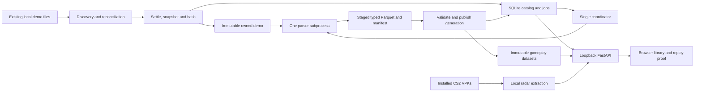

# Phase 0 — architecture and shared contracts

Status: approved implementation contract with the targeted review adjustments. Technology rationale and primary sources: [decisions](phase-0-decisions.md). Practical gates: [risks](phase-0-risks.md).

## 1. Boundaries and data flow



One Uvicorn worker, one application instance per data directory, one parse child at a time. The parent owns SQLite writes and generation publication. Watcher callbacks enqueue observations, never parse demos. Parsing/native crashes must not terminate the API. Blocking file IO and bounded Parquet reads run off the event loop; never hold a SQLite write transaction while copying/parsing.

No network service between internal Python modules. HTTP/JSON is only the browser boundary. The child receives a versioned JSON request on stdin and returns small JSON status/manifest references on stdout; bulk data moves through app-owned files. stderr is bounded diagnostic output. Use an argument vector, `shell=False`, and explicitly managed child lifetime; no Python pickle, giant JSON tick streams, shell command interpolation or message broker.

Each child request carries `job_id` and a unique `generation_id` serving as its attempt token. The job records its active token; the parent accepts publication only for that token. A retry uses a new token and staging path, so a stale child cannot overwrite or publish a newer attempt. The application-instance lock is not inherited by children.

## 2. Implemented component layout and ownership

```text
backend/
  pyproject.toml, uv.lock
  src/cs_demo_analyzer/
    domain/contracts.py       DTOs, enums, errors, profile and manifest
    domain/tables.py          canonical column schemas and schema version
    config.py                 CLI/environment/TOML/XDG data-root selection and space policy
    discovery/steam.py        Steam library/appmanifest resolution using srctools
    discovery/watcher.py      scan/watch observations; root availability
    ingestion/service.py      settle, snapshot/hash, source revision handling
    storage/catalog.py        SQLite access and durable jobs
    storage/artifacts.py      immutable files, manifest validation/publication
    storage/migrations/       ordered SQL migrations
    parsing/awpy_adapter.py   only Awpy imports in application code
    parsing/normalize.py      explicit upstream-to-domain mapping
    worker/main.py            JSON DTO protocol and isolated extraction entrypoint
    assets/radar.py           Source2Viewer invocation + overview normalization
    api/routes.py             local REST surface
    api/replay.py             bounded gameplay projections, not parsing
    application.py            composition, scheduling, lifetime/recovery
    cli.py                    serve, scan, import, reprocess
  tests/                      isolated behavior fixtures; real-demo canary via explicit CLI input
web/
  package.json, package-lock.json
  src/api/schema.d.ts          generated; never hand-edited
  src/api/client.ts            fetch/error handling
  src/components/             roots/library/jobs and one-round Canvas replay
  src/lib/                    clock, generation-pinned loading and coordinate projection
contracts/
  openapi.json                generated from backend models/routes
  examples/                  tiny authored contract examples, no real demos
scripts/                     contract export/development entrypoints only as needed
docs/planning/               these four preparation documents
research/                    existing references; unchanged
```

This is one Python distribution and one UI package, not a package for every module. Do not create empty future modules. The orchestrator owns `domain/`, `application.py`, manifests/lockfiles and generated contracts. Slice owners and integration points are specified in [execution](phase-0-execution.md).

## 3. Canonical gameplay representation

**Owner: `domain/contracts.py` and `domain/tables.py`.** A versioned `GameplayDataset` comprises a manifest plus explicit typed Parquet tables. Pydantic owns JSON envelopes; Polars schemas own persisted columns. OpenAPI is generated from those models; UI types are generated from OpenAPI. No hand-maintained second TS match model and no DAK/cs2df schema as internal authority.

### Identity, time and fidelity invariants

- `demo_id` = SHA-256 of exact `.dem` bytes, independent of path/name/mtime. It identifies a recording, not necessarily a unique played match. Do not merge alternate recordings by filename, map or score.
- `generation_id` = unique parse attempt/artifact-set ID. `profile_key` fingerprints parser version, normalizer version, canonical schema version and extraction options. Reprocessing changes generation, not raw identity. A successful existing profile is reused unless the user explicitly requests reprocessing.
- `player_id` is a recording-scoped opaque string. Positive SteamIDs map to `steam:<decimal-id>`; `steam_id` is nullable String on disk and over JSON. Null/zero IDs never join by name or collapse into a shared account. Unresolved roster records have unique roster-local IDs; unresolved state/event references stay null.
- The parent pre-freeze probe found ten valid roster accounts and one null roster ID; sampled state contained null-ID dead-player observations with empty names. Positive `(tick, steamid)` keys were unique. Therefore `player_state.row_ordinal`, not `(tick, steamid)`, identifies observations. Unknown rows remain auditable, and replay cannot invent their cross-tick continuity. Bot/control fidelity remains unclaimed.
- Ticks are signed Int64 in canonical tables. Preserve Awpy's native tick coordinate with `clock="awpy_demo_tick"`; do not relabel it server/subtick time without evidence. Input is one ordinary demo file; no multipart joining in Phase 0.
- Record `tick_rate_hz` as a positive number with source, plus `tick_origin=0`. Absolute parser-axis seconds = `tick / tick_rate_hz`; round-relative display seconds = `(tick - freeze_end_tick) / tick_rate_hz` when known. Never assume 64 Hz in algorithms.
- Event references are `(generation_id, dataset_name, row_ordinal)`. Preserve upstream within-dataset order for equal ticks. Cross-dataset same-tick wire ordering is **unknown** unless supplied by the parser; sorting for display is not proof of causality.
- World XYZ is Z-up, Hammer units; preserve decoded float precision. Angles are numeric degrees. No integer quantization, pixel coordinates, team-relative mirroring or 8 Hz sampling in canonical state.
- Missing values stay null; absent event families have typed empty tables plus an availability reason. Non-finite values are rejected or represented as null with a quality warning, never invalid JSON. Upstream defaulted Booleans are not proof that the wire recorded false: retain dataset semantics/defaulting caveats in the manifest.
- `recording_kind = gotv | pov | unknown`, `quality = complete | partial`, and capabilities are separate. Here `complete` means the selected extraction profile passed its checks, **not** complete world truth or a finished competitive match. POV gaps never become zero-filled positions or inferred visibility.
- Round IDs are recording-scoped ordinals; keep the upstream round number separately. Nullable start/freeze/official-end ticks are legitimate. Do not renumber away warmup/restart evidence or force MR12/pistol-round assumptions. Tag phase/round assignment as unknown when not established.

### Required manifest and tables (profile `foundation-v1`)

The manifest records `schema_version`, `demo_id`, `job_id`, `generation_id`, `profile`, `profile_key`, parser/normalizer versions, map, tick metadata, recording kind, quality/capabilities, timestamp, source size, table descriptors `{path, schema_version, row_count, sha256}`, warnings and inferred demo-version provenance. Extraction options are fixed by the named foundation profile, not an upstream field inventory. Installed ClientVersion belongs to the radar descriptor/cache; Steam depot buildid/source revision are not normalized by this profile and must not be confused with the inferred demo ClientVersion.

Every table belongs to exactly one generation via its manifest; do not repeat long hashes on every tick row. The exact bounded schemas live in `domain/tables.py`, frozen only after the parent mapping probe. `foundation-v1` has seven tables; exposing an upstream field does not require normalizing it. A later named profile/schema key can add fields or tables without changing existing generations.

| Table | Key and required columns | Nullable/semantics |
|---|---|---|
| `players` | `player_id: String`, `steam_id: String?`, `name: String?` | Entire observed roster, including players without snapshots; no fixed roster size. Identity source and optional entity/controller references retained. |
| `rounds` | `round_id: Int32`, `source_round_num: Int32?`, `start_tick`, `freeze_end_tick`, `end_tick`, `official_end_tick: Int64?`, `winner_side: String?`, `reason_code: Int32?` | Each timing column is nullable if unobserved. Side is `t`, `ct`, `spectator`, `unknown`; no fixed persistent team identity inferred from side. |
| `player_state` | `row_ordinal: Int64`, `tick: Int64`, `player_id: String?`, XYZ/yaw/pitch/velocity XYZ: Float32?, `health`, `armor`, `money`: Int32?, `side: String`, `active_weapon: String?`, `has_bomb`, `is_crouched`, `is_scoped`, `is_reloading`: Boolean? | Source = **`snapshots(every=1)`**; only the listed fields are normalized. Unresolved identity stays null, with unique observation ordinal; do not infer it from name or stale position. |
| `kills` | `row_ordinal: Int64`, `tick: Int64`, attacker/victim/assister player refs: String?, `weapon: String?`, `headshot: Boolean?` | Preserve available participant entity-lifetime refs/positions and engine flags. Null attacker permits world/suicide deaths. |
| `damages` | `row_ordinal`, `tick: Int64`, attacker/victim refs: String?, `damage_health`, `damage_armor`: Int32?, `weapon: String?` | Retain parser raw/effective damage distinction when supplied; do not turn estimated pre-hit health into an observed fact. |
| `shots`, `bomb` | `row_ordinal`, `tick: Int64`, actor ref: String?, weapon or action: String?, XYZ: Float32? | Explicit dataset-specific columns, not an untyped event dump. Missing actor/position allowed. |
| Deferred in Phase 0 | `grenades`, `smokes`, `fires`, `blinds`, `item_events`, `round_economy` and all other upstream inventory | Not required by `foundation-v1`. Phase 2 adds selected fields in the separately versioned [`reconstruction-v1` profile](phase-2-reconstruction.md); original demos and foundation generations remain preserved. |

A table/field capability records `available | absent | unsupported | failed`, source dataset/property, units and normalization/defaulting notes. Essential profile extraction failure fails the generation; optional absence produces partial quality with a visible warning. Do not silently promote an all-null string column to a valid numeric angle field.

### Parsing strategy and escape hatch

Batch compatible datasets with `Demo.load`; avoid per-field/per-round reparsing. Use **typed snapshots** for full-rate state. The preparation probe found both friendly angle names and bracket-style raw angle queries in `ticks()` were all-null strings; the fixed snapshot API supplied valid numeric angles. Upstream raw `ticks(..., players_only=False)` and generic `events[name]` remain confined to the adapter for future requested fields; validate each property against a fixture before adding it to the profile. Original `.dem` bytes remain the authoritative escape hatch when upstream omits a field.

No extra parser, usercmd extraction, generic query plugin or interchangeable parser framework in Phase 0. A later adapter change must produce this same canonical contract or explicitly increment its schema version.

## 4. Local discovery and ingestion

### Observed machine layout

Inspected installation: `/mnt/nvme/SteamLibrary/steamapps/common/Counter-Strike Global Offensive/`. Both `game/csgo/` and **`game/csgo/replays/` actually exist**. Exactly one `.dem` plus its `.dem.info` was found under the installation; no compressed demos were found in that scoped scan. Downloads/Desktop/Documents were also inspected without finding demos. This is not a whole-filesystem absence claim.

Default roots, derived at runtime:

1. Steam `libraryfolders.vdf` → app 730 `appmanifest_730.acf` → `installdir`, parsed with srctools. Also honor an explicit install path; de-duplicate equivalent resolved paths.
2. Existing `<install>/game/csgo/replays`, recursive; `<install>/game/csgo`, direct files only, avoiding a recursive game-asset sweep.
3. Resolved XDG downloads directory, direct files only; additional user-configured roots can be recursive. Do not recursively scan home, all Steam libraries or arbitrary disks for demos.

Persist each root's existence/readability and recursive policy. Missing roots remain configured/unavailable and are reconsidered on reconciliation; **never create game directories**. Do not follow discovered file/directory symlinks; an explicitly configured root may be resolved once. Exclude the app's own raw/artifact/staging paths to prevent feedback imports. Watch before the initial sweep, then reconcile pending observations to close startup races. Reconcile every 60 seconds, after watcher errors, and at every restart; filter candidates before stat/hash work. No promise of exact-once notification delivery. [watchfiles/inotify sources](phase-0-decisions.md#primary-sources)

### Completion, snapshot and deduplication

Candidate lifecycle: `observed → settling → snapshotting → imported`; visible alternatives: `missing`, `unsupported`, `error`. A durable job then has `queued → running → succeeded | failed | interrupted`. Generation quality is independent of job state.

- Accept regular, nonempty `.dem` files with `PBDEMS2\0` magic; reject Source 1/invalid input explicitly. Recognized `.dem.gz/.bz2/.zst/.zip` inputs get `UNSUPPORTED_COMPRESSED`; no decompressor is added.
- Initial policy: unchanged device/inode/size/mtime-ns/ctime-ns for at least 10 seconds, sampled at least three times. This is a heuristic, **not proof the producer has finished**. Watcher debounce and close-write events do not provide that proof either.
- Copy into same-filesystem app staging while streaming SHA-256; compare descriptor and path identity/stat before/after. If replaced/grown/rewritten, discard only the app-owned staging copy and settle again. No full-file memory buffering, source rename/delete, hardlink or reflink-based mutable alias.
- Validate/parse the stable owned snapshot; EOF/truncation errors remain visible and retryable on a source revision or explicit retry. A tolerant parser may accept a paused prefix: keep monitoring imported source locations, and invalidate their **current-source association** on later mutation. Preserve the old immutable recording with an incomplete/superseded-source warning; create a new content identity for changed bytes. Never claim the quiet window alone guarantees a complete download.
- Publish the owned raw copy under its content hash; a duplicate hash adds/updates a source location, not another demo or redundant successful-profile parse. Stat fingerprints avoid rehashing unchanged files but are not content identity. Multiple identical imports must converge through catalog uniqueness.
- Preserve an available `.dem.info` separately as opaque, content-hashed sidecar metadata, including a sidecar that arrives later. It is optional, excluded from demo identity and not a completion signal. On this machine its mtime preceded the demo's; that observation is not proof of the client's write protocol.
- Errors have a stable code, stage, safe message, source revision and retryability: at least `SOURCE_UNSTABLE`, `SOURCE_MISSING`, `PERMISSION_DENIED`, `UNSUPPORTED_FORMAT`, `UNSUPPORTED_COMPRESSED`, `INVALID_DEMO`, `PARSE_FAILED`, `RESOURCE_LIMIT`, `DISK_FULL`, `ARTIFACT_INVALID`. No infinite retry of unchanged corrupt content. Reconcile unavailable/unstable sources; retry deterministic parse failures only after input/profile change or explicit request.

## 5. Persistence, publication and restart recovery

Large immutable recordings must not be forced onto the OS partition. Data-root precedence is CLI `--data-root` > environment `CSDA_DATA_ROOT` > `data_root` in the XDG config TOML > `$XDG_DATA_HOME/cs-demo-analyzer`. Require an absolute path; permit `/mnt/nvme` from the first release. Catalog, raw recordings, datasets, assets, staging and diagnostics are rooted together; staging/publication stay on the same filesystem. The root must be local, not an NFS/SMB SQLite WAL target. Create only application-owned directories. Before copying, require free space for two input sizes plus a configurable reserve (256 MiB initially); before parsing an existing raw copy, require one input size plus reserve. These are conservative allowances, not reservations: handle actual ENOSPC without corrupt publication. Report the selected root/free space in health and errors. [XDG specification](https://specifications.freedesktop.org/basedir/latest/)

```text
<configured-data-root>/            XDG default only when no override is supplied
  catalog.sqlite                 roots, candidates, locations, demos, jobs, generations
  raw/<demo_id>/source.dem
  raw/<demo_id>/sidecars/<hash>.dem.info
  datasets/<demo_id>/<generation_id>/manifest.json + *.parquet
  assets/<installed_client_version>/<map>/radar PNG + overview + manifest
  staging/<job_id>/<generation_id>/  same filesystem as publication target
$XDG_CONFIG_HOME/cs-demo-analyzer/config.toml
<configured-data-root>/logs/       bounded diagnostics; not gameplay cache
```

Catalog minimum: `roots`; candidate/source observations and revision fingerprints; `demos(demo_id UNIQUE, raw_path, size)`; `locations(root_id,path,revision,demo_id?,last_seen,status)`; `jobs(id,kind,demo_id?,profile_key,state,attempt,error,started_at,finished_at)`; `generations(id,demo_id,profile_key,manifest_path,quality,created_at)` and a current-generation pointer per demo/profile. Enforce one active extraction job per demo/profile; deliberate reprocessing may create a new attempt after success. Root/path indexes are distinct from content uniqueness. Keep schemas small; only library summaries/round counts go in SQLite, not dense ticks.

Publication protocol:

1. Child finishes files and manifest in its attempt-specific staging directory; parent validates the active job/generation token, allowed relative paths, schema, hashes and essential table integrity. No child writes SQLite.
2. Flush/fsync files and staging directory; rename into a unique final generation directory on the **same filesystem**, then fsync its parent.
3. In one short SQLite transaction, insert generation, switch the current pointer and finish the job. Preserve the previous successful generation until this commit. A failed reprocess must not hide usable prior data.
4. On restart under the single-instance OS lock: first reconcile published-but-unreferenced manifests against their recorded job/attempt or classify them as orphaned. Then mark incomplete abandoned jobs interrupted and requeue once with new tokens. Remove/rebuild only app-owned incomplete staging after excluding live stale writers. A DB pointer to missing/corrupt artifacts is an explicit error/reprocess condition, never an empty successful match.

Filesystem rename and SQLite commit are **not one atomic transaction**. Ordering + reconciliation supplies recoverability. The preparation storage probe proved local primitives, not crash/power-loss behavior. Retention/deletion UI and automatic garbage collection are outside Phase 0; no automatic removal of original demos or last-good generations.

## 6. API, UI and replay boundary

All routes under `/api/v1`; production serves bundled UI on the same loopback origin. Bind `127.0.0.1` only; explicit Host/Origin allowlist, no wildcard CORS. Mutations require JSON and an allowed Origin for browser requests; reject cross-site writes. CLI uses internal services. No arbitrary SQL, shell execution, URL fetches, raw filesystem browsing or unrestricted file serving endpoints.

| Route | Contract |
|---|---|
| `GET /health` | runtime/schema readiness and worker availability; not a fake parse-health verdict |
| `GET /roots`, `POST /roots` | root status; add explicit absolute local root plus recursive policy |
| `POST /scans` | schedule reconciliation, return `202` + job/reference |
| `POST /imports` | absolute local file path; same settle/snapshot policy as discovery, no URL/upload requirement |
| `GET /demos`, `GET /demos/{demo_id}` | limit/offset-paged recordings, metadata, source locations, generation/quality/warnings |
| `GET /jobs`, `GET /jobs/{job_id}` | durable status and structured error; UI polls while active |
| `GET /sources` | current candidate/source revision state and structured ingestion errors |
| `POST /demos/{demo_id}/reprocess` | `202`, profile; coalesce concurrent duplicate requests, retain last-good generation |
| `GET /demos/{demo_id}/rounds` | timings, outcomes and explicit generation ID |
| `GET /demos/{demo_id}/replay` | requested `generation_id`, round/window and sample stride; bounded projection only |
| `GET /assets/{asset_id}` | catalog-resolved app-owned asset; no caller-controlled filesystem path |

All data responses pin `generation_id` and schema version. A stale/unavailable generation is explicit, not silently substituted mid-playback. Error JSON: `{code, message, stage, retryable, job_id?}`. Define concrete request/response models and generate OpenAPI in T0; no free-form duplicated frontend types.

Replay response: `{generation_id, clock, tick_rate_hz, start_tick, end_tick, stride_ticks, players, samples, events, radar, warnings}`. `samples` contains explicit tick values and dynamic player references with numeric XYZ/yaw, side, health/derived alive state. `events` retains exact ticks even when samples are sparse. Default rendering projection is 8 Hz (`stride_ticks=8` for 64 Hz); server caps at one round/120,000 player samples and rejects oversized windows with a structured error. Full canonical state stays full-rate. UI requests chunks if needed, never the entire match as JSON.

Drive playback with a single tick clock and `requestAnimationFrame`; seek resets it. Interpolate position/shortest-arc yaw only between valid samples of the same actor lifetime, never across missing observations, deaths or round changes. Kill markers jump to the exact event tick; interpolation is display-only. Network polling, file IO and React rerenders must not each own competing clocks.

Radar contract: asset ID, map, extracted install `ClientVersion`, requested/inferred demo version, match status (`exact | mismatch | unknown`), image dimensions, world origin/scale, raw rotate/zoom metadata and altitude sections. Base overview mapping is `px=(x-pos_x)/scale`, `py=(pos_y-y)/scale`, followed by actual image/canvas scaling. Do not blindly apply overview HUD rotation/zoom to already oriented radar textures; verify behavior with landmarks. Multilevel assets/metadata must select by declared Z bands, not hardcoded map-name logic. Phase 0 proves Inferno; unverified maps/floors show an explicit limitation rather than invented geometry.

Reuse Source2Viewer-CLI for local extraction; no Steam fetch stage, collision/nav extraction or full awpy-data pipeline. Current-install radar can be displayed with a **version-mismatch warning**; it is not evidence of historical collision/visibility. No cones, fog of war or LOS in the replay proof.

## 7. Future extension points — boundaries, not new modules

- Spatial/visibility modules read immutable world-state queries and independently versioned map assets; derived estimates stay separate from measured parser state.
- Temporal detectors consume typed tables and native tick references; their evidence points back to `(demo_id, generation_id, dataset, row/tick window)`.
- Cross-match analytics can introduce DuckDB over these Parquet files without moving catalog authority or changing parser consumers.
- Hosted-AI adapters later consume bounded evidence-query results, not raw demos/tick dumps; outbound access and credentials require explicit configuration then. No AI component is implemented now.
- cs2df export or an additional parser is an explicit later adapter with measured field ownership, not a second canonical representation.

Acceptance and ownership of these interfaces are frozen through task T0 before fan-out. Schema changes require orchestrator review and regenerated API consumers, not parallel ad-hoc edits.
