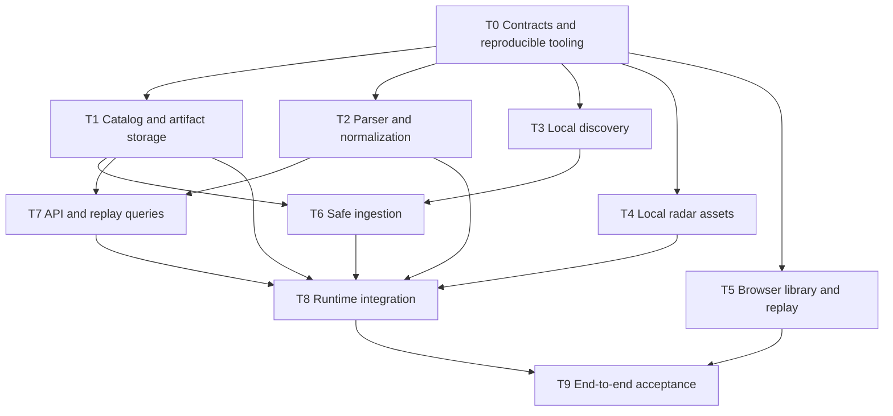

# Phase 0 — orchestrator-ready execution plan

**Implemented. C0, C1, C2 and post-integration hardening passed; this document records the executed task contracts and future re-verification criteria.**

Inputs: [decisions](phase-0-decisions.md), [architecture/contracts](phase-0-architecture.md), [risk gates and observed evidence](phase-0-risks.md). The orchestrator owns consistency, generated contracts, shared files and the final end-to-end acceptance. Existing research remains read-only.

## Deliverable boundary

A runnable local application that automatically notices ordinary `.dem` files, safely preserves/deduplicates them, extracts the canonical profile, survives restarts, exposes status/errors and displays the real local match in a minimal 2D replay. It must work offline after tools/dependencies and local assets are provisioned. No remote match/demo acquisition, compression support, coaching, AI calls, geometry/visibility, cloud infrastructure or desktop packaging.

A parsed file or compiling scaffold alone is not completion. Unsupported recording data must be visible as partial/error rather than a fabricated complete match. No reduction of acceptance criteria without user approval.

## Shared interfaces to freeze before fan-out

T0 supplies actual versioned DTOs/schemas and callable signatures corresponding to these boundaries. Names below are the proposed public interface, not a new general plugin system.

| Owner module | Boundary | Contract / invariant |
|---|---|---|
| `domain` | `Observation`, `SourceFingerprint`, `ExtractionRequest`, `ExtractionManifest`, `ReplayWindow`, `ReplayChunk`, `RadarDescriptor`, `AppError` | Types/enums/nullability from architecture; no upstream parser types cross boundaries. |
| `discovery` | `scan_root(root) -> observations`; watcher yields changed path hints | Root status and bounded file metadata only; no copy/hash/parse/DB writes. |
| `ingestion` | `snapshot_source(observation, staging_dir) -> snapshot_result` | Owned staged path + content hash + verified source revision, or structured instability/error. No source mutation or publication. |
| `storage` | `Catalog.record_observation`, `enqueue`, `claim_next`, `publish_generation`; `Artifacts.validate_and_publish` | Concrete local services. One catalog owner; idempotent job keys, immutable generation publication, last-good pointer. |
| `parsing` | `extract(request) -> manifest` | Read-only owned input; write only assigned staging; complete canonical tables or explicit failure. No catalog/HTTP/UI imports. |
| `worker` | versioned JSON request/status on stdin/stdout | Parent supplies paths/profile/job ID; child returns staged manifest location and errors. Tables never cross pipes. |
| `assets` | `resolve_radar(map_name, demo_version) -> descriptor` | Local extraction/cache or explicit unavailable status; version mismatch visible; no Steam downloads. |
| `api/replay` | `read_replay(window) -> chunk` | Generation-pinned bounded queries over persisted tables; never reparse on scrub. |
| `application` | compose services, `start/stop`, scan/import/reprocess dispatch | Single-instance lifetime, worker supervision, queue recovery, no second scheduler in route handlers. |

## Execution graph

Suggested groups: **G0 = T0** (shared prerequisite); **G1 = T1–T5 concurrently**; **G2 = T6 and T7 as soon as their prerequisites land**; **G3 = parent T8 integration and T9 acceptance**. Do not wait for all of G1 to finish before starting an already-unblocked G2 task. T7 can prepare route handling against frozen DTOs while T1/T2 finish; real query integration needs their outputs. T8 consumes completed slices incrementally but owns composition alone.

| Checkpoint | Required integrated result | Outcome |
|---|---|---|
| C0 | Dependencies, pre-freeze identity/field probe, bounded contracts and fixtures work | Passed before parser/storage consumers were implemented |
| C1 | Real demo → content-verified immutable storage → validated seven-table Parquet generation | Passed through the actual CLI before replay integration |
| C2 | Automatic discovery → persistent API → functioning real-data replay | Passed with actual file arrival, live API and browser interactions |
| Hardening | Incomplete writes, crashes, restarts, space failures and child supervision | Passed automated regressions and real process/write fault probes; [evidence](phase-0-risks.md#implementation-verification) |

## Tasks

### T0 — Freeze contracts and reproducible tooling

- **Owner/files:** parent orchestrator; root tooling, `backend/pyproject.toml`, `backend/uv.lock`, `web/package*.json`, `domain/*`, worker DTO protocol, `contracts/*`, generated `web/src/api/schema.d.ts`, top-level developer instructions.
- **Dependencies:** approval received; parent first performs the small identity/field-mapping probe on the existing demo, then freezes contracts. T2 consumes those decisions rather than rediscovering foundational identity semantics.
- **Work:** establish reproducible Python/UI tooling and a bounded seven-table `foundation-v1` schema: players, rounds, player_state, kills, damages, shots, bomb. Keep full-rate snapshots but only selected fields. Define nullable IDs/unique observation ordinals, job/generation/error transitions and API DTOs; additional profiles require explicit versioned mappings. Add configurable data root and pre-copy/pre-parse free-space checks. Export actual OpenAPI/types as routes are integrated; author small neutral fixtures.
- **Checkpoint C0:** dependencies, identity/field mapping, contracts and fixtures work; each owner has stable inputs/outputs and owned paths before parallel coding.
- **Acceptance:** backend binary-only dependency resolution succeeds on Python 3.13; frontend peer resolution succeeds with TS 5.9.3; request/manifest/replay examples are accepted by the actual schemas; no float64 SteamID conversion. The API contract includes errors/partial data, not just happy paths. No extra parser/DAK/DuckDB dependency appears.

### T1 — SQLite catalog and immutable artifact publication

- **Owner/files:** storage subagent; `storage/*`, `tests/storage/*` only. Parent owns shared contracts and lockfiles.
- **Needs:** T0 observation/job/manifest contracts.
- **Work:** ordered SQL migrations, constraints/indexes, short transactions, root/location/content distinction, durable extraction jobs, current-generation pointer, manifest validation and publication ordering. Implement restart reconciliation for staged/orphaned/missing artifact states. No tick rows in SQLite; no worker DB access.
- **Acceptance:** identical bytes at two paths converge to one demo; one active extraction job per demo/profile; explicit reprocess creates a new generation; failed reprocess leaves previous data readable. Simulated failure before rename, after rename/before commit and after commit yields an unambiguous recoverable state. Referenced incomplete tables are never served as success. A second app instance cannot share coordinator ownership.

### T2 — Released Awpy adapter and normalization

- **Owner/files:** parser subagent; `parsing/*`, `worker/main.py`, `tests/parsing/*` only.
- **Needs:** T0 schemas and child protocol; does not need T1 implementation. Writes to caller-supplied scratch/staging.
- **Work:** batch `load` for the specified primitive datasets; full-rate typed `snapshots(every=1)`; normalize IDs/sides/tick widths and explicit schemas. Build manifests/capabilities, preserve nullable lifetimes/participants and raw entity references where present. Reject all-null/string angles instead of treating them as good coordinates. Do not add custom metrics, ratings or a second parser.
- **Acceptance:** actual local demo produces all profile tables with semantic schema checks, proper numeric XYZ/yaw/pitch, exact string IDs and native tick/event alignment. All selected tables round-trip through Parquet, including typed empties/null actors. Roster need not equal active state population. Unknown/bot/partial identities must be reported, never collapsed under `"0"`. Child emits bounded status and exits cleanly on malformed input; no source or catalog writes.
- **Evidence:** use the known local fixture and count/shape observations in risks as a smoke baseline, not arbitrary globally fixed test expectations.

### T3 — Actual Steam/demo roots and reconciliation-aware watching

- **Owner/files:** discovery subagent; `discovery/*`, `tests/discovery/*` only.
- **Needs:** T0 root/observation models; uses srctools, not a hand-written VDF grammar.
- **Work:** resolve Steam libraries/app 730 manifest, explicit install override, observed replay/direct csgo/XDG download roots, deduped paths and recursive policy. Watch before startup sweep; periodic/error reconciliation, missing-root recovery, app-store exclusion and symlink policy. Notifications only yield candidate hints.
- **Acceptance:** resolves the actual installation and its existing replay demo without assuming a directory; roots missing at launch do not crash or create anything under the game installation. A root/file appearing during downtime or initial enumeration is found by reconciliation. Direct csgo scanning does not walk asset subdirectories; duplicate events/roots do not multiply candidate revisions. Permission errors are surfaced per root.

### T4 — Local radar assets and version metadata

- **Owner/files:** asset subagent; `assets/*`, `tests/assets/*` only. Parent provisions/pins CLI 20.1 and its hash outside the CS2 install.
- **Needs:** T0 `RadarDescriptor`; local install, not parser output. Preparation has already proved Inferno extraction paths.
- **Work:** invoke Source2Viewer-CLI with an argument vector, read local VPKs and write only app-owned outputs; parse overviews with srctools; retain image dimensions, raw HUD rotate/zoom metadata, altitude sections, map/install/tool versions. Cache by install version/map; explicit absence and demo-version mismatch.
- **Acceptance:** Inferno PNG/overview load from app data, agree with extracted origin/scale and display known locations without axis reversal. Current assets are labelled 2000932 rather than the demo's inferred 2000930. Reuse cached outputs offline. No Steam/game download stage, map modification, collision/nav extraction or bundled Valve assets.

### T5 — Browser library, job/error surface and minimal replay

- **Owner/files:** UI subagent; `web/src/library/*`, `web/src/replay/*`, `web/src/api/client.ts`, UI styles and entrypoint. Do not edit generated types/manifests.
- **Needs:** T0 generated API contract/examples; no Python module dependency. Use examples only for isolated development, never production fake success/fallback.
- **Work:** root/library/job status, scan/import/reprocess actions, source/quality warnings; one-round Canvas with radar, dynamic actors, yaw, pause/play/scrub and exact-tick kill navigation. One tick clock; bounded loading, stale-response/generation handling. No view cones, tactical labels or full utility editor.
- **Acceptance:** actual API response types are the UI authority; SteamIDs remain strings. Scrubbing does not parse/download the source; marker selection uses event tick, not a rounded sample index. No interpolation across missing actors/deaths/round boundaries; yaw crosses ±180 by the short arc. Import/parse/missing-asset/version errors are visible, not hidden behind an empty replay. Final visual proof must use real persisted data, not examples.

### T6 — Settling, safe import and revision/dedup policy

- **Owner/files:** ingestion subagent; `ingestion/*`, `tests/ingestion/*` only.
- **Needs:** T0 contracts, T1 catalog/artifacts, T3 observations. No parser import; snapshot completion feeds jobs.
- **Work:** quiet/stat policy, regular-file/magic checks, bounded copy+hash to staging, descriptor/path stat recheck, content dedup and source-location updates. Opaque optional sidecar capture including late arrival. Explicit compressed-input reporting. Persist source revisions so new writes retry and unchanged deterministic failures do not loop.
- **Acceptance:** slow/paused write, atomic rename, file replacement, same bytes/new path, same path/new bytes, disappearance, optional/early/late sidecar and unsupported archive all follow the specified states. Mutating after a provisional import yields a new revision/quality warning rather than permanent lost data or overwritten raw bytes. Crash mid-copy leaves the original intact and can be resumed/restarted safely. No hardlinks or source deletion.

### T7 — Local REST routes and bounded persisted replay queries

- **Owner/files:** API subagent; `api/*`, `tests/api/*` only. Parent regenerates contracts when approved; models live in `domain`, not route-local duplicate DTOs.
- **Needs:** T0 DTOs, T1 catalog lookup, T2 table schemas/artifact shape. Scheduling callbacks are injected by T8; route code must not invent a second job scheduler.
- **Work:** implement all architecture routes using concrete services; Parquet projection/filtering, generation-pinned reads, range/sample limits, exact-tick events and asset IDs. Production same-origin static delivery; Host/Origin policy and no arbitrary path/URL/SQL-serving surface.
- **Acceptance:** a persisted real match serves library/round/replay data without Awpy parsing; window bounds, null identities, stale generation, malformed ranges and unavailable assets return correct typed responses. Oversized reads are rejected/chunked as specified; mutations return durable job references with `202`. Cross-site mutation/host spoofing is rejected; no non-loopback bind.

### T8 — Parent-owned runtime composition and recovery

- **Owner/files:** parent; `application.py`, `cli.py`, shared config/tooling, generated contracts and launch documentation; integration changes in owned slices require owner handoff.
- **Needs:** T1/T2/T4/T6/T7, with T3 consumed through ingestion/discovery.
- **Work:** single-instance lock; Uvicorn lifetime; watcher startup/reconciliation; serialized extraction jobs; child stdin/stdout/stderr/exit supervision; bounded blocking IO; shutdown/restart reconciliation. Assemble scan/import/reprocess paths with the same services. Configure base packages without runtime outbound calls.
- **Checkpoints:** run C1 as soon as storage/parser/minimum import wiring connect; run C2 when discovery/API/replay connect. Do not postpone both to T9. Follow C2 with crash/restart/incomplete-write hardening.
- **Acceptance:** kill a parse child and observe API/job survival; restart app during ingestion/extraction and recover one usable result; deliberate reprocess never hides last-good data. Import/scan requests remain responsive during a real parse. All new workers are reaped on normal shutdown; stale children/attempts cannot publish a second generation. No orphan child survives parent death unnoticed at recovery.

### T9 — Parent-owned end-to-end acceptance

- **Owner/files:** parent; integrated verification and relevant runbook updates. Slice owners provide behavior-test additions; do not delegate a separate competing architecture/rewrite.
- **Needs:** T5 + T8.
- **Work:** run focused behavioral checks and the integrated program; record commands/results/limitations. Use a scratch watched directory and app data root, never mutate the live replay or installation. Tests must cover consumer-visible boundaries/recovery, not source text, forwarding or incidental wording.
- **Acceptance:** all exit criteria below pass. Fix integration issues before claiming Phase 0 done; record the exercised recording/map scope honestly.

## Final exit criteria

1. **Discovery:** fresh launch finds the existing real replay; adding a local `.dem` to a configured scratch root triggers import without a manual API call. No network/game-account credentials are involved.
2. **Completion safety:** slow/paused writes do not become irreversible success; later revisions reconcile. Duplicate paths/content, rename, restart, failed parse, disk/permission errors and optional sidecars produce the specified durable outcomes.
3. **Data:** raw owned copy is content-verified against input; full canonical profile has correct dtypes, null semantics, ID precision, time provenance and manifest checksums. No fixed-ten-player or assumed-64-Hz invariant.
4. **Recovery:** exercise failures around copy, extraction, artifact rename and catalog commit; never expose partial generations or lose the last-good one. Restart catches files written while offline.
5. **Actual surface:** launch the real CLI/server and browser. Open the actual persisted Inferno match, select a round, play, pause, seek and jump to a kill; observe marker/player/tick agreement and current-radar-version warning. Close the verification browser afterward. UI screenshots/observed state, not tests alone, are the replay proof.
6. **Local-first:** after dependencies/tools/assets are provisioned, disable outbound access and repeat a parse/replay with an isolated app root. Production listens only on loopback; no externally hosted fonts/scripts/tiles, telemetry export or model invocation.
7. **Boundaries/performance:** actual parse remains in the child with concurrency one; API status remains responsive; measure wall time, peak RSS and output size. Do not turn the single preparation measurement into a universal latency promise.
8. **Repository:** manifests/lockfiles, generated OpenAPI/types, run instructions, fixture policy and applicable attribution are updated. Keep real demos/Valve assets/keys out of Git; remove temporary development examples from runtime behavior. No unapproved future capability is introduced.

The same-file canary, authored null/identity/time fixtures and scratch filesystem races can run without downloading gameplay. Additional POV/bot/overtime/multilevel demos are targeted compatibility gates, not permission to fetch remote replays during preparation; see risks.

## Oh My Pi orchestration protocol

- Parent uses `task` with one batch of genuinely independent slices and shared `context`; use `scout` for unresolved read-only research, normal coding agents for implementation. Prompts reference these documents and frozen contracts, declare owned paths/non-goals and require a concise handoff: changes, contracts consumed, issues and evidence.
- Share large contract material through a `local://` artifact; coordinate interface changes through `write agent://<name>`. A worker proposes changes; it never independently edits shared DTOs/locks/generated types. Parent approves and updates every consumer together.
- Shared working directory is sufficient with disjoint ownership. **Do not require worktrees.** Optional isolation/worktrees are useful only for a concrete conflicting refactor or risky experiment; parent still owns application/integration. Isolation does not reconcile incompatible interfaces automatically.
- Agents must not run competing build/lint/test/formatter loops mid-flight. Parent runs verification after integration, including smoke on the actual surface; observe failures rather than suppressing them. Do not download upstream gameplay fixtures automatically or mistake opt-in integration skips for a passing real-demo check.
- Development-time Oh My Pi delegation is not an application dependency or hosted-coaching agent design. Approval covers the reviewed foundation, not future analytics.

Capability references: [OMP task contracts/async/isolation](omp://tools/task.md). Use the installed tool schema; isolation controls are configuration-dependent and may not be exposed. No OMP configuration changes are needed for the default shared-directory plan.
